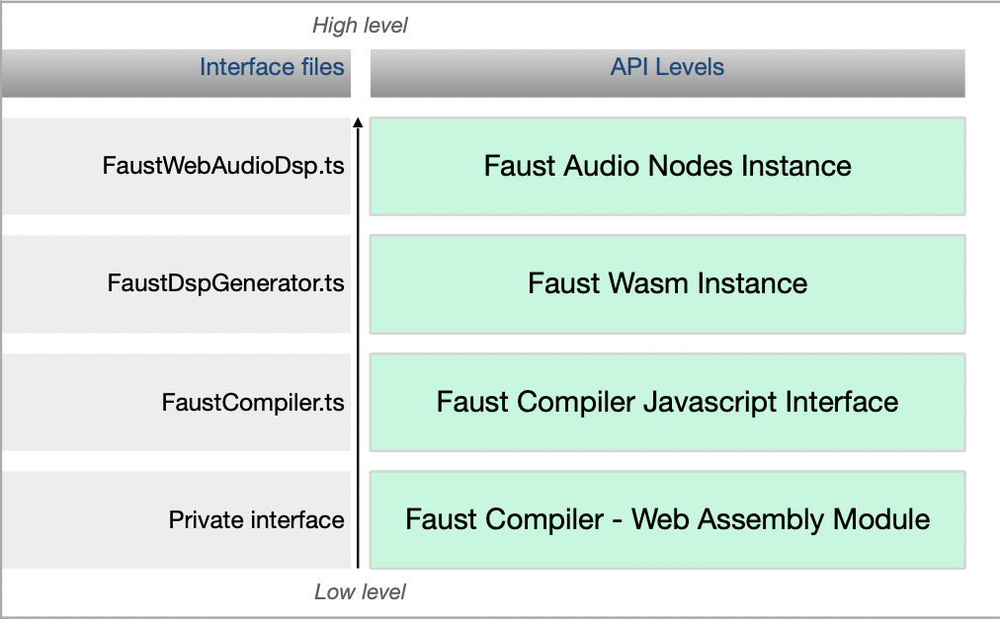

# FaustWasm

The FaustWasm library presents a convenient, high-level API that wraps around [Faust](https://faust.grame.fr) compiler. This library's interface is primarily designed for [TypeScript](https://www.typescriptlang.org/) usage, although it also provides API descriptions and documentation for pure JavaScript. The WebAssembly version of the Faust Compiler, compatible with both [Node.js](https://nodejs.org) and web browsers, has been compiled using [Emscripten](https://emscripten.org/) 6.0.3.

The library offers functionality for compiling Faust DSP code into WebAssembly, enabling its utilization as WebAudio nodes within a standard WebAudio node graph. Moreover, it supports offline rendering scenarios. Furthermore, supplementary tools can be employed for generating SVGs from Faust DSP programs.

Synthesizer and effect mono nodes, as well as [polyphonic](https://faustdoc.grame.fr/manual/midi/#midi-polyphony-support) poly nodes can be created. MIDI support is activated as soon as [MIDI metadata](https://faustdoc.grame.fr/manual/midi/#configuring-midi-in-faust) are used in the DSP code for mono nodes, and always in polyphonic mode. 
  
[Sensors](https://faustdoc.grame.fr/manual/syntax/#sensors-control-metadatas) (accelerometer and gyroscope) metadata are supported, as well as the [Progressive Web Application](https://en.wikipedia.org/wiki/Progressive_web_app) model.  

## Usage

Please use a stable version of [Node.js](https://nodejs.org) 16+ to work with this project.

### Use the command line interface

Clone and get into this project:
```bash
git clone https://github.com/grame-cncm/faustwasm.git
cd faustwasm
```

Install development dependencies:

```bash
npm install
```

Possibly:

```bash
npm update
```

Build the files:
```bash
npm run build
```

The source code uses [Prettier code formatter](https://prettier.io) to properly format all TS and JS files. Use:

```bash
npm run format
```

to apply format rules on `src`, and:

```bash
npm run lint
```

to check format rules on `src`. 

### Versioning

You'll have to raise the package version number in `package.json` before `npm run build` to properly work.

#### Generate WebAssembly version of a Faust DSP

For example:

```bash
rm -rf test/out # make sure you are under the faustwasm directory.
node scripts/faust2wasm.js test/mono.dsp test/out
```
will create a set of files: `index.js`, `create-node.js`, `dsp-module.wasm`, `dsp-meta.json`, `index.html` and the `faustwasm` folder in the `out` folder. The `-no-template` option omits everything but `dsp-module.wasm` and `dsp-meta.json`.

Polyphonic instrument with:

```bash
rm -rf test/out # make sure you are under the faustwasm directory.
node scripts/faust2wasm.js test/poly.dsp test/out -poly
```
will create a set of files: `index.js`, `create-node.js`, `dsp-module.wasm`, `dsp-meta.json`, `mixer-module.wasm`, `index.html` and the `faustwasm` folder (and, when the DSP source defines an `effect`, `effect-module.wasm` and `effect-meta.json`) in the `out` folder.

#### Local include files and `-I`

The CLI runs the Faust compiler inside a WebAssembly in-memory filesystem, so it cannot read your host filesystem directly. To make local `import("something.lib")` work:

- The directory that contains the input `.dsp` is automatically copied into the in-memory FS and added to the compiler include path.
- Any `-I <dir>` you pass is mirrored into the in-memory FS and added to the include path.
- Only `.dsp` and `.lib` files are mirrored.

This means you can run the CLI from any working directory as long as your local includes live next to the DSP or are listed with `-I`.

Example, using the `test/foo.dsp` and `test/includes/mylib.lib` fixtures that ship with the repository (`mylib.lib` deliberately does not sit next to `foo.dsp`, so the build only works with `-I`):

```bash
node scripts/faust2wasm.js -I test/includes test/foo.dsp test/out
```

#### Creating a Progressive Web Application (PWA) of a Faust DSP

You can create a standalone Progressive Web Application using the command line:

```bash
node scripts/faust2wasm.js test/rev.dsp test/rev -pwa
```
will create a set of files: `icon.png`, `service-worker.js`, `manifest.json`, `index.js`, `create-node.js`, `faust-pwa.js`, `dsp-module.wasm`, `dsp-meta.json`, `index.html`, and the `faustwasm`, `faust-ui` folders in the `rev` folder. 

The folder contains the necessary ressources to deploy the Faust application as a PWA on a server, to be installed and used offline. Note that audio files used by the `soundfile` primitives in the DSP code will have to be mannually added in the folder. 

A standalone polyphonic and MIDI standalone Progressive Web Application can be created with:

```bash
node scripts/faust2wasm.js test/organ1.dsp test/organ1 -poly -pwa
```
will create the same set of files, plus `mixer-module.wasm` and, since `organ1.dsp` defines an `effect`, `effect-module.wasm` and `effect-meta.json`, in the `organ1` folder.

#### Creating a standalone version of a Faust DSP, with audio and MIDI devices selector

You can create a standalone using the command line:

```bash
node scripts/faust2wasm.js test/rev.dsp test/rev -standalone
```
will create a set of files: `icon.png`, `service-worker.js`, `manifest.json`, `index.js`, `create-node.js`, `dsp-module.wasm`, `dsp-meta.json`, `index.html`, and the `faustwasm`, `faust-ui` folders in the `rev` folder. 

The folder contains the necessary ressources to deploy the Faust application as a PWA on a server, to be installed and used offline. Note that audio files used by the `soundfile` primitives in the DSP code will have to be mannually added in the folder. 

A standalone polyphonic and MIDI standalone Progressive Web Application can be created with:

```bash
node scripts/faust2wasm.js test/organ1.dsp test/organ1 -poly -standalone
```
will create the same set of files, plus `mixer-module.wasm` and, since `organ1.dsp` defines an `effect`, `effect-module.wasm` and `effect-meta.json`, in the `organ1` folder.

#### Creating a remote-controlled application (experimental)

A Faust DSP can run on one machine (the *host*, the one connected to the speakers) and be controlled from phones (the *remote controls*): buttons, sliders, and sensors through the `[acc:]`/`[gyr:]` metadata, over WebRTC. See [docs/remote-control.md](docs/remote-control.md) for the design.

```bash
node scripts/faust2wasm.js mydsp.dsp out -remote
```
writes the host page at the top of `out` (`index.html`, `index.js`, `create-node.js`, the compiled DSP, and the `faustwasm`, `faust-ui` folders), the remote control PWA in `out/remote` (no DSP file: its interface comes from the host), and the remote control library in `out/faustwasm-remote`, one file per role: `host.js` for the host page, `client.js` for the remote control, which downloads nothing of the host's code. Add `-poly` for a polyphonic host. The folder is served by `faust-remote-server-ts` (`scripts/faust-remote-server.js`), which also relays the signaling between the host and its remote controls, and their messages when WebRTC cannot connect.

The generated pages need `npm run build` to have been run: it builds the remote control library and copies `faustwasm` and `faust-ui` into `assets/standalone`.

##### Testing on one machine

`localhost` is a secure context, so no certificate is needed:

```bash
npm run build
node scripts/faust2wasm.js mydsp.dsp /tmp/remote-app -remote
node scripts/faust-remote-server.js /tmp/remote-app -port 8443
```

1. Open [http://localhost:8443/](http://localhost:8443/): the host page, with its pairing link and the same link as a QR code. Click **Activate audio**.
2. Open the *Remote control* link it shows, in another tab or browser, and click **Connect**. The status reads `connected (WebRTC)` with the round trip time; moving a control there moves it on the host.

Variants:

- **Timed mode**: open the host as [http://localhost:8443/?delay=40](http://localhost:8443/?delay=40). Values from the remote controls are then applied 40 ms after they were sent, as regularly as they were sent, instead of when the network delivers them.
- **Relay fallback**: in the remote control tab's console, run `window.RTCPeerConnection = undefined` before clicking **Connect**. The status then reads `connected (relay)`: the messages go through the server.
- **Local sound**: tick **Play locally** on the remote control before clicking **Connect**. The remote control then also runs the DSP itself, with its own sound, kept in step with the host: one hears one's own gestures with no network delay, and the others' changes as they arrive. It is the DSP computed on the phone with the host's settings, not the host's sound (oscillators are not in phase, noises differ); the phone downloads `faustwasm` and the DSP's wasm for it. In code, `new FaustLocalSound(dsp, localNode)` (in `client.js`) bridges a `FaustRemoteDsp` and a node of the same DSP, and a faust-ui interface is built on it as on a node.

Several phones can control the host at once. By default they share every control, and every phone's sensors drive the same `[acc:]`/`[gyr:]` controls (the latest reading wins). Options in the host page's URL change that:

- `?assign=groups`: each phone gets a top-level group of the DSP of its own (one per player, such as `hgroup("p1", ...)` and `hgroup("p2", ...)`) and may change only that; the remote control shows its group.
- `?sensors=assigned`: each phone's sensors drive only the controls it may change (with `assign=groups`, its group's), mapped with the DSP's own curves.
- `?sensors=mean`: the sensor controls follow the mean of the phones' readings: the room tilts together.

With `?assign=groups`, a phone that arrives when every group is taken may change nothing (it still sees everything); a group is freed when its phone leaves, and the next phone to connect gets it. Whatever the reason a change is refused (a control of another player's group, `[remote:off]` below), the host sends the real value back, and the slider on the phone returns to it.

```faust
player(i) = hgroup("p%i", os.osc(220 * i) * button("gate") * hslider("tilt [acc: 0 0 -10 0 10]", 0.5, 0, 1, 0.001));
process = player(1) + player(2) : *(0.2);   // open the host with ?assign=groups&sensors=assigned
```

The DSP decides what remote controls may change: a control with `[remote:off]` in its label is shown on the remote controls and follows the host's value, but cannot be changed from them (the host refuses the write and sends the value back). To hide it from the remote controls as well, add `[hidden:1]`, which faust-ui honours:

```faust
volume = hslider("volume [remote:off]", 0.5, 0, 1, 0.01);   // shown, not remotely changeable
calib = hslider("calib [remote:off] [hidden:1]", 0, 0, 1, 0.01);   // neither
```

Sensors do not drive a `[remote:off]` control either: a remote control sends its accelerometer or gyroscope readings only if some control it may drive uses them.

The repository also has manual pages where the DSP can be edited in the page: serve the repository root with `node scripts/faust-remote-server.js . -port 8443` and open [http://localhost:8443/test/web/remote/host.html](http://localhost:8443/test/web/remote/host.html).

##### A signaling server elsewhere

By default the pages use the signaling and relay of the server that serves them. They can use another one instead, such as a public server when the pages are served by a website, with STUN servers for remote controls on another network:

```bash
node scripts/faust2wasm.js mydsp.dsp out -remote -signal https://signal.example.org -stun stun:stun.example.org:3478
```

`-stun` can be repeated. The remote control follows only the signaling server it was built for (or the server of its own page): a link naming another one is refused. The signaling server must then let the pages' origin in, since the pages are served from somewhere else:

```bash
node scripts/faust-remote-server.js <dir> -allow-origin https://pages.example.org
```

`-allow-origin` can be repeated; requests from any other page origin are refused, the relay included. Behind a reverse proxy, the event stream must not be buffered (the server sends `X-Accel-Buffering: no`, which nginx honours). See section 18 of [docs/remote-control.md](docs/remote-control.md) for what using it over the Internet involves.

##### Testing with a phone

Phones need HTTPS for their motion sensors and for installing a PWA, so the server needs a certificate the phone trusts. With [mkcert](https://github.com/FiloSottile/mkcert) (`brew install mkcert` or `sudo port install mkcert`), and the address of the host machine on the local network (`ipconfig getifaddr en0` on macOS) in place of `192.168.1.20`:

```bash
mkcert -install
mkdir -p ~/.faust-remote-certs
mkcert -cert-file ~/.faust-remote-certs/cert.pem -key-file ~/.faust-remote-certs/key.pem 192.168.1.20 localhost
node scripts/faust-remote-server.js /tmp/remote-app -port 8443 -cert ~/.faust-remote-certs/cert.pem -key ~/.faust-remote-certs/key.pem
```

The certificates are made outside the repository on purpose: `key.pem` is a private key, and must never be committed (`.gitignore` ignores `*.pem` and `*.key` in case one lands there anyway).

The phone must trust mkcert's authority, `rootCA.pem` in the folder `mkcert -CAROOT` prints. On iOS, send it to the phone (AirDrop), install the profile, then enable it in Settings > General > About > Certificate Trust Settings. On Android, Settings > Security > Install a certificate > CA certificate.

1. On the host machine, open the host page **by its address**, `https://192.168.1.20:8443/`, not by `localhost`: the link and the QR code it shows are built from that address, and the phone cannot reach `localhost`. Click **Activate audio**.
2. On the phone, on the same Wi-Fi network, scan the QR code with the camera (or open the *Remote control* link), and tap **Connect**. On iOS, this tap is when the motion sensor permission is asked.
3. Tilt the phone: a slider with `[acc:]` metadata follows. Bargraphs move, and the status shows the round trip time over the real network.
4. Add the remote control to the home screen to try the installed PWA: it finds its host again when launched, without the link.

On its first run, macOS may ask whether to allow incoming connections for `node`: allow them.

##### A faustgen~ in a Max patch

Phones can drive a [faustgen~](https://github.com/grame-cncm/faust/tree/master-dev/embedded/faustgen) in Max 8 or 9 the same way, through a `node.script` object (Node for Max) that runs the server and the host in the patch. The files are in [assets/max](assets/max): `faust-remote.js` (the `node.script`), `faust-json.js` (a `js` object that catches faustgen~'s JSON and thins its bargraphs) and an example, `faust-remote-demo.maxpat` with its DSP `faust-remote-demo.dsp`.

1. Generate the phones' remote control from the same DSP, next to the patch: `node scripts/faust2wasm.js assets/max/faust-remote-demo.dsp assets/max/app -remote` (or with your own DSP). Give the DSP a `declare name`: faustgen~ names its controls after it, and "Play locally" then finds them on the phone.
2. Open `faust-remote-demo.maxpat`. The `node.script` starts by itself (`@autostart 1`) and serves the folder given in its `@args` (`root app`); the pairing link appears in the patch and in the Max console. For a phone's sensors, add `cert <file> key <file>` to `@args`, as in [Testing with a phone](#testing-with-a-phone), and open the link by the machine's address.
3. Open the link on a phone and tap **Connect**: the phone's sliders move faustgen~'s, its bargraphs follow faustgen~'s, and a change made in the patch reaches the phone.

Any other patch can be driven too, through its named parameters (the `live.*` objects, or any object with Parameter Mode Enable): `target params` in the `node.script`'s `@args`, and a `js faust-params.js` object in the patch, as in `faust-remote-params.maxpat`. `faust-params.js` lists the parameters and builds the phone's interface from them (a slider for a float, a number box for an integer, a checkbox for a two-state enum, a menu for a longer one); bargraphs are named after `meters` in its arguments and fed with `meter <name> <value>`. For more than Max parameters can say (groups, a sensor with `[acc:]`, `[remote:off]`), describe the interface in Faust, widgets labelled as the parameters, as `faust-remote-params.dsp` does, and give its JSON to the `node.script` with `ui params-app/dsp-meta.json`.

Other `@args`: `port`, `address`, `room` and `token` (otherwise kept from one run to the next, in `~/.faust-remote/`), `sensors shared|mean|assigned`, `assign groups`, `delay <ms>`, and `trace <file>`, which writes every message in and out of the script to a file. Phones connect through the relay: Node has no WebRTC. When the DSP is edited in faustgen~, the host restarts on the new one and the phones have to connect again. See section 20 of [docs/remote-control.md](docs/remote-control.md).

A faustgen~ that has `report` (on the `faustgen-remote` branch of grame-cncm/faust for now) needs no `faust-json.js`: give it `@report 30`, wire its control outlet straight to the script, turn the script's `getjson` into a `json` message to faustgen~, and add `dump 0` to the script's arguments; faustgen~ then sends its JSON itself, and only the controls and bargraphs that changed, whatever changed them.

Such a faustgen~ also takes `wasm <folder>`, which both scripts send at the start with the folder they serve (route `wasm` to faustgen~ through a `prepend wasm`): it then writes each DSP compiled for the phones there, before announcing its JSON. "Play locally" plays the patch's own DSP, and when the DSP is edited in faustgen~, the phones are told (`dsp-changed`), come back at once to the new interface, and remake their local sound from the new files. This needs a libfaust whose `wasm-dsp.h` works without wasmtime (grame-cncm/faust `master-dev` since `7406aa897`).

In Max 9.2 or later, a `v8` object can take the `node.script`'s place, without Node for Max: `v8 faust-remote-v8.js root app address 192.168.1.20`, the same arguments without `@args` (paths relative to the patch's folder), the same messages, as in `faust-remote-v8-demo.maxpat`. `faust-remote-v8.js` is one self-contained file, built into [assets/max](assets/max) by `npm run build-esm` (from `src/max/v8.ts`); copy it next to any patch. Give it `address`, the computer's address on the phones' network: `v8` cannot find it, and the link otherwise says `127.0.0.1`. It keeps its room and token in the same file as the `node.script`, if `~/.faust-remote/` exists (the `node.script` creates it); otherwise phones pair again at each start. No `trace` here.

##### Using the API

The generated pages use the remote control library, which can also be used directly, to add remote control to an application of one's own. It has one bundle per role, so that a phone downloads none of the host's code: `dist/remote/host.js` for the page running the DSP, `dist/remote/client.js` for the remote control (`dist/remote/index.js` has both). It is experimental, not exported by the main package, and may change.

On the host, around any Faust node, AudioWorklet or ScriptProcessor, mono or polyphonic:

```js
import { FaustRemoteHost, createHttpSignaling, qrCodeSvg } from "@grame/faustwasm/dist/remote/host.js";

const host = new FaustRemoteHost(faustNode, {
    token,                       // the session's secret, also in the pairing link
    playoutDelay: 0.04,          // seconds; null (default) applies values on arrival
    assign: "groups",            // or (client) => (path) => boolean
    sensorPolicy: "assigned",    // "shared" (default), "mean" or "assigned"
    // policy: "exclusive", expose: (path) => boolean, maxClients: 16, sensorWindow: 1000, ...
});
const signaling = createHttpSignaling(location.origin, room, token, { role: "host" });
await signaling.ready;
host.listen(signaling);                              // WebRTC
host.listenRelay(location.origin, room, token);      // the relay, where WebRTC cannot connect
host.addEventListener("join", (event) => console.log(event.detail));   // { id, mode, group }
document.querySelector("#qr").innerHTML = qrCodeSvg(pairingLink);
```

`listen` and `listenRelay` return a function that stops them; `host.close()` stops everything, releases what the remote controls held, and gives the node back its handlers. `host.clients` lists the remote controls connected.

On the remote control, the object returned has the control part of a node's API (`setParamValue`, `getParamValue`, `getUI`, `setOutputParamHandler`, `setInputParamHandler`, `startSensors`, `midiMessage`...), so a faust-ui interface can be built on it as on a node:

```js
import { FaustRemoteDsp, createHttpSignaling } from "@grame/faustwasm/dist/remote/client.js";

let dsp;
try {
    dsp = await FaustRemoteDsp.connectRTC(createHttpSignaling(signalingUrl, room, token, { role: "remote" }), { token });
} catch {
    dsp = await FaustRemoteDsp.connectRelay(signalingUrl, room, { token });
}
dsp.startSensors();   // after asking for the motion sensor permission on iOS
console.log(dsp.state, dsp.group, dsp.rtt);
```

A host can also run without Web Audio, in the server's own process (under Node, or in a Max patch's `node.script`, which section 20 of the spec studies), for a DSP that runs somewhere else. `FaustRemoteHub` stands in for the node, built from the DSP's JSON; what the remote controls write comes out of `onwrite`, and what changes on the DSP's side goes in through `update` and `output`:

```js
import createFaustRemoteServer from "@grame/faustwasm/src/faustRemoteServer.js";
import { FaustRemoteHost, FaustRemoteHub } from "@grame/faustwasm/dist/remote/host.js";

const server = createFaustRemoteServer({ root: "out", cert, key });
server.listen(8443);
const hub = new FaustRemoteHub(json, {
    onwrite: (path, value) => sendToTheDsp(path, value),   // a remote control moved a slider
    onmidi: (data) => sendMidiToTheDsp(data)
});
const host = new FaustRemoteHost(hub, { token });
host.acceptRelay(server.hostRoom(room, token));            // the relay, with no WebSocket in between
hub.update("/synth/freq", 440);                            // a change made on the DSP's side
hub.output("/synth/level", 0.5);                           // a bargraph value
```

Such a host has no WebRTC: remote controls connect through the relay, and give up WebRTC at once when they find no host for it.

See [docs/remote-control.md](docs/remote-control.md) for the design, every option and the protocol.

#### Generate SVG Diagrams of a Faust DSP

For example:
```bash
rm -rf test/out # make sure you are under the faustwasm directory.
node scripts/faust2svg.js test/mono.dsp test/out
```

The main diagram should be in `test/out/process.svg`.

#### Compile a Faust DSP in a Cmajor file

For example:
```bash
rm -rf test/out # make sure you are under the faustwasm directory.
node scripts/faust2cmajor.js test/organ.dsp test/out
```

The Cmajor file should be in `test/out/organ.cmajor`.

#### Generate or process audio files

Options:
- `-bs     <num>` to setup the rendering buffer size in frames (default: 64)
- `-bd     16|24|32` to setup the output file bit-depth (default: 16)
- `-c      <samples>` to setup the output file length in frames, when -ct is not used (default: SR*5)
- `-in     <inputWav.wav>` specify an input file to process
- `-sr     <num>` to setup the output file sample rate (default: 44100)
See this help:

```bash
node scripts/faust2sndfile.js -h
```

For example:
```bash
rm -rf test/out # make sure you are under the faustwasm directory.
node scripts/faust2sndfile.js test/djembe.dsp test/out/djembe.wav -c 192000 -sr 48000 -bd 24
```
Now the `test/out/djembe.wav` should be generated. Folders leading to the output file are created as needed.

The generated file can in turn be processed by another DSP with `-in`:

```bash
node scripts/faust2sndfile.js test/rev.dsp test/out/djembe-rev.wav -c 192000 -sr 48000 -bd 24 -in test/out/djembe.wav
```

### Use the JavaScript Module

```bash
npm i -D @grame/faustwasm
```

In JavaScript:
```JavaScript
const FaustWasm = require("@grame/faustwasm");
const path = require("path");
const fs = require("fs");

const {
    instantiateFaustModuleFromFile,
    LibFaust,
    WavEncoder,
    FaustMonoDspGenerator,
    FaustCompiler,
    FaustSvgDiagrams
} = FaustWasm;

(async () => {
    const faustModulePath = path.join(__dirname, "../node_modules/@grame/faustwasm/libfaust-wasm/libfaust-wasm.js");

    // initialize the libfaust wasm
    const faustModule = await instantiateFaustModuleFromFile(faustModulePath);

    // Get the Faust compiler
    const libFaust = new LibFaust(faustModule);
    console.log(libFaust.version());
    const compiler = new FaustCompiler(libFaust);
    const generator = new FaustMonoDspGenerator();
    const sampleRate = 48000;
    const name = "Djembe"
    const argv = ["-I", "libraries/"];
    const code = `
import("stdfaust.lib");
process = ba.pulsen(1, 10000) : pm.djembe(60, 0.3, 0.4, 1);
`;
    // Compile the DSP
    await generator.compile(compiler, name, code, argv.join(" "));
    const processor = await generator.createOfflineProcessor(sampleRate, 1024);

    // Generate SVG diagrams.
    const svgDiagrams = new FaustSvgDiagrams(compiler);
    const svgs = svgDiagrams.from(name, code, argv.join(" "));
    console.log(Object.keys(svgs));

    const out = processor.render(null, 192000);
    const wav = WavEncoder.encode(out, { sampleRate, bitDepth: 24 });

    // The wav file is generated
    fs.writeFileSync(`${__dirname}/out.wav`, new Uint8Array(wav));
})();
```

### Use in a web browser

```JavaScript

(async () => {
    const {
        instantiateFaustModuleFromFile,
        LibFaust,
        WavEncoder,
        FaustMonoDspGenerator,
        FaustCompiler,
        FaustSvgDiagrams
    } = await import("../node_modules/@grame/faustwasm/dist/esm/index.js");

    // initialize the libfaust wasm
    const faustModule = await instantiateFaustModuleFromFile("../node_modules/@grame/faustwasm/libfaust-wasm/libfaust-wasm.js");

    // Get the Faust compiler
    const libFaust = new LibFaust(faustModule);
    window.libFaust = libFaust;
    console.log(libFaust.version());
    const compiler = new FaustCompiler(libFaust);
    const generator = new FaustMonoDspGenerator();
    const sampleRate = 48000;
    const name = "Djembe"
    const argv = ["-I", "libraries/"];
    const code = `
import("stdfaust.lib");
process = ba.pulsen(1, 10000) : pm.djembe(60, 0.3, 0.4, 1);
`;
    // Compile the DSP
    await generator.compile(compiler, name, code, argv.join(" "));
    const processor = await generator.createOfflineProcessor(sampleRate, 1024);

    // Generate SVG diagrams.
    const svgDiagrams = new FaustSvgDiagrams(compiler);
    const svgs = svgDiagrams.from(name, code, argv.join(" "));
    console.log(Object.keys(svgs));

    const out = processor.render(null, 192000);
    const wav = WavEncoder.encode(out, { sampleRate, bitDepth: 24 });

    // The wav file is generated
    const blob = new Blob([wav], { type: "audio/wav" });
    const player = document.createElement("audio");
    player.controls = true;
    player.src = URL.createObjectURL(blob);
    document.body.appendChild(player);
    const svg = document.createElement("div");
    svg.innerHTML = svgs["process.svg"];
    document.body.appendChild(svg);
})();
```

### Steppable diagrams

With `-sst <n>` in the arguments of `FaustSvgDiagrams.from`, the diagrams show, on each wire, the value of its signal for samples 0 to n-1, computed by the compiler, with a player to step through them: arrow keys, a table of values over time, a guess mode. `FaustSvgDiagrams.display` shows a diagram in a page, starts its player and follows its links to the sub-diagrams:

```js
const svgs = new FaustSvgDiagrams(compiler).from("main", code, "-sst 32");
FaustSvgDiagrams.display(document.getElementById("diagram"), svgs);
```

These options go with `-sst`:

| Option | Meaning |
|---|---|
| `-sst <n>` | steppable diagrams, samples 0 to n-1 (implies `-svg`) |
| `-ssi <expr>` | the test signal fed to the inputs of `process`: a Faust expression with no input and 1 output (copied to every input) or one output per input, evaluated with the definitions of the program, so it can use them and the libraries it imports. Default `1-1'`, an impulse. Examples: `-ssi 1` (a step), `-ssi os.osc(440)`, `-ssi 1-1',0.5` (two inputs) |
| `-ssc <label>=<value>[@<n>]` | sets a control (button, checkbox, slider, nentry, by its label) to a value from sample n on (0 by default); repeat it for several changes, e.g. `-ssc gate=1@3 -ssc gate=0@8` presses a button from sample 3 to 7 |
| `-sso <s>` | shows samples s to s+n-1 instead of 0 to n-1; the first s samples are computed too, so a large offset is slow |

The other diagram options apply too: `-f <n>` (folding threshold; `-f 0` folds every named block into its own file, which a small example needs to show sub-diagrams), `-fc <n>`, `-sn`, `-sd`, `-sc`... The values are computed at 44100 Hz, with the controls at their default values unless `-ssc` changes them.

`from` splits its argument string at every space and handles no quotes, unlike a shell: write `-ssc gate=1@3`, not `-ssc "gate=1@3"`, and give `-ssi` an expression without spaces (`1-1',0.5`). The command line

```
faust -sst 16 -f 0 -ssi 1 -ssc "gate=1@3" -ssc "gate=0@8" demo.dsp
```

is thus, with faustwasm:

```js
const svgs = new FaustSvgDiagrams(compiler).from("demo", code, "-sst 16 -f 0 -ssi 1 -ssc gate=1@3 -ssc gate=0@8");
FaustSvgDiagrams.display(document.getElementById("diagram"), svgs);
```

`display` works for plain diagrams too, following their links. The player is evaluated with `new Function`, which a page with a strict Content Security Policy must allow (`'unsafe-eval'`). `test/web/svg-step.html` is an example.

### Smoothing controls in polyphonic instruments

Idle polyphonic voices are not computed, so a control smoothed with `si.smoo` can retain an old value until the voice is reused. For controls that should take their current value when a note starts, use [`si.polySmooth`](https://faustlibraries.grame.fr/libs/signals/#sipolysmooth) with the instrument's `gate`:

```faust
import("stdfaust.lib");

freq = nentry("freq", 440, 20, 20000, 1);
gain = nentry("gain", 1, 0, 1, 0.01);
gate = button("gate");
level = hslider("level", 1, 0, 1, 0.01)
    : si.polySmooth(gate, 0.999, 32);

process = os.osc(freq) * gain
    * en.adsr(0.01, 0.1, 0.8, 0.2, gate) * level <: _, _;
```

Here, `0.999` is the smoothing coefficient, and `32` is the number of samples before smoothing resumes after the gate rises. Later control changes during a held note are still smoothed.

### Counting active voices

Polyphonic nodes and offline processors have a `getNumActiveVoices()` method, which returns the number of voices still sounding: playing, in their release, or in legato. A released voice counts until it has died away, which makes it suitable for a voice meter:

```JavaScript
const meter = () => {
    voicesLabel.textContent = `${node.getNumActiveVoices()} voices`;
    requestAnimationFrame(meter);
};
meter();
```

With an AudioWorklet node, the voices live on the audio thread: the processor reports their number at the end of each block in which it changed, and the node returns the latest report. ScriptProcessor nodes and offline processors count them directly. It matches `getNumActiveVoices()` of the C++ polyphonic architecture (`faust/dsp/poly-dsp.h`).

### Freeing released voices sooner

A released voice is computed until its level falls under -90 dB, then its slot is free again. A host that considers a higher level inaudible can give its own threshold, the *stop level*, and get the CPU back sooner. It is the `stopLevel` of the `processorOptions` of `createNode`, for an AudioWorklet node as for a ScriptProcessor one, and the last argument of `createOfflineProcessor`:

```JavaScript
// Voices are freed under -60 dB
const node = await generator.createNode(
    audioContext, 16, "synth", undefined, undefined, undefined, false, 1024, undefined,
    { stopLevel: 0.001 }
);
const processor = await generator.createOfflineProcessor(
    sampleRate, 1024, 16, undefined, undefined, undefined, undefined, 0.001
);
```

The stop level is a linear amplitude, `10^(dB/20)`, compared to the RMS level of the voice on each block, over all its output channels. It has to be in `]0, 0.01]`, that is at most -40 dB: any other value is refused with a warning in the console, and -90 dB is used. It is set when the node is created and cannot be changed afterwards. It matches the `stoplevel` argument of `mydsp_poly` in the C++ polyphonic architecture (`faust/dsp/poly-dsp.h`).

### Sample-accurate scheduling

Every control method on a Faust AudioWorklet node takes an optional `time` argument as its last parameter: `setParamValue(path, value, time)`, `keyOn(channel, pitch, velocity, time)`, `keyOff(channel, pitch, velocity, time)`, `midiMessage(data, time)`, `ctrlChange(channel, ctrl, value, time)`, `pitchWheel(channel, wheel, time)`. `time` is in AudioContext seconds — the same clock as `audioCtx.currentTime` and `AudioParam.setValueAtTime` — and the action lands on the exact sample that instant names, inside the audio block that contains it. The unit is the second (a JavaScript double), the granularity is the sample: the processor converts it with `Math.round(time * sampleRate)` to a frame on the audio clock, so an instant is honoured to the nearest sample (about 21 µs at 48 kHz):

```JavaScript
const t0 = audioCtx.currentTime + 0.1;

// A parameter change on the exact sample
node.setParamValue("/mydsp/gate", 1, t0);
node.setParamValue("/mydsp/gate", 0, t0 + 0.05);

// A polyphonic pattern scheduled ahead of time
node.keyOn(0, 60, 100, t0);
node.keyOff(0, 60, 0, t0 + 0.5);
node.keyOn(0, 63, 100, t0 + 0.25);
```

Regular `AudioParam` automation on the node's parameters (`setValueAtTime`, `linearRampToValueAtTime`, ...) is followed sample-accurately as well, so a note and a parameter ramp can be scheduled against one another. Timestamps carried by Web Audio Modules (WAM) events are honoured the same way.

Left out, `time` behaves as before: the message is applied on arrival, at the start of the next audio block. A `time` already in the past is applied as soon as possible, in order. Notes:

- the FFT processor honours `time` at block granularity rather than sample granularity;
- ScriptProcessor nodes (`sp: true`) accept the argument and apply the message on arrival;
- `setParamValue` with a negative `time` throws (it is refused by `AudioParam.setValueAtTime`).

The page `test/web/poly-schedule.html` demonstrates the API, and `test/timing/measure.mjs` measures the sample accuracy (see below).

### Running the tests

Unit tests live in `test/unit` and run in plain Node (no browser needed). This builds the ESM bundle first, then runs every `*.test.mjs` file with Node's built-in test runner:

```bash
npm test
```

A timing measurement lives in `test/timing/measure.mjs`: it renders MIDI notes and parameter changes through a real AudioWorklet in headless Chromium and checks that each one lands on the exact sample it was scheduled for. It needs [Playwright](https://playwright.dev), which is deliberately not a dependency of this package:

```bash
npm i --no-save playwright
npx playwright install chromium
npm run measure
```

CLI tests live in `test/cli` and run the scripts in `scripts/` as real processes, checking what they leave on disk. They cover every output mode of `faust2wasm.js` (default template, `-no-template`, `-standalone`, `-pwa`, `-remote`, each with and without `-poly`), every `.dsp` file in `test/` -- each one compiled, then loaded back from the generated `dsp-module.wasm` and `dsp-meta.json` and rendered offline -- and the edge cases: `-I` include handling, argument parsing, failure modes, and concurrent invocations. `faust2svg`, `faust2cmajor` and `faust2sndfile` are covered too, the latter by reading `-sr`, `-bd` and `-c` back out of the generated WAV header. They need no browser:

```bash
npm run test-cli
```

`npm run test-all` runs the unit tests and the CLI tests together. Both write under `test/out`, which is gitignored and removed once the suite passes; a failing run leaves it in place so the output can be inspected. The CLI tests take a few seconds.

`test/web` contains interactive test pages to be checked by hand in a browser: mono and polyphonic instruments, FFT processors, soundfiles, and the `createFaustNode` API. Build the package, serve the repo root (so `dist/` and `libfaust-wasm/` are reachable), then open a page such as [http://localhost:8000/test/web/mono.html](http://localhost:8000/test/web/mono.html):

```bash
npm run build
python3 -m http.server 8000
```

The remote control pages, `test/web/remote/host.html` and `remote.html`, need the signaling of `scripts/faust-remote-server.js` instead of a plain file server: see [Testing on one machine](#testing-on-one-machine).

### Projects examples

Several examples can be tested by launching a local web server at the faustwasm root level, and going in `test/faustlive-wasm` and `libfaust-in-worklet` folders.

The package is used in the following projects:

- [faust-web-component](https://github.com/grame-cncm/faust-web-component), a package providing two web components for embedding interactive Faust snippets in web pages.
- [Faust Playground](https://github.com/grame-cncm/faustplayground), a Web platform designed to enable children to learn basic audio programming in a simple and graphic way. 
- [Faust Editor](https://github.com/grame-cncm/fausteditor), a simple online editor used to edit, compile and run Faust code from any recent Web Browser with WebAssembly support. 
- [Faust Web IDE](https://github.com/grame-cncm/faustide), a more powerfull editor used to edit, compile and run Faust code from any recent Web Browser with WebAssembly support. 
- [Testing the embedded dynamic Faust compiler](https://fausteditor.grame.fr/faustlive-wasm.html) page allows to test the compiler, with this [HTML source code](https://github.com/grame-cncm/fausteditor/blob/master/faustlive-wasm.html) using [this JavaScript code](https://github.com/grame-cncm/fausteditor/blob/master/src/faustlive-wasm.js).

## Documentation

-  [Organisation of the API](#org)

  - [Faust Compiler WebAssembly module](#module)
  - [Faust Compiler Javascript Interface](#compiler)
  - [Faust Wasm Instance](#wasm)
  - [Faust Audio Nodes Instances and Offline Processor ](#audio)
  - [High-level API](#high)
  - [How to use with typescript](#tsuse)
- [Dynamic and Static Instances](#ds)
- [Misc. services](#misc)
- [Important note](#note)

### Organisation of the API <a name="org"></a>

The API is organised from low to high level as illustrated by the figure below.



#### Faust Compiler WebAssembly module <a name="module"></a>

The first level is the Faust compiler compiled as a wasm library named `libfaust-wasm`.
It consists in 3 different files:

- `libfaust-wasm.wasm` : the Faust compiler provided as a WebAssembly module 
- `libfaust-wasm.js` : a Javascript loader of the WebAssembly module
- `libfaust-wasm.data` : a virtual file system containing the Faust libraries.

The C++ code is compiled with [Emscripten](https://emscripten.org) and interfaced in `LibFaust.ts` and `types.ts`files. The loader will take care of providing an instance of the Faust WebAssembly module and of the associated virtual file system (libfaust-wasm.data).

### Faust Compiler Javascript Interface <a name="compiler"></a>

The Faust Compiler Javascript interface is described in `FaustCompiler.ts`.   
It provides *classic* Faust compilation services, which output is a raw WebAssembly module with an associated JSON description of the module.

### Faust Wasm Instance <a name="wasm"></a>

This level takes a WebAssembly module produced by the Faust compiler or a precompiled module loaded from a file, and builds an instance of this module with the proper Wasm memory layout, ready to run. It is described in `FaustDspGenerator.ts`, `FaustWasmInstantiator.ts`, `FaustWebAudioDsp.ts` and `FaustDspInstance.ts` files.   

#### Faust Audio Nodes Instances and Offline Processor <a name="audio"></a>

This level takes a Faust Wasm instance to build an audio node. [AudioWorklet](https://developer.mozilla.org/fr/docs/Web/API/AudioWorklet) and [ScriptProcessor](https://developer.mozilla.org/en-US/docs/Web/API/ScriptProcessorNode) nodes are supported. It is described in `FaustAudioWorkletNode.ts` and `FaustAudioWorkletProcessor.ts` files.   
  
**Warning**: AudioWorklet is a recent technology and may not be supported by all the browsers. Check the [compatibility](https://developer.mozilla.org/fr/docs/Web/API/AudioWorklet) chart.

The base audio node API documentation is documented in the [IFaustBaseWebAudioDsp](https://github.com/search?q=repo%3Agrame-cncm%2Ffaustwasm%20IFaustBaseWebAudioDsp&type=code) interface. The [IFaustPolyWebAudioDsp](https://github.com/search?q=repo%3Agrame-cncm%2Ffaustwasm%20IFaustPolyWebAudioDsp&type=code) interface documents the polyphonic extension.  

Note that ScriptProcessor is marked as [deprecated](https://developer.mozilla.org/en-US/docs/Web/API/ScriptProcessorNode) but it's the only audio architecture available in older Safari versions. Both monophonic (generators, effects...) or polyphonic (instruments) nodes can be created. It is described in `FaustScriptProcessorNode.ts` file.

Created audio nodes have a `start` and `stop` methods. When started (which is done by default), they are processing audio buffers. You may have to explicitly stop them to save CPU (and start then again when needed), if for instance several nodes are created at init time before actual use. 

An offline processor to render a DSP in a non real-time context and get the computed frames is available. It is described in `FaustOfflineProcessor.ts`. It will automatically use the `start` and `stop` methods internally to activate actual rendering in its `plot` method. 

#### High-level API <a name="high"></a>

The high-level API provides convenient functions to compile a Faust DSP program and create its corresponding audio node, either monophonic or polyphonic.
- using the appropriate `FaustMonoDspGenerator` or `FaustPolyDspGenerator` class, `createNode` explicitly builds a mono or polyphonic node.
- `createFaustNode` automatically selects mono or polyphonic mode by inspecting the `[nvoices:N] `field in the DSP metadata.

For offline rendering, `createOfflineProcessor` is available and supports both mono and polyphonic processing. FFT processing nodes can be created using `createFFTNode`.

This API is implemented in FaustDspGenerator.ts.

#### How to use with typescript <a name="tsuse"></a>

Simply include the following to get access to types and functions:
~~~~~~~~~~~~~~~
///<reference types="@grame/faustwasm"/>
~~~~~~~~~~~~~~~

### Dynamic and Static Instances <a name="ds"></a>

The Faust Wasm and Audio Node levels make it possible to generate instances from Faust dsp code as well as from pre-compiled WebAssembly modules.
In the latter case, it is not necessary to include the `libfaust-wasm.js` library, `index.js` is sufficient to provide the required services.
This allows to generate lighter and faster-loading HTML pages.

## Misc. services <a name="misc"></a>

- `FaustSvgDiagrams.ts`: provides facilities to browse Faust generated SVG diagrams
- `FaustFFTAudioWorkletProcessor`: provides FFT processing

### Important note <a name="note"></a>

Html pages embedding the Faust compiler must be served using https, unless using http://localhost.

----
<a href="http://faust.grame.fr"></a>
