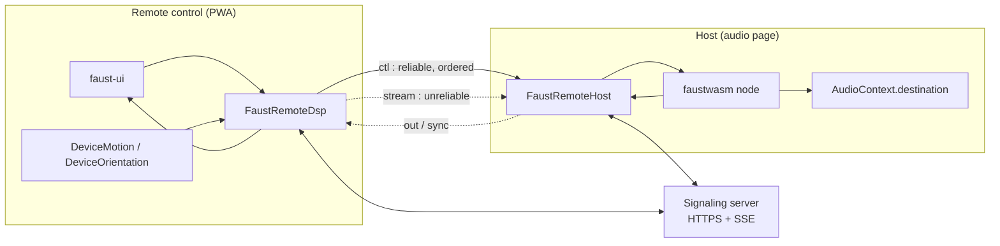
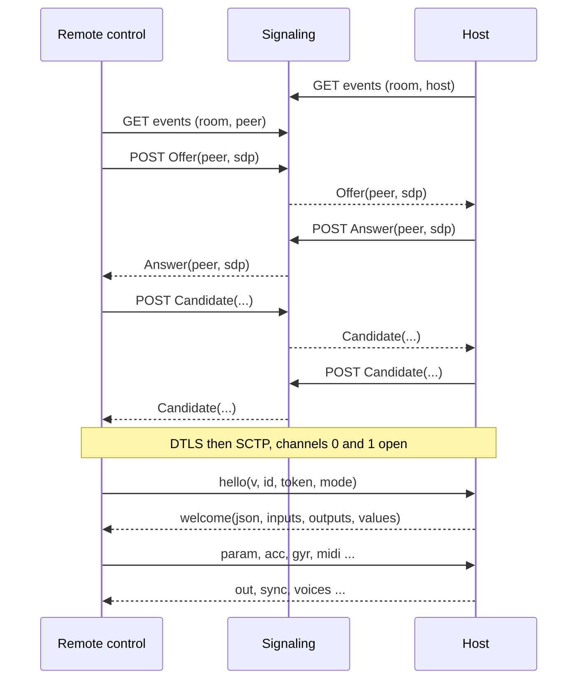
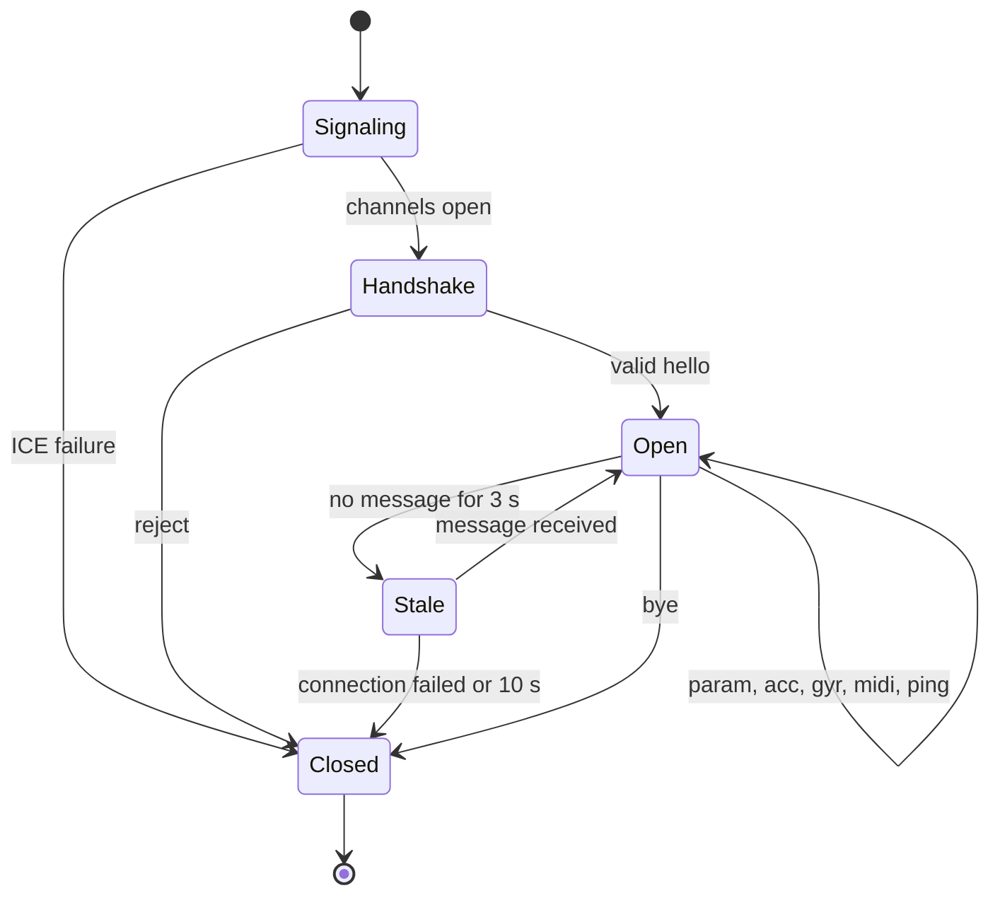
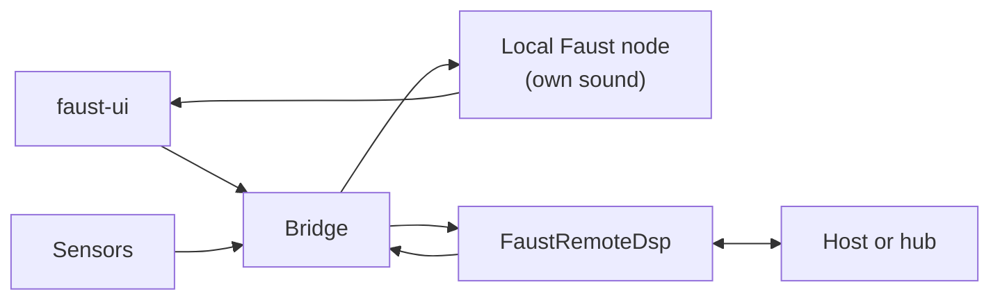
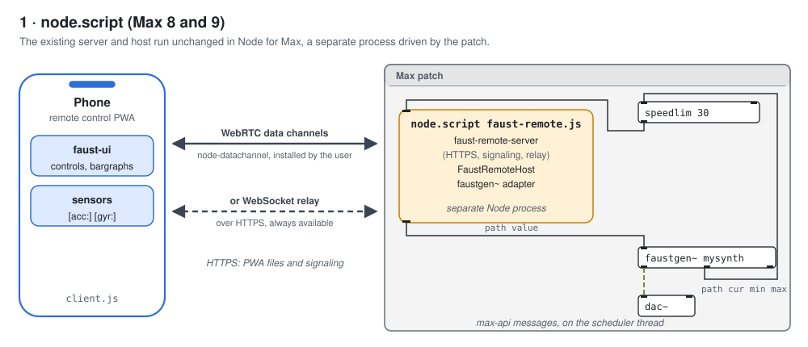
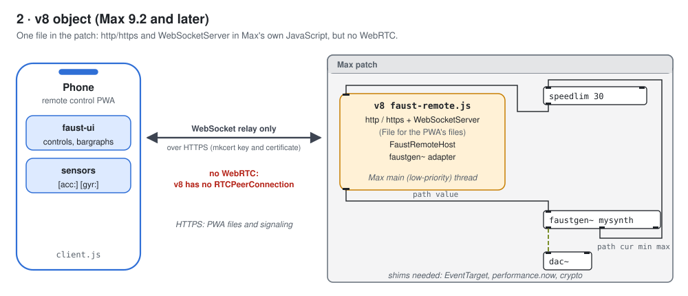
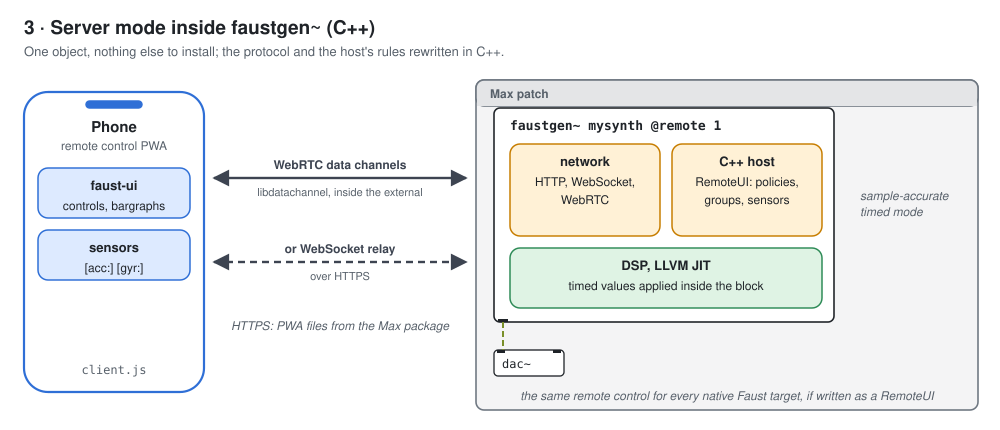
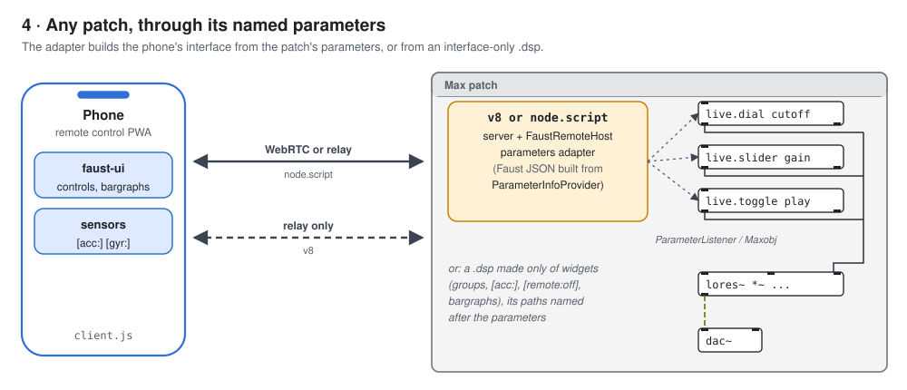
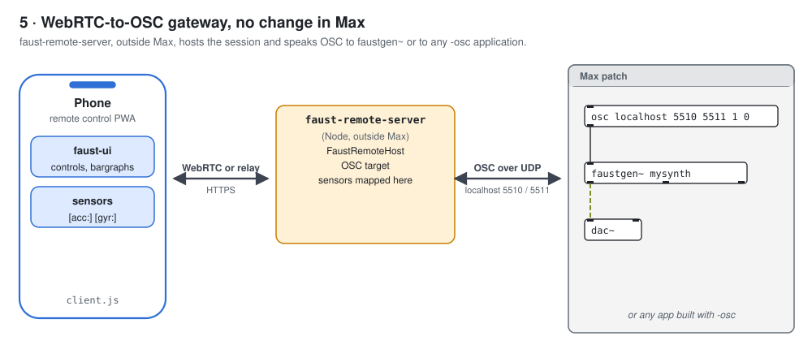
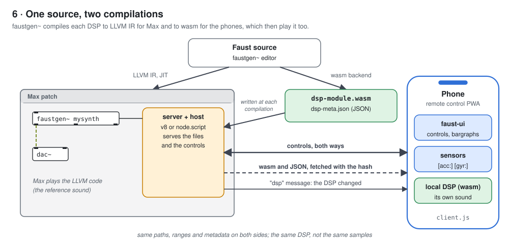

```header
faustwasm — remote control | | {page} / {pages}
```

*A French version of this document is in [remote-control.fr.md](remote-control.fr.md).*

::: toc+
- **Summary** — the feasibility verdict and the structural choices, on one page.
- **Context and goals** — the use cases, what the extension must do and what it will not do.
- **What faustwasm already provides** — the public APIs everything rests on, and the constraints they impose.
- **Architecture** — the three roles, the overall diagram, the deployment topologies.
- **Transport** — why WebRTC, the data channel configuration, ICE, flow control.
- **Signaling** — the need, the options, the recommendation, the connection sequence.
- **Application protocol** — the messages, the handshake, the one-way and two-way modes, validation.
- **Sensors** — where to apply the `[acc:]`/`[gyr:]` mapping, and the constraints of mobile browsers.
- **Feedback from the host to the remote control** — bargraphs, state synchronization, echo suppression.
- **Time, latency and jitter** — the latency budget, immediate mode, timed mode.
- **Multiple remote controls** — the sharing policies and their limits.
- **Security and robustness** — pairing, validation, panic on disconnection.
- **Proposed API** — the TypeScript interfaces on the host side and on the remote control side.
- **Integration into the package** — files, build, generator, dependencies, version.
- **Tests and measurements** — how to verify without a browser, then measure for real.
- **Risks and open questions** — what remains to be decided with the maintainer.
- **Implementation status** — what is done, phase by phase, and the deviations from the preceding sections.
- **Use over the Internet** — what the online IDE would need: public server, pages, NAT, security, hosting.
- **Sound on the phone** — host audio over WebRTC or the DSP on the phone: the two uses, the bridge, a hub without DSP, limits and plan.
- **Hosting in Max/MSP** — the server in a `v8` or `node.script` object, or inside `faustgen~`; driving `faustgen~` or a patch's parameters; phones that play the `faustgen~` DSP, compiled to wasm; plan.
- **Implementation plan** — the phases and their order.
:::

# 1. Summary

**The extension is feasible without modifying the DSP runtime.** Everything a
remote control needs already exists in the public API of faustwasm nodes: the
parameter address space (`getParams`, `getUI`, `getJSON`), timed writes
(`setParamValue(path, value, time?)`), the bargraph stream
(`setOutputParamHandler`), the echo of every parameter change
(`setInputParamHandler`), raw sensors (`propagateAcc`, `propagateGyr`) and
MIDI. The remote layer is therefore an *additive* layer, on the main thread,
on top of an existing node: not a single line of `FaustWebAudioDsp.ts`,
`FaustAudioWorkletProcessor.ts` or `src/worklet/` needs to change, and the
audio thread invariants (no allocation, no exception in `process`) are not
affected.

The proposed structural choices:

1. **Two roles**: a *host* (the page that plays the sound, on the machine
   connected to the loudspeakers) and *remote controls* (a PWA on a phone).
   The remote control embeds **neither a compiler nor wasm**: it receives the
   DSP's JSON from the host and builds its interface with faust-ui.
2. **WebRTC DataChannel**, with two negotiated channels: a *reliable, ordered*
   channel for the session, buttons and MIDI, and an *unreliable, unordered*
   channel for continuous streams (sliders, sensors, bargraphs), where the
   last value wins.
3. **Two-way by default.** Feedback makes sense: the interface JSON, the
   bargraphs, slider synchronization between several remote controls, the
   number of active voices. One-way mode is not a second protocol but a
   subset of the same one (the host goes silent after the handshake).
4. **Sensors: raw values, mapping on the host.** The remote control sends the
   raw accelerometer and gyroscope values; the host passes them to
   `propagateAcc`/`propagateGyr`, so that the `[acc:]`/`[gyr:]` curves apply
   exactly as they do locally and `FaustSensors` stays internal.
5. **Dependency-free signaling**: a small Node server (static HTTPS + HTTP/SSE
   signaling) that also serves the PWA, behind an abstract interface that can
   be replaced by any other channel.
6. **No new runtime dependency.** The remote code is a separate bundle, kept
   out of `src/exports.ts` while it is experimental.

The main obstacle is not technical but practical: sensors and service workers
require a **secure context (HTTPS)**, which means a certificate on the local
network (\ref{sec:signal}).

# 2. Context and goals

## 2.1. Use cases

- **Concert, installation**: a computer connected to the sound system runs a
  Faust application; musicians or the audience control it from their phones,
  through the screen or through gesture.
- **Front of house and rehearsal**: a technician in the audience area adjusts
  the parameters of a process running backstage.
- **Remote gestural interface**: the phone provides the sensors, a more
  powerful machine computes a DSP too heavy for the phone (high polyphony,
  reverbs, multichannel spatialization) and outputs the sound on its own
  audio interfaces.
- **Sharing from an editor**: an environment built on faustwasm (the online
  Faust IDE, for example) offers "Remote control" and displays a QR code; the
  phones present control the DSP while it is being written.

## 2.2. Goals

O1
:   Control from a PWA all the input widgets of a Faust DSP
    (`button`, `checkbox`, `hslider`, `vslider`, `nentry`) running in a
    faustwasm node (AudioWorklet or ScriptProcessor, mono or polyphonic).

O2
:   Control these same widgets with the phone's sensors, with the semantics of
    the `[acc:]` and `[gyr:]` metadata already implemented.

O3
:   Display the host's bargraphs and the current parameter state on the remote
    control, when that makes sense (two-way mode).

O4
:   Reuse the existing generated interface: the code that builds a faust-ui UI
    from a local node (`createFaustUI(div, node)`) must work unchanged with a
    remote proxy.

O5
:   Impose nothing on applications that do not use the extension: no
    dependency, no overhead in the main bundle, mono/poly behavior
    bit-identical.

## 2.3. Non-goals

- Carrying audio from the phone to the host or the other way round (a
  possible extension is described in \ref{sec:risques}, outside v1).
- Compiling or modifying a DSP remotely: the remote control never submits
  code, only values.
- Providing a TURN server, a public signaling service or account-based
  authentication.
- FFT nodes (`createFFTNode`): their parameter interface is the same and
  should work, but they are not targeted by v1.

# 3. What faustwasm already provides

Everything below is public API, common to `FaustMonoAudioWorkletNode`,
`FaustPolyAudioWorkletNode` and their ScriptProcessor equivalents.

| Existing | Role in the extension |
| :-- | :-- |
| `getParams()`, `getUI()`, `getJSON()`, `getDescriptors()` | Parameter address space (`/dsp/group/param`), identical to that of the OSC and HTTP interfaces of C++ Faust. Sent to the remote control on connection. |
| `setParamValue(path, value, time?)` | Writes a parameter; `time` in `AudioContext` seconds, applied sample-accurately in AudioWorklet, ignored in ScriptProcessor. |
| `setOutputParamHandler(h)` | Bargraph stream, toward the remote control. |
| `setInputParamHandler(h)` | Echo of *every* parameter change seen by the DSP, whatever its origin (local UI, MIDI, sensors, another remote control). Basis of state synchronization. |
| `hasAccInput`, `hasGyrInput`, `propagateAcc`, `propagateGyr` | Raw sensors; the `[acc:]`/`[gyr:]` mapping is done by the DSP (on the audio thread in AudioWorklet). |
| `midiMessage`, `keyOn`, `keyOff`, `ctrlChange`, `pitchWheel` (with `time?`) | MIDI and notes, for a keyboard on the remote control and for polyphony. |
| `getNumActiveVoices()` (poly) | Optional state feedback. |
| `faust2wasm-ts … -pwa`, `FaustPWA`, `createFaustUI` | Generator and PWA skeleton; `createFaustUI` uses only `getUI`, `setParamValue`, `setOutputParamHandler` and `setInputParamHandler`. |

Studying the code reveals five constraints that the design takes into
account:

C1 — One handler per node
:   `setOutputParamHandler` and `setInputParamHandler` replace the previous
    handler. If the host page also displays its own interface, the remote host
    must *chain* the existing handler (call it, then emit) and restore it on
    close. A multiple-listener API in the core would be cleaner but is an
    addition to the public API (open question Q1).

C2 — The `invert` flag depends on the sensor's platform
:   `handleDeviceMotion` computes `invert` from the user agent
    (`/Android/i`) of the machine *that carries the sensor*. Remotely, it is
    the remote control's platform that matters, not the host's: the flag must
    travel with the measurement.

C3 — Fixed, unaggregated bargraph rate
:   `updateOutputs` emits *all* bargraphs every 6 calls to `compute`, even
    unchanged, each in a separate `postMessage`: 6 × 128 = 768 frames, i.e.
    62.5 Hz at 48 kHz in AudioWorklet (about 15.6 Hz with a 512-frame
    ScriptProcessor). The remote host must aggregate, filter out unchanged
    values and limit the rate before the network.

C4 — `FaustSensors` stays internal
:   As required by `AGENTS.md`, the sensor mapping is not exported. The choice
    made in \ref{sec:capteurs} (raw values, mapping on the host) respects
    this.

C5 — Nothing on the audio thread
:   Network messages arrive on the host's main thread; they are converted into
    calls to the node's API, which already goes through the AudioWorklet port.
    The processor sees no difference between a local write and a remote one.

# 4. Architecture

## 4.1. Roles

Host
:   The page (or process) that owns the faustwasm node and the `AudioContext`
    connected to the loudspeakers. It creates a `FaustRemoteHost` on top of the
    node. It is the *authority*: it validates and clamps every value it
    receives.

Remote control
:   A lightweight PWA that creates a `FaustRemoteDsp`, a proxy exposing the
    "control" part of a node's API (parameters, handlers, sensors, MIDI)
    without producing sound. It loads faust-ui and the remote bundle, not
    faustwasm.

Signaling
:   The out-of-band channel that lets the two peers exchange the SDP offer and
    answer and the ICE candidates before the WebRTC channel exists. No control
    message goes through it.

## 4.2. Overall diagram



## 4.3. Deployment topologies

Local network (main case)
:   Host and phones on the same Wi-Fi. The Node server runs on the host
    machine: it serves the PWA, the host page and signaling over HTTPS. Local
    ICE candidates are enough; no STUN is needed.

Internet
:   Host and remote controls on different networks. Signaling must be publicly
    reachable (hosted server or third-party service) and a TURN server becomes
    necessary behind symmetric NATs. The extension accepts an
    `RTCConfiguration` but provides neither.

Same page
:   Host and remote control in the same page, connected by an in-memory
    transport. Of no use in production, it is what the unit tests run on
    (\ref{sec:tests}).

# 5. Transport

## 5.1. Why WebRTC

| Criterion | WebRTC DataChannel | WebSocket (via relay) | WebTransport |
| :-- | :-- | :-- | :-- |
| Host browser directly reachable | yes, peer to peer | no, relay required | no, HTTP/3 server required |
| Unreliable, unordered messages | yes | no (TCP) | yes (datagrams) |
| Head-of-line blocking on Wi-Fi loss | avoidable | unavoidable | avoidable |
| Prior signaling | required | not needed | not needed |
| Encryption | DTLS, mandatory | TLS (`wss:`) | TLS 1.3 |
| iOS Safari | yes | yes | recent or partial depending on version |
| Host under Node | native library to add | server to write, or `ws` | HTTP/3 server to add |

The decisive argument is the first one: **a web page cannot accept an
incoming connection**, neither WebSocket nor WebTransport. Only WebRTC
connects two browsers without routing messages through a server, and only
WebRTC (along with WebTransport) offers unreliable messages, which are
essential so that a loss on the Wi-Fi does not delay the following values. The
price is signaling and ICE.

The transport is nevertheless abstract (the `FaustRemoteTransport` interface, \ref{sec:api}): a WebSocket transport through a relay remains a simple fallback for
networks where ICE fails, without touching the protocol. Both are
implemented; 5.5 compares them in practice.

## 5.2. Data channels

Two channels, created in *negotiated* mode (`negotiated: true`, fixed
identifiers) by both peers: they are usable as soon as the SCTP connection
opens, without a DCEP round trip.

| Channel | Options | Content |
| :-- | :-- | :-- |
| `faust-ctl` (id 0) | `ordered: true`, reliable | handshake, `button` and `checkbox`, last value of a gesture, MIDI, state synchronization, ping, active voices, end of session |
| `faust-stream` (id 1) | `ordered: false`, `maxRetransmits: 0` | continuous slider values during a gesture, sensors, bargraphs |

Two rules follow from this separation:

- **A discrete event never takes the unreliable channel.** A lost button
  release would leave a stuck note.
- **The last value of a gesture is guaranteed.** When a slider stops moving
  (end of a faust-ui gesture, or 100 ms without a new value), the remote
  control sends its last value again on `faust-ctl`. The unreliable stream
  provides responsiveness; this resend provides the exact final value.

Since `faust-stream` is not ordered, every message on it carries a per-sender
sequence number; for a given key (parameter, sensor), the receiver ignores any
message older than the last one applied.

## 5.3. ICE, STUN, TURN

On a local network, *host* candidates are enough. Browsers now hide local
addresses behind mDNS names (`….local`); resolution works on most home and
venue networks, but some corporate or institutional networks filter
multicast. In that case a (reachable) STUN or a TURN server is needed, or the
WebSocket fallback. The diagnosis must be visible: the remote control displays
the ICE state (`checking`, `connected`, `failed`) rather than failing
silently.

## 5.4. Flow control

Continuous streams must never pile up: a queue is latency. Before each send on
`faust-stream`, the sender checks `bufferedAmount`; above a threshold (4 KiB
by default), it **replaces** the pending value for that key instead of
queueing a new one, and sends it on the next `bufferedamountlow` event. The
useful bandwidth is tiny anyway: a sensor at 60 Hz in JSON messages of about
80 bytes amounts to about 5 KB/s.

## 5.5. WebRTC or WebSocket relay: what changes in practice

Both transports are implemented (section 17): the
remote control tries WebRTC first and falls back on the relay by itself, and
its status says which one it got (`connected (WebRTC)` or
`connected (relay)`). The difference that matters for playing: **WebSocket
delivers everything, in order, even if it has to wait; WebRTC can skip a
lost value instead of waiting for it.** The rest follows from that.

| | WebSocket (the relay) | WebRTC (data channels) |
| :-- | :-- | :-- |
| Path | phone → server → host, always through the server | phone ⇄ host directly; the server only introduces them (signaling) |
| Network | TCP | UDP (SCTP over DTLS) |
| Delivery | everything arrives, in order | set per channel: `faust-ctl` reliable and ordered, `faust-stream` unordered and never resent |
| A packet lost on the Wi-Fi | everything behind it waits for its resend: the slider freezes, then the values arrive at once | the lost value is skipped, the next one replaces it |
| Setup | one HTTPS connection, almost immediate | ICE/STUN negotiation, from a few hundred milliseconds to a few seconds; can fail behind some NATs without a TURN server |
| Available in | browsers, Node, Max's `v8` object | browsers only; Node needs a native module; absent from `v8` |
| Server load | all the traffic goes through it | only the introduction |
| Privacy | TLS ends at the server, which sees the messages | encrypted end to end between phone and host |
| Audio | no | yes, an Opus track is possible (19.2) |

What it changes:

- **On a good local network, no difference is felt.** Both take a few
  milliseconds, and the detour through the server costs little when it runs
  on the host's machine.
- **On a busy or disturbed Wi-Fi** (a concert hall, an audience with its
  phones), WebRTC is clearly better for **continuous gestures and
  sensors**. Over TCP, one loss blocks the whole stream for the time of the
  resend, a few tens to a few hundred milliseconds: audible jitter. On
  `faust-stream`, a loss is one value skipped among sixty per second.
- **Events that must arrive** (a button, a note, the last value of a
  gesture) are the same either way: they always take the reliable channel.
- **Over the Internet**, WebRTC keeps the traffic off a server run by GRAME,
  which then does not see the messages; it is harder to establish (NATs,
  corporate networks), where the relay goes wherever HTTPS goes.
- **In Max**, this is what keeps the `v8` option viable (\ref{sec:max}):
  without WebRTC it still works through the relay, at the cost of that
  jitter on a lossy network.


# 6. Signaling \label{sec:signal}

## 6.1. Need

Before any WebRTC connection, the two peers must exchange an SDP offer, an SDP
answer and their ICE candidates. The remote control is the *caller* (it
creates the offer), the host is the *callee* (it answers): it is the host that
"listens", like a server.

```adt
Signal ::= Offer(peer, sdp)              (* remote control to host *)
         | Answer(peer, sdp)             (* host to remote control *)
         | Candidate(peer, candidate)    (* both directions, incremental ICE *)
         | Bye(peer)
```

## 6.2. Options

| Option | Advantages | Drawbacks |
| :-- | :-- | :-- |
| Node HTTP + SSE server (recommended) | no dependency (`node:https`), also serves the PWA and the host page, a single origin | a process to launch, a certificate to provide |
| WebSocket server | natively two-way | Node has no built-in WebSocket server: `ws` dependency or framing code to write |
| Third-party service or public server | works over the Internet, suits the online IDE | external dependency, privacy, availability |
| Manual (SDP in a QR code) | no server | the answer must also be brought back to the host (camera), fragile; rejected |

## 6.3. Recommendation

A dependency-free `faust-remote-server-ts` script that:

- serves the generated host page and remote control PWA over HTTPS;
- exposes `POST /signal/{room}/{peer}` (one signaling message) and
  `GET /signal/{room}/{peer}/events` (SSE stream of the messages addressed to
  that peer), where `room` identifies a host session;
- neither interprets nor stores the messages: it relays them between the
  room's host and its peers, then forgets them.

**Pairing** goes through a URL, displayed by the host page as text and, where
possible, as a QR code: `https://hote.local:8443/remote/#room=…&token=…`. The
token is in the URL *fragment*: it is sent neither to the HTTP server's logs
nor in the `Referer` header. The remote control passes it to the host in its
`hello`, over the encrypted channel.

::: warning [HTTPS on the local network]
`DeviceMotionEvent`, `DeviceOrientationEvent` and registering a service worker
require a secure context. `http://localhost` is one, but
`http://192.168.1.10` seen from a phone is not. The server must therefore be
given a certificate (`--cert`, `--key`) that the phones accept: typically a
local mkcert-style authority installed on the devices, or a real domain name
with a public certificate pointing to the local address. Conversely, a page
served over HTTPS from public hosting cannot query a local signaling server
over HTTP (mixed content is blocked). This is the extension's main usability
cost, and the documentation must address it first.
:::

## 6.4. Connection sequence



The `FaustSignaling` interface (\ref{sec:api}) makes this mechanism
replaceable: an environment that already has a channel (the online IDE, an
application server) adapts it in a few lines.

# 7. Application protocol

## 7.1. Principles

- **JSON text messages**, one object per message, discriminated by `type`
  (like the current messages between node and processor). Binary messages are
  reserved for a later version, if measurements justify them; a v1 receiver
  ignores them.
- **Addressing by index** after the handshake: `welcome` gives the ordered
  list of inputs (`inputs`, in `getParams()` order) and outputs (`outputs`,
  the bargraph addresses); regular messages designate a parameter by its
  index `i` in these lists.
- **Values in widget units** (those of `setParamValue`), never normalized.
  The host clamps to `[min, max]`; it does not quantize to the step, which
  faust-ui already does.
- **The host is the authority**: it never accepts JSON, code or an address
  that is not in its own lists.
- **Version**: `hello` and `welcome` carry `v` (1). A host rejects a major
  version it does not know with `reject`.

## 7.2. Messages

```adt
ClientMsg ::= Hello(v, id, token, mode, hash?)     (* ctl *)
            | Param(i, value, seq, time?)          (* stream during a gesture, ctl otherwise *)
            | Acc(x, y, z, invert, seq, time?)     (* stream ; invert = the phone's platform *)
            | Gyr(α, β, γ, seq, time?)             (* stream *)
            | Midi(bytes, time?)                   (* ctl ; channel messages only *)
            | Ping(s, t₀)                          (* ctl, every second *)
            | Bye                                  (* ctl *)

HostMsg   ::= Welcome(v, session, mode, json?, inputs, outputs, values, outputValues, voices, rates)  (* ctl *)
            | Reject(code, reason)                 (* ctl, then close *)
            | Out(values, i?)                      (* stream ; bargraphs, i = indices if partial *)
            | Sync(i, value)                       (* ctl ; parameter changed by another source *)
            | Voices(count)                        (* ctl ; poly *)
            | Pong(s, t₀, t₁, t₂)                  (* ctl ; t₁, t₂ = host clock *)
            | Bye(reason)                          (* ctl *)
```

`time` is present only in timed mode (\ref{sec:temps}); it is expressed in
the remote control's `performance.now()` clock, in milliseconds. `hash` is
only useful in one-way mode (section 7.4).

A DSP's JSON can exceed the interoperable SCTP message size (the safe limit is
16 KiB; `RTCSctpTransport.maxMessageSize` gives the negotiated value). The
host then splits `welcome` into fragments
`{"type":"chunk","id":…,"part":k,"of":n,"data":…}` on `faust-ctl`; the
channel's ordering and reliability make reassembly trivial.

## 7.3. Examples

```json
{"type":"hello","v":1,"id":"c-7f3a","token":"Zq3…","mode":"bi"}
{"type":"welcome","v":1,"session":"s-21","json":"{…}","inputs":["/synth/freq","/synth/gate"],"outputs":["/synth/level"],"values":[440,0],"voices":0,"rates":{"out":30}}
{"type":"param","i":0,"value":523.25,"seq":118}
{"type":"param","i":1,"value":1}
{"type":"acc","x":0.12,"y":-9.71,"z":0.4,"invert":false,"seq":119}
{"type":"out","values":[0.031]}
{"type":"sync","i":0,"value":523.25}
```

## 7.4. One-way and two-way modes

The handshake is always two-way; the mode decides what the host sends
*afterwards*.

| Host message | `bi` (default) | `uni` |
| :-- | :-- | :-- |
| `welcome` with the JSON | yes | without the JSON, which the PWA already embeds |
| `out` (bargraphs) | yes | no |
| `sync` (parameter state) | yes | no |
| `voices` | yes | no |
| `pong` | yes | yes (latency measurement, liveness) |

One-way mode serves two situations: a PWA generated with the DSP, which
already knows its interface (it then sends `hash`, the SHA-256 of its JSON,
and the host rejects a different interface); and a large number of remote
controls, where feedback would cost the host as many streams as there are
clients. In every other case, two-way is preferable: it avoids distributing
the JSON with the PWA, it keeps the remote controls consistent with one
another and with the host, and it makes displaying the bargraphs possible,
which nothing else allows.

## 7.5. Session lifecycle



Entering `Closed` always triggers the panic described in
\ref{sec:securite}. A remote control that comes back (phone woken from sleep)
opens a new connection with the same `id`; the host treats it as a new
session and sends it the full state again in `welcome`.

## 7.6. Host-side validation

For each message received, the host applies, in order:

1. well-formed JSON message, known `type`, otherwise ignored (no close: a more
   recent remote control may send types the host does not know);
2. session open (only `hello` is accepted before that);
3. index within the bounds of `inputs`, parameter exposed (`expose` option);
4. finite numeric value, clamped to the descriptor's `[min, max]`;
5. sequence number more recent than the last one applied for that key;
6. per-client rate under the limit (200 messages/s by default), otherwise the
   message is dropped;
7. for `midi`: channel messages only (notes, controllers, pitch bend,
   pressure, program), no SysEx.

# 8. Sensors \label{sec:capteurs}

## 8.1. Chosen option: raw values, mapping on the host

The remote control reads `devicemotion` (`accelerationIncludingGravity`) and
`deviceorientation` (`alpha`, `beta`, `gamma`), and sends them as they are in
`acc` and `gyr`, with the `invert` flag of *its* platform (constraint C2). The
host calls `node.propagateAcc({x, y, z}, invert)` and
`node.propagateGyr({alpha, beta, gamma})`. The host's DSP applies the
`[acc: a c amin amid amax]` curves exactly as for a local sensor, and each
parameter driven this way comes back as `in-param`, hence as `sync` to the
remote controls: their sliders follow the gesture.

This choice has four advantages: the mapping exists in only one place, the one
that is already tested; `FaustSensors` stays internal (C4); the remote control
does not need to know the metadata; and `hasAccInput`/`hasGyrInput`, which
the proxy computes from the JSON as the node does, are enough to decide
whether to ask for permission and listen to the sensors.

## 8.2. Rejected option: mapping on the phone

Applying the curves on the remote control and sending only parameter values
would duplicate the mapping outside the audio thread and would require
exporting `FaustSensors`, which `AGENTS.md` rules out. The only gain, sending
only the axes in use, can also be obtained by not sending `gyr` when
`hasGyrInput` is false.

## 8.3. Constraints of mobile browsers

- **iOS permission**: `DeviceMotionEvent.requestPermission()` must be called
  from a user gesture; the PWA reuses `requestPermissions()` from
  `create-node.js`.
- **Rate**: about 60 Hz on iOS, of the same order on Android; the remote
  control sends a sample only if it differs from the previous one by more
  than a threshold, which removes most of the traffic of a phone lying still.
- **Background**: a locked phone or a hidden PWA stops providing sensor data
  and, on iOS, quickly loses its WebRTC connection. On
  `visibilitychange`/`pagehide`, the remote control sends `bye`; when it comes
  back, it reconnects. The Screen Wake Lock API can keep the screen on, with
  support that varies across iOS versions in installed PWA mode.
- **Several sensors, one parameter**: if two remote controls send `acc`, the
  last write wins (\ref{sec:multi}).

# 9. Feedback from the host to the remote control

## 9.1. Bargraphs

The host chains `setOutputParamHandler` (C1) and stores each value received
at the index of its address in `outputs`. It sends an `out` message when two
conditions are met:

- at least one value has changed by more than `outputDeadband` (by default
  0.1 % of the bargraph's range) since the last send;
- at least $1/\text{outputRate}$ s have elapsed since the last send
  (30 Hz by default; the eye needs no more).

Sending is triggered by the arrival of values, without a timer: since the
processor emits all bargraphs at every tick (C3), no value waits more than one
tick. This also avoids timer throttling in a background host tab. For a DSP
with many bargraphs, `out` carries `i`, the list of changed indices, instead
of the full array.

## 9.2. State synchronization and echo suppression

The host chains `setInputParamHandler`. Since the DSP calls this handler after
every write, the host learns of each change, wherever it comes from: its local
interface, MIDI, sensors, another remote control. It broadcasts it as `sync`,
rate-limited like the bargraphs.

Sending a value back to the remote control that just wrote it would make its
slider jump backwards during the gesture. The host therefore remembers, per
remote control and per parameter, the last value received and when it was
received; an `in-param` equal to `Math.fround` of that value (the DSP computes
in float32) and arriving less than 500 ms later is not sent back to that remote
control, but is sent to the others. A value that the host clamped differs from
the one sent: it comes back and corrects the slider, which is the intended
behavior. Possible duplicates (port message and `AudioParam` both seen by the
processor) are filtered by the same rule.

## 9.3. Other feedback

`voices` relays `getNumActiveVoices()` when it changes (poly nodes). `pong`
serves both for liveness and for latency measurement, displayed by the remote
control (median round trip and 95th percentile).

# 10. Time, latency and jitter \label{sec:temps}

## 10.1. Latency budget

Expected orders of magnitude, to be confirmed by the measurements described in
\ref{sec:tests}:

```csv "Gesture-to-sound latency budget, local network" \label{tab:latence}
Step, Typical (ms), Worst case (ms)
Sensor sampling period at 60 Hz, 0 to 17, 17
JS processing and sending on the remote control, < 1, 5 to 20 (GC or busy thread)
Local Wi-Fi one way, 2 to 5, 50 to 200 (power saving or interference)
Reception on the host main thread, < 1, 10 to 50 (busy page)
AudioWorklet port and next block, 0 to 3, 3
Host audio output latency, 10 to 30, 50 and more
Total gesture to sound, 15 to 55, beyond 200
```

The dominant and most variable term is the phones' Wi-Fi, whose radio
power saving produces spikes of several tens of milliseconds. Nothing in the
software layer removes them; one can only choose between putting up with them
(immediate mode) and smoothing them at the cost of a constant delay (timed
mode).

## 10.2. Immediate mode (default)

Each value is applied as soon as it is received, with `setParamValue(path,
value)` without `time`. This gives the lowest latency and is the right choice
for a performer's gesture, where a constant delay is more disturbing than
moderate jitter; smoothing remains the DSP's job (`si.smoo` on continuous
parameters, as for a local interface).

## 10.3. Timed mode (`playoutDelay` option)

When jitter is a problem (sequences, rhythms produced on the phone), the
remote control timestamps each message in its own clock and the host applies
the values at a regular instant, delayed by a fixed duration $D$, through the
existing timed writes (`setParamValue(path, value, time)`, `midiMessage(data,
time)`), hence sample-accurately in AudioWorklet.

The clock offset $θ$ between the two `performance.now()` clocks is estimated
from the `ping`/`pong` exchanges, in the manner of NTP[@ntp] and Cristian's
algorithm[@cristian]: $t_0$ and $t_3$ are read by the remote control when the
`ping` is sent and when the `pong` is received, $t_1$ and $t_2$ by the host.

```math
\begin{aligned}
  δ &= (t_3 - t_0) - (t_2 - t_1) && \text{(round trip)} \\
  θ &= \frac{(t_1 - t_0) + (t_2 - t_3)}{2} && \text{(clock offset)} \\
  τ &= \mathrm{currentTime} + D - \frac{h - (t + θ)}{1000} && \text{(application time, in AudioContext seconds)}
\end{aligned}
```

where $t$ is the message's timestamp and $h$ the host's `performance.now()`
when it is received. The subtracted term is the message's age; the result
does not depend on any absolute correspondence between the `performance.now()`
and `AudioContext.currentTime` clocks.

```algorithm "Applying a timed message on the host"
Input: message m (index, value, timestamp t), estimate θ, delay D
age ← (performance.now() - (t + θ)) / 1000
τ ← ctx.currentTime + D - age
if τ ≤ ctx.currentTime then
  node.setParamValue(path(m.i), m.value)        // late: apply now
else
  node.setParamValue(path(m.i), m.value, τ)
end
```

Among the last 16 exchanges, the host keeps the one with the smallest round
trip $δ$ (the least disturbed by queueing) and derives $θ$ from it; one
`ping` per second is enough to track clock drift. $D$ is chosen above the
95th percentile of the measured jitter, typically 20 to 40 ms, and the remote
control can suggest it from its own measurements.

# 11. Multiple remote controls \label{sec:multi}

The host accepts up to `maxClients` remote controls (16 by default). The
possible policies:

Shared (default)
:   All remote controls write all exposed parameters; the last write wins;
    `sync` keeps everyone consistent.

Exclusive
:   Only one remote control is "in control" at a time; the others receive
    `out` and `sync` but their writes are ignored. Useful at front of house.

Partitioned
:   An `assign(client)` function returns, for each remote control, the
    predicate of the addresses it may write (for example the `/voice_3/`
    group for the third phone). The remote control can display only that
    subset.

Polyphony
:   The host attributes to each remote control the notes it triggers, so as to
    release them when it disconnects. Two remote controls playing the same
    pitch on the same channel collide in voice allocation (the `keyOff` of a
    pitch releases the voice playing it, whichever remote control sent it);
    assigning one MIDI channel per remote control avoids this.

The number of WebRTC connections a host page handles comfortably is in the
order of a few dozen (DTLS and SCTP cost per peer, and the `out` feedback
multiplied by the number of clients); it remains to be measured. Beyond that
(a whole audience), a server-side relay that aggregates is needed, along with
one-way mode.
Sensors of several phones (implemented after P3). A node applies every
`[acc:]`/`[gyr:]` mapping in one `propagateAcc`/`propagateGyr` call: it
cannot send one phone's tilt to one slider and another phone's to another.
The host's `sensorPolicy` option therefore offers three behaviours:

Shared (`shared`, default)
:   Every reading drives every sensor control through the node; the latest
    wins. The phones' sliders jump from one phone to the next.

Mean (`mean`)
:   The host keeps each phone's latest reading, sign corrected (Android
    reports the opposite sign), and passes the node the mean of those of the
    last `sensorWindow` ms (1000 by default): the room tilts together. The
    gyroscope's alpha (compass) and beta angles get a circular mean, so that
    350° and 10° make 0°, not 180°; gamma a plain one.

Assigned (`assigned`)
:   Each phone drives only the sensor controls it may write (`assign`,
    `expose`, outside `[remote:off]`). The host maps the reading itself, with
    the curve of each control's metadata, through the package's own
    `FaustSensors`, bundled in `host.js` and still not exported, then writes
    the values (timed when there is a playout delay). Checked on real nodes:
    the values are those the node's own mapping gives.

With `assign: 'groups'`, each remote control is given the next top-level
group of the DSP that no other holds (one per player: `hgroup("p1", ...)`,
`hgroup("p2", ...)`), freed when it leaves; a remote control that finds none
free may write nothing. The group is announced in `welcome` (`group`) and
shown by the generated pages. Any refused write, whatever the reason, is
answered with the real value, so that a remote control's slider never stays
on a value nothing applied. On the generated host page:
`?assign=groups&sensors=assigned`, or `?sensors=mean`.

# 12. Security and robustness \label{sec:securite}

- **Pairing**: a random 128-bit token per host session, in the fragment of the
  pairing URL, checked in `hello`. Without a valid token, `reject` and close.
  The signaling server accepts a message for a room only if it comes with this
  token, in the request body and never in the URL; a peer's SSE stream is
  designated by a random 128-bit identifier known only to that peer
  (`EventSource` does not allow an authentication header).
- **Encryption**: DTLS is mandatory in WebRTC; signaling goes over HTTPS.
- **Host authority**: validation as in section 7.6; no address, no JSON, no
  code from a remote control; an `expose` filter to make only some parameters
  controllable (a master volume, for example, can stay local).
- **Panic on disconnection**: when a remote control moves to `Closed`
  (`bye`, connection failure, no message within the liveness timeout), the
  host resets to 0 the `button`s it was holding down (and that nobody else is
  holding), releases its notes, then removes it from the broadcast. This is
  the remote counterpart of the invariant "a panic flushes pending events".
- **Host shutdown**: `close()` sends `bye` to all remote controls, gives the
  original handlers back to the node (C1) and closes the connections; the node
  keeps working as before.
- **Errors**: no network or protocol error surfaces as an exception in the
  host application's code; they are reported through events.

# 13. Proposed API \label{sec:api}

A sketch, to be refined during the prototype phase.

```ts
/** Two logical channels, text messages. */
export type FaustRemoteChannel = 'ctl' | 'stream';

export interface FaustRemoteTransport {
    send(channel: FaustRemoteChannel, message: string): void;
    /** Bytes pending (RTCDataChannel.bufferedAmount). */
    bufferedAmount(channel: FaustRemoteChannel): number;
    onmessage: ((channel: FaustRemoteChannel, message: string) => void) | null;
    onclose: ((reason: string) => void) | null;
    close(): void;
}

/** WebRTC transport: creates the negotiated channels 0 and 1 on the connection. */
export function createRTCTransport(pc: RTCPeerConnection): Promise<FaustRemoteTransport>;

/** A pair connected in memory, for tests and for an in-page demonstration. */
export function createLoopbackTransports(): [FaustRemoteTransport, FaustRemoteTransport];

export type FaustSignalMessage =
    | { type: 'offer'; peer: string; sdp: string }
    | { type: 'answer'; peer: string; sdp: string }
    | { type: 'candidate'; peer: string; candidate: RTCIceCandidateInit | null }
    | { type: 'bye'; peer: string };

export interface FaustSignaling {
    send(message: FaustSignalMessage): void;
    onmessage: ((message: FaustSignalMessage) => void) | null;
    close(): void;
}

/** Client for the provided HTTP + SSE signaling server. */
export function createHttpSignaling(
    url: string,
    room: string,
    token: string,
    options: { role: 'host' | 'remote'; id?: string; onerror?: (error: Error) => void }
): FaustSignaling & { readonly ready: Promise<void> };

export interface FaustRemoteHostOptions {
    token?: string;
    mode?: 'bi' | 'uni';               // default 'bi'
    policy?: 'shared' | 'exclusive';   // default 'shared'
    assign?: (client: FaustRemoteClientInfo) => (path: string) => boolean;
    expose?: (path: string) => boolean;
    maxClients?: number;               // default 16
    outputRate?: number;               // Hz, default 30
    outputDeadband?: number;           // fraction of the range, default 0.001
    playoutDelay?: number | null;      // seconds; null = immediate mode (default)
    livenessTimeout?: number;          // ms, default 3000
}

export interface FaustRemoteClientInfo {
    readonly id: string;
    readonly mode: 'bi' | 'uni';
}

export class FaustRemoteHost extends EventTarget {
    constructor(
        node: IFaustMonoWebAudioNode | IFaustPolyWebAudioNode,
        options?: FaustRemoteHostOptions
    );
    /** Accepts a remote control on an already open transport. */
    accept(transport: FaustRemoteTransport): void;
    /** Listens to signaling and opens one RTCPeerConnection per remote control. */
    listen(signaling: FaustSignaling, rtc?: RTCConfiguration): void;
    readonly clients: ReadonlyArray<FaustRemoteClientInfo>;
    /** Events: 'join', 'leave', 'error'. */
    /** Sends bye, gives the original handlers back to the node, closes everything. */
    close(): void;
}

/** The "control" part of a node's API, without audio. */
export type IFaustRemoteControl = Pick<
    IFaustBaseWebAudioDsp,
    | 'setParamValue' | 'getParamValue' | 'getParams'
    | 'getMeta' | 'getUI' | 'getJSON' | 'getDescriptors'
    | 'setOutputParamHandler' | 'getOutputParamHandler'
    | 'setInputParamHandler' | 'getInputParamHandler'
    | 'midiMessage' | 'keyOn' | 'keyOff' | 'ctrlChange' | 'pitchWheel'
    | 'hasAccInput' | 'hasGyrInput' | 'propagateAcc' | 'propagateGyr'
    | 'startSensors' | 'stopSensors'
>;

export interface FaustRemoteDspOptions {
    token: string;
    id?: string;                       // stable across reconnections
    mode?: 'bi' | 'uni';
    json?: string;                     // required in 'uni' mode
    timestamps?: boolean;              // timed mode, default false
}

export class FaustRemoteDsp extends EventTarget implements IFaustRemoteControl {
    static connect(transport: FaustRemoteTransport, options: FaustRemoteDspOptions): Promise<FaustRemoteDsp>;
    static connectRTC(
        signaling: FaustSignaling,
        options: FaustRemoteDspOptions,
        rtc?: RTCConfiguration
    ): Promise<FaustRemoteDsp>;
    readonly state: 'connecting' | 'open' | 'reconnecting' | 'closed';
    readonly rtt: number;
    getNumActiveVoices(): number;
    /** Events: 'statechange', 'error'. */
    close(): void;
    // … plus the methods of IFaustRemoteControl
}
```

With this proxy, the remote control reuses the existing code as it is:

```js
const signaling = createHttpSignaling(location.origin, room, token, { role: "remote" });
const dsp = await FaustRemoteDsp.connectRTC(signaling, { token });
const faustUI = await createFaustUI(divFaustUI, dsp);  // unchanged
await requestPermissions();                              // user gesture
dsp.startSensors();                                      // if hasAccInput / hasGyrInput
```

and the host adds only two lines to an existing application:

```js
const host = new FaustRemoteHost(faustNode, { token });
host.listen(createHttpSignaling(location.origin, room, token, { role: "host" }));
```

# 14. Integration into the package

## 14.1. Proposed files

```tree
src
  remote
    protocol.ts — message types, version, validation
    FaustRemoteHost.ts — host side, on top of an existing node
    FaustRemoteDsp.ts — remote control side, proxy for the DSP
    transport.ts — RTCDataChannel and in-memory loopback
    signaling.ts — HTTP + SSE client
    clock.ts — clock offset estimation
    index.ts — entry point of the remote bundle
scripts
  faust-remote-server.js — static HTTPS and signaling, no dependency
assets
  remote
    host — host page: node, FaustRemoteHost, pairing URL and QR code
    client — remote control PWA: faust-ui, FaustRemoteDsp, sensors
test
  unit
    remote-protocol.test.mjs
    remote-host.test.mjs
    remote-render.test.mjs
  web
    remote — manual host and remote control pages
```

## 14.2. Build and distribution

- **Separate bundle.** `src/remote/index.ts` becomes one more esbuild entry
  point, producing `dist/remote/index.js` (ESM) and `dist/remote/index.d.ts`.
  A separate directory rather than `dist/esm/`: `postbuild.js` copies
  `dist/esm/` into every generated standalone application, which has no need
  to embed the remote bundle. The remote control imports only this bundle
  (48 KB unminified, no wasm); it depends on faustwasm only through types.
  Since the package has no `exports` field, the path
  `@grame/faustwasm/dist/remote/index.js` is enough; adding an `exports` field
  would change the resolution of every existing deep import and must remain a
  separate decision. No IIFE variant until a page asks for one.
- **Outside `src/exports.ts`** while the API is experimental: anything that
  goes in there becomes a compatibility commitment.
- **Nothing for the audio thread**: the remote bundle does not go through
  `build-worklets.js`.
- **No runtime dependency**: WebRTC, `EventSource` and `crypto.subtle` are
  native in browsers; the server uses only `node:https`, `node:fs` and
  `node:path`. A QR code generator would have to be embedded in `assets/`, as
  faust-ui is (open question Q3).
- **`files`**: `assets` and `scripts` are already in it; the new `bin` entry
  (`faust-remote-server-ts`) and the `dist` files are covered. To be checked
  with `npm pack --dry-run`.

## 14.3. Generator

`faust2wasm-ts foo.dsp out -pwa -remote` would produce, next to the current
files:

- `out/host/`: the host page, built like the current standalone application
  (node, local interface) plus `FaustRemoteHost` and the display of the
  pairing URL;
- `out/remote/`: the remote control PWA (manifest, service worker, faust-ui,
  remote bundle) without `dsp-module.wasm`;
- the launch instruction: `npx faust-remote-server-ts out --cert … --key …`.

The expected file sets go in `test/cli/expected.mjs`, as for the other modes.

## 14.4. Host under Node

A browserless host would require a Web Audio implementation for Node (for
example node-web-audio-api) and a native WebRTC library. Both are heavy
dependencies and must not enter the package; the `FaustRemoteTransport`
abstraction lets such a host provide its own transport. The reference host
remains a browser page, possibly in kiosk mode on the audio machine.
Feasibility to be studied separately (Q4). A host inside Max, which runs
JavaScript under Node (`node.script`) or in the patch (`v8`), is studied in
\ref{sec:max}.

## 14.5. Version and C++

A feature and API addition: **minor version** (0.22.0 → 0.23.0) according to
`AGENTS.md`, to be agreed with the maintainer. C++ Faust has no WebRTC
equivalent; on the other hand, the protocol reuses the address space of its
OSC[@osc] and HTTP interfaces, which would make a WebRTC-to-OSC gateway
possible, to control a native application (`faust2xxx -osc`) from the same
PWA.

# 15. Tests and measurements \label{sec:tests}

Unit, without a browser
:   The in-memory transport connects a `FaustRemoteHost` and a
    `FaustRemoteDsp` in the same Node process. `remote-protocol.test.mjs`
    covers validation (out-of-bounds indices, non-finite values, clamping,
    stale sequence numbers, rate, filtered MIDI), the splitting of `welcome`,
    echo suppression and panic on disconnection. `remote-render.test.mjs`
    puts the host on a real node created by `createNode`, with the fake Web
    Audio environment of `test/unit/web-audio.mjs`, as `node-render.test.mjs`
    does: a value sent by the remote control must change the rendering, an
    `acc` must produce the same rendering as a local `propagateAcc`, and a
    bargraph must come back as `out`.

Mutants
:   Add to `test/mutants.mjs` the mutants that matter: sending a `button` on
    the unreliable channel, not releasing on disconnection, forgetting to
    clamp, sending the echo back to the sender.

Type checking
:   `npm run lint-tests` covers the new tests like the others.

Manual, in the browser
:   `test/web/remote/`: a host page and a remote control page on the same
    machine, then a real phone on the Wi-Fi.

Measurements
:   Round trip and jitter (histograms of `δ` and of arrival intervals), on a
    real local network, with and without Wi-Fi power saving; gesture-to-sound
    latency by simultaneously recording a click on the phone and the host's
    output. A variant of `npm run measure` can connect two Chromium pages over
    loopback WebRTC to track regressions in the software layer, but not the
    Wi-Fi.

# 16. Risks and open questions \label{sec:risques}

| Risk | Effect | Mitigation |
| :-- | :-- | :-- |
| HTTPS certificate on the local network | sensors and PWA unavailable | documentation, `--cert/--key` option, mkcert procedure |
| Filtered mDNS, symmetric NAT | ICE fails | configurable STUN/TURN, WebSocket fallback through a relay |
| Phones' Wi-Fi in power saving mode | latency spikes | timed mode, measurements displayed |
| iOS in the background | connection drops | `bye`, automatic reconnection, Wake Lock |
| Single handler (C1) replaced afterwards by the application | the host loses the stream | document the order, or a listener API (Q1) |
| Many remote controls | host CPU | `maxClients`, `uni` mode, relay |

Questions to decide with the maintainer:

Q1
:   Chain the handlers in the host (v1, no change to the core), or add a
    multiple-listener API to the core (`addOutputParamListener`…), which is a
    public API addition and therefore a minor version?

Q2
:   Remote bundle in `@grame/faustwasm` (proposed) or a separate package
    (`@grame/faustwasm-remote`)?

Q3
:   Embed a QR code generator in `assets/`, or only display the URL?
    **Decided:** Project Nayuki's generator (MIT) is included as is in
    `src/remote/vendor/qrcodegen.ts` (only exported as a module, its license
    notice kept in the bundle); `qrCodeSvg` renders it as SVG and the host
    page displays the code under the pairing link.

Q4
:   Should a host under Node (native Web Audio and WebRTC) be studied, or
    should we stick to the browser host? A host without Web Audio, driving
    a Max patch, is studied in \ref{sec:max}; its first step (a host core
    free of browser globals) is the one a Node host would need.

Q5
:   Signaling for Internet use (online IDE): a service hosted by GRAME, or
    left to the integrator through `FaustSignaling`? Detailed analysis in
    \ref{sec:internet}: what the server lacks (CORS, relay origin, abuse
    protection, reverse proxies), what the pages lack (signaling address, ICE
    servers), NAT traversal and the work to be done.

Q6
:   A metadata convention (`[remote:off]` on a widget, or
    `declare remote "…"`) so that the DSP itself declares what is
    controllable, in addition to the `expose` option?
    **Settled:** `[remote:off]` on an input widget. Remote controls still
    show it and follow its value (hiding is what `[hidden:1]` is for, and
    faust-ui honours it), but cannot change it: the remote control sends
    nothing and puts the host's value back; the host refuses the write and
    sends the value back, in case a remote control does not play along.
    Sensor readings are taken only while a controllable widget uses them
    (the node applies every sensor mapping at once, so one `[remote:off]`
    `[acc:]` slider among controllable ones still moves). It means nothing
    on a bargraph, which is still sent. No DSP-level `declare` for now.

Q7
:   Audio feedback: a WebRTC track (Opus) from the host to the remote control,
    for headphone monitoring during rehearsal (latency in the order of 100 to
    200 ms, hence unusable for playing). Useful in v2? Designed in
    \ref{sec:audio}, which compares it with running the DSP on the phone
    itself, the recommended first step.

# 17. Implementation status

P0, P1, P2 and P3 are done on the `remote-control` branch.

P0
:   `src/remote/`: protocol, `FaustRemoteHost`, `FaustRemoteDsp`, in-memory
    transport. Tests `remote-protocol`, `remote-host`, `remote-render`.

P1
:   `createRTCTransport`, `callHost`/`answerPeers` (exposed as
    `FaustRemoteDsp.connectRTC` and `FaustRemoteHost.listen`),
    `createHttpSignaling`, `createLoopbackSignaling`, the
    `faust-remote-server-ts` server (`src/faustRemoteServer.js`) and the
    `test/web/remote/host.html` and `remote.html` pages. Tests `remote-rtc`
    (fake `RTCPeerConnection`, strict about candidate order) and
    `remote-server`, plus `test/cli/remote-server.test.mjs`.

Deviations from the preceding sections, decided during implementation:

- **Signaling**: the token travels in the `x-faust-token` header of *all*
  requests, including the event stream, which is read with `fetch` rather
  than `EventSource`; the endpoints are `POST host`, `GET events/<id>` and
  `POST send` under `/signal/<room>/`.
- **ICE candidates**: each side holds back its own until it has sent its
  description, and the host keeps (in bounded number) those that arrive
  before the offer, since signaling does not guarantee the order of two
  messages.
- **Initial state**: `setInputParamHandler` and `setOutputParamHandler` on a
  `FaustRemoteDsp` immediately replay the current values, so that
  `createFaustUI` shows the host's state and not the `init` values.
- **Measurement**: `FaustRemoteDsp` emits an `rtt` event on every round trip.

P2
:   `faust2wasm-ts foo.dsp out -remote` (`copyWebRemoteAssets`, templates in
    `assets/remote/`). Test `test/cli/remote-app.test.mjs`, and the `remote`
    mode in the matrix of `faust2wasm-modes.test.mjs`.

Layout produced, different from section 14.3: the host page is at the root of
`out/` (next to `dsp-module.wasm`, like the standalone application) and the
remote control PWA in `out/remote/`, which reuses `../create-node.js`,
`../faust-ui/` and `../faustwasm-remote/` (the `dist/remote` bundle). `out/`
is served with `faust-remote-server-ts`. Notable points:

- The remote control PWA has its own service worker: the one of the existing
  PWAs caches every GET response before returning it, which would block the
  signaling stream indefinitely. Its own responds only for its files and lets
  `/signal/` through.
- The session (room, token) is kept in `localStorage` on both sides: the host
  finds it again on reload (a "New session" button to change it,
  `FaustRemoteHost.setToken`), and the installed PWA, which starts without
  the link's fragment, finds its host again. The fragment is removed from the
  address bar as soon as it is read.
- When hidden, the remote control says goodbye (the host releases what it was
  holding); when visible again, it reconnects; a lost connection is retried.
- QR code of the pairing link on the host page (Q3), redrawn for every new
  session. Tested by decoding it: a decoder written in the test from the
  standard (`remote-qr.test.mjs`), and Chromium's barcode detector.
- A remote control can connect before the host's audio is activated; its
  writes are applied as soon as the `AudioContext` is running.
- Per-role bundles: `dist/remote/client.js` (remote control),
  `dist/remote/host.js` (host, with the QR generator) and
  `dist/remote/index.js` (everything, for the API), produced by a single
  esbuild command, each self-contained. The generated remote control loads
  only `client.js`: 40 KB instead of 109 (unminified), 6.6 KB instead of
  16.4 once minified and compressed. The generated application receives only
  `client.js` and `host.js`.

P3
:   Timed mode (`playoutDelay`, `src/remote/clock.ts`) and WebSocket relay
    fallback (`src/remote/relay.ts`, relay in the server). The exclusive and
    partitioned policies and per-remote-control notes had existed since P0.
    Tests `remote-timed`, and relay tests in `remote-server`.

Timed mode, as implemented (section 10.3 described the conversion on the host
side; it is done on the remote control side, which is simpler):

- The remote control estimates the clock offset (`FaustRemoteClock`: the
  exchange with the shortest round trip among the last 16) and sends `time`
  already expressed in the host's `performance.now()` clock. It timestamps
  only if `welcome` announces a `delay`; it then sends a burst of four pings
  to learn the clock as early as possible.
- The host applies at `currentTime + delay − age`: sample-accurately for
  parameters and MIDI (the node's timed writes), through a timer for sensors,
  which the node cannot schedule. A timestamp slightly in the future (an
  error in the clock estimate, the same for all messages) is kept, bounded to
  twice the delay; bringing it back to "now" reintroduced jitter. A message
  later than the delay is applied on arrival.
- On disconnection, the releases are scheduled after the last scheduled value
  of that remote control: otherwise a still-pending "gate = 1" would come
  after the release and the note would stay held.
- Generated host page: `index.html?delay=40` for 40 ms.

Jitter measured on the in-memory transport, latency drawn between 0 and 40 ms,
100 notes sent every 10 ms; difference between the application spacing and
the sending spacing:

```csv "Jitter before and after the playout delay"
Mode, Median (ms), p95 (ms), Max (ms)
Immediate, 9.15, 23.27, 29.28
80 ms delay, 0.00, 0.02, 0.06
```

This is the software layer alone, on a shared clock: on a real network, the
error and drift of the clock estimate add to it, to be measured with a phone.

WebSocket relay: `GET /relay/<room>` upgraded to WebSocket (RFC 6455
hand-written, text messages only), first message `{ token, role, id }`, then
an `id\n` prefix added by the server. `FaustRemoteHost.listenRelay` and
`FaustRemoteDsp.connectRelay`; the generated remote control tries WebRTC
(8 s), then the relay, and displays which one it is using. The relay goes
over TCP: a loss delays everything that follows, on both channels. `listen`
and `listenRelay` return their stop function (for "New session"); stopping the
relay disconnects the remote controls that were using it.

Verified in a browser (built-in Chromium, two tabs on localhost): connection
through the server, parameters and button applied on the host, bargraph fed
back, simulated accelerometer applied then synchronized, 8 successive
connections opened in 13 to 15 ms, median round trip of 1.2 ms over loopback.
The very first attempt timed out for no identified reason; not reproduced
since. An application generated by `-remote` was verified the same way
(slider moved on the remote control and applied on the host, no `.wasm`
loaded on the remote control side, disconnection when the page is hidden and
reconnection when it becomes visible again). The service worker could not be
verified there: this built-in browser refuses any service worker
registration; it is tested under Node. P3 verified likewise: generated remote
control deprived of WebRTC, fell back to the relay, slider applied on the host
in timed mode (`?delay=40`). **Not verified: a real phone on the Wi-Fi**, hence
neither HTTPS with a certificate, nor real sensors, nor radio latency.

A defect found while verifying, outside this layer, fixed on `master`
("AudioWorklet node: getParamValue reports values written on the audio
thread"): `getParamValue` on an AudioWorklet node read its `AudioParam`, which
writes made on the audio thread (sensor mapping, MIDI) do not update; the
initial values sent in `welcome` for a sensor-driven parameter could
therefore be stale. The node now records these writes and returns them in
`getParamValue`.

# 18. Use over the Internet \label{sec:internet}

Everything above assumes that the host, the server and the phones are on the
**same local network**: `faust-remote-server` runs on the host machine, and
the phones on the same Wi-Fi reach it at its local address
(`https://192.168.1.43:8443`). This section analyzes what it would take to do
without that (question Q5), with the online Faust IDE as the typical case:
there, the host page is the IDE itself, served by a public site, which runs
the DSP with faustwasm in the user's browser. `FaustRemoteHost` sits on the
node there as it is; what changes is everything surrounding the connection.

## 18.1. What prevents the current setup

No local server
:   The IDE user has no Node, no certificate and no server to launch.
    Signaling must be a service that is already there.

Mixed content and private network
:   A page served over HTTPS by a public site cannot call
    `http://192.168.x.x` (mixed content, blocked), and Chrome additionally
    restricts requests from a public site to a private address (*Private
    Network Access*). Even if launched, a local server would be out of the
    page's reach.

A remote control to load
:   The phone has to get the remote control PWA from somewhere: it must be
    hosted publicly, and the pairing link must point to it.

Different networks
:   The phone may be on 4G or on another Wi-Fi: the connection must traverse
    NATs, which the local network never required.

## 18.2. Topology


```csv "Depending on where the computer and the phone are" \label{tab:internet}
Situation, Signaling, Control connection, Added latency
Same Wi-Fi, over the Internet (a few messages at the start), direct WebRTC on the local network, none
Different networks and ordinary NATs, over the Internet, direct WebRTC after STUN, the Internet path
Different networks and symmetric NAT (4G), over the Internet, TURN or WebSocket relay, the path to the server and back
```

By far the most common case, the computer and the phone in the same room, is
also the best: only signaling goes over the Internet, and the control
connection is established directly on the local network, with today's
latency.

## 18.3. What the server needs

`faust-remote-server` already does almost everything a public service must
do (rooms, tokens, signaling, relay). What it lacks:

CORS
:   The IDE page and the server do not have the same origin. The client sends
    the `x-faust-token` header and `application/json`, which triggers an
    `OPTIONS` preflight request: the server does not answer it today (it is
    refused for lack of a token). It must answer `OPTIONS` without a token,
    and answer all requests with `Access-Control-Allow-Origin` (the page's
    origin if it is in an allow list, never `*` with a token),
    `Access-Control-Allow-Headers: content-type, x-faust-token` and
    `Access-Control-Allow-Methods: GET, POST`. The event stream, read with
    `fetch`, is affected in the same way.

Relay origin
:   A WebSocket is not subject to CORS: the server must itself check the
    `Origin` header of the connection request against the same list, so that
    a third-party page cannot use it.

Abuse protection
:   Open to everyone, the server must bound what each client can cost it:
    number of rooms and streams per address, expiry of inactive rooms,
    signaling and relay message rates, queue sizes (already bounded: 64
    messages, one minute). Room names are random (48 bits) and the first
    token owns the room: taking someone else's room requires guessing its
    name.

Behind a reverse proxy
:   A public server is often placed behind nginx or an equivalent, which by
    default **buffers** streamed responses: the signaling event stream would
    arrive only when it closes. The server must send `X-Accel-Buffering: no`
    on this stream, and the deployment documentation must describe the
    reverse proxy configuration (`proxy_buffering off` for `/signal/`,
    `Upgrade` and `Connection` headers for `/relay/`, idle timeouts longer
    than the 15 s heartbeat).

Certificate
:   A real certificate (Let's Encrypt) replaces mkcert: nothing left to
    install on the phones, which in itself is a big usability gain.

## 18.4. What the pages need

Configurable signaling address
:   The pages currently assume that signaling is served by the same origin as
    themselves (`location.origin`). It must be possible to specify it: an
    option of the host page (and of the generator, for example
    `-signal <url>`), and, on the remote control side, one more field in the
    link's fragment (`&signal=…`). A publicly hosted PWA must accept only a
    list of known servers: otherwise a booby-trapped link would direct the
    phone to a third-party server, which would see its control messages go
    through.

ICE servers
:   Pass an `RTCConfiguration` with a STUN server (free ones exist) and, if
    one is available, TURN: the API already accepts it
    (`FaustRemoteDsp.connectRTC`, `FaustRemoteHost.listen`); the pages just
    need to pass it on.

Hosted remote control PWA
:   The remote control generated by `-remote` is suitable as it is, served by
    the IDE site or by the signaling server, provided it is given the
    signaling address as above.

Integration into the IDE
:   A "Remote control" button that creates a `FaustRemoteHost` on the current
    node, opens the session and displays the QR code (`qrCodeSvg`); to be
    redone at every recompilation of the DSP, since the node changes.

## 18.5. Traversing NATs

Between two networks, WebRTC has to discover reachable addresses. **STUN** is
enough behind most home routers. Behind a symmetric NAT, common on mobile
networks, a **TURN** server is needed, which relays all of the session's
traffic and therefore costs bandwidth to whoever hosts it (*coturn* is the
free reference implementation).

The existing **WebSocket relay** plays the same role without an additional
server: the host and the phone both connect to it outbound, which gets through
every NAT. Its limits, already noted in P3, weigh more over the Internet:
everything goes over TCP, so a loss delays what follows, on both channels. A
session's bandwidth is tiny (a few KB/s): a relay on the signaling server can
handle many sessions. Timed mode (`playoutDelay`) absorbs the jitter of an
Internet path, at the cost of a fixed delay of a few tens of milliseconds,
acceptable for parameter control, less so for playing notes.

## 18.6. Security and privacy

- The signaling server sees the room names, the tokens (in the headers) and
  the SDP descriptions, which contain the peers' IP addresses. It does not see
  the control messages of a WebRTC connection, which are end-to-end encrypted
  by DTLS.
- Through the relay, on the other hand, control messages pass through the
  server in clear text as far as it is concerned (encrypted only up to it, by
  TLS). For slider values, this is acceptable from a trusted service, which
  must then say so in its privacy policy.
- The server must log nothing of what passes through it: no tokens, no SDP,
  no messages.
- The token in the link's fragment and pairing by QR code remain valid over
  the Internet: the link is never sent to a server; it goes from the host's
  screen to the phone's camera.

## 18.7. Who hosts

| | A. Service hosted by GRAME | B. Building blocks for the integrator |
| :-- | :-- | :-- |
| For the IDE user | nothing to install, it just works | depends on the integrator |
| Services | signaling, relay, remote control PWA, possibly TURN | to be deployed by each integrator |
| Cost | a service to maintain, monitor and protect; TURN costs bandwidth | the deployment documentation |
| faustwasm provides | the server, configured for the IDE | the server with CORS, `FaustSignaling` for any other channel |

The two are not mutually exclusive: B is needed for A anyway, and the
`FaustSignaling` interface lets an application that already has its own
server (WebSocket, Firebase, Matrix…) use it for signaling.

## 18.8. Work to do, in order

1. *(Done.)* **CORS and relay origin** in `faust-remote-server`, with an
   optional list of allowed origins (`-allow-origin`), and `X-Accel-Buffering`
   on the event stream. Small, and testable like the rest of the server.
2. *(Done.)* **Configurable signaling address and ICE servers** in the
   generated pages and the generator (`-signal`, `-stun`), with the remote
   control following only known servers.
3. **Abuse protection**: per-address quotas, room expiry, rates.
4. **Deployment documentation**: TLS, reverse proxy, monitoring.
5. **Deploying** a service (option A) or not: the maintainer's decision.
6. **Integration into the IDE**, once the service is available.
7. **TURN**, only if measurements on mobile networks show that the relay is
   not enough.

Points 1 and 2 are useful even without Internet use: a signaling server
separate from the host page is also useful on a local network.

They are done. On the server side, `createFaustRemoteServer({ allowOrigins })`
and the `-allow-origin` option (repeatable): answers to `OPTIONS` preflight
requests without a token, CORS headers for the origins in the list, refusal
(403) of any other foreign origin, the relay included (the `Origin` header of
the WebSocket request is checked); requests without `Origin` and those from
the server's own origin are served as before; `X-Accel-Buffering: no` on the
event stream. On the page side, `faust2wasm -remote -signal <url> -stun <url>`
writes the signaling address and the STUN servers into the host page and the
remote control; the link carries `&signal=…`, which the remote control follows
only if it designates the server it was built for or the one serving its own
page. Verified in Chromium with the pages on one origin and signaling on
another: WebRTC connection and relay accepted for the allowed origin,
preflight request refused for another one (the host page says so, naming the
option), link to an unknown server refused without any request being sent to
it.

# 19. Sound on the phone \label{sec:audio}

So far the remote control receives values only: parameters and bargraphs.
This section studies how a phone could also give sound (question Q7), and
compares two ways: sending the host's audio to the phone, or running the
DSP on the phone itself. It is a design, not yet implemented.

## 19.1. What for

- **Monitoring during rehearsal**: a musician or technician far from the
  loudspeakers, or in another room, listening on headphones.
- **Remote session** (with Internet use, \ref{sec:internet}): someone
  driving a DSP running elsewhere who wants to hear it.
- **Phones as instruments**: each phone plays its own part on its own
  loudspeaker, a phone orchestra, the server only coordinating the
  controls.

## 19.2. Two ways

Host audio over WebRTC
:   The output of the host's node is also routed to a
    `MediaStreamAudioDestinationNode`
    (`context.createMediaStreamDestination()`), whose track is added to the
    peer connection (`addTrack`); the phone plays the track it receives
    (`ontrack`) in an `<audio>` element or through Web Audio. WebRTC brings
    Opus (mandatory, 48 kHz, suited to music when set for it: stereo, 96 to
    128 kbit/s), encryption (SRTP), congestion control, a jitter buffer and
    loss concealment. Its voice processing (echo cancellation, gain control,
    noise suppression) applies to microphone tracks only, not to a track
    produced by Web Audio.

DSP on the phone
:   The remote control becomes a standard standalone application, with the
    compiled DSP (`dsp-module.wasm`, no compiler) and its own sound, as the
    standalone PWA already is, plus the control messages that exist. The
    phone hears its own computation, with the same parameters as the host.

```csv "Sound on the phone: the two ways" \label{tab:audio}
Criterion, Host audio over WebRTC, DSP on the phone
Latency of what is heard while playing, about 100 to 250 ms, local audio latency (about 10 to 30 ms)
Network, one audio track per phone (64 to 128 kbit/s), control messages only (a few KB/s)
Number of phones, bounded by encoding on the host, not bounded by audio
Through the WebSocket relay, no sound, works (messages only)
Same sound as the host, yes (it is the same), no: same parameters but an independent computation
Download on the phone, nothing more, faustwasm and the DSP's wasm (cached by the service worker)
```

Latency of host audio over WebRTC, orders of magnitude to be measured: Opus
frame 10 to 20 ms; adaptive jitter buffer 20 to 80 ms, more on a busy
Wi-Fi; network a few ms to a few tens; phone audio output 10 to 20 ms on
iOS, often 50 to 150 ms on Android. Chrome lets the jitter buffer be
lowered (`RTCRtpReceiver.jitterBufferTarget`), at the cost of more
dropouts. This is monitoring latency, not playing latency: a loop where one
plays by gesture while listening on the phone is unusable at 150 ms.

**Recommendation: the DSP on the phone first.** Host audio over WebRTC
remains the answer only when the sound must be exactly the host's: a DSP
that processes the host's audio input (microphone, line), uses sounds only
the host has, or is too heavy for a phone.

## 19.3. DSP on the phone: two uses

Local monitoring
:   The host remains the reference sound, on the PA system; the phone runs
    a copy of the DSP so that one hears it on headphones. The direct
    replacement for Q7.

Phones as instruments
:   No sound on the server side, necessarily: each phone plays its part,
    the server coordinates (a conductor sending settings to all, players
    influencing one another). `assign: 'groups'` takes a natural meaning:
    each phone plays and hears its group.

## 19.4. Architecture on the phone

Two objects side by side: a **local Faust node**, created as in the
standalone PWA (`createFaustNode` of `create-node.js`), and the existing
**`FaustRemoteDsp`**, joined by a small bridge.



- **A local action** (UI) applies at once to the local node, then goes to
  the host as today: one hears oneself with no network delay.
- **A change from elsewhere** (the host, another phone) arrives as the
  existing `sync` and applies to the local node. The host already does not
  echo a write back to its writer, so there is no loop.
- **Sensors** drive the local node directly (`propagateAcc`), with no
  delay, and also go to the host according to its `sensorPolicy`.
- **Bargraphs** are computed by the local DSP: no need to receive them
  (`uni` mode is enough when nothing else is needed from the host).

The bridge belongs in `client.js`, so that an application of one's own can
use it; the generated remote control would offer a "Play locally" choice.

## 19.5. A hub without DSP

For phones as instruments, the server need not compute anything: a **hub**
keeps the parameter state, applies the rules (groups, `[remote:off]`,
rights, sensor policies) and broadcasts changes. `FaustRemoteHost` only
needs an object that looks like a node (`FaustRemoteHostTarget`): an object
storing values, built from `dsp-meta.json`, is enough. Such a hub no longer
needs Web Audio, which also brings the host under Node (Q4) closer: with
the WebSocket relay, the server could be a Node process alone.

## 19.6. Limits

- **The sound is not the host's.** Same settings, two independent
  computations: oscillators and LFOs out of phase, different noise, a note
  starting slightly later on one side. A good approximation for
  monitoring, not a replacement when the host's sound depends on what the
  phone lacks (see 19.2).
- **Rhythm between phones.** Each phone has its own audio clock. Events a
  conductor wants played together need the timed mode **the other way**:
  scheduled at a common instant converted into each phone's audio clock.
  The existing clock estimate (`FaustRemoteClock`) is the basis; it is a
  step of its own.
- **Load and battery.** The phone computes the DSP: a heavy DSP may not fit
  an older phone, and continuous audio drains the battery.
- **iOS.** Audio needs a gesture to start (the **Connect** tap provides
  it), and the remote control currently disconnects when the screen locks:
  to keep playing screen off, it would have to stay connected then.
- **File locations.** `create-node.js` fetched `dsp-meta.json` and
  `dsp-module.wasm` next to the page, while the generated remote control
  lives in `remote/` and those files at the top. Solved in step 1: it now
  resolves them against itself.

## 19.7. Plan

1. *(Done.)* **Local monitoring**: the local node ↔ remote control bridge in
   `client.js`, and "Play locally" in the generated remote control (which
   then also loads `faustwasm` and the DSP's wasm, cached by its service
   worker). The most useful and least risky step.
2. **The hub without DSP**, for phones as instruments.
3. **Rhythmic synchronization** between phones, if needed.
4. **Host audio over WebRTC**, only for the cases where the sound must be
   exactly the host's: an `audio` option chosen at connection (the offer
   must carry the audio track; changing it later means renegotiating over
   the control channel), no sound through the relay, one encoded track per
   phone.

Step 1, as implemented: `FaustLocalSound(dsp, node)` (`src/remote/local.ts`,
in `client.js` and `index.js`) has the control part of a node's API, so a UI
is built on it as on a node, and it shows the local node's state, what one
hears. A change made here goes to the local node at once, then to the host;
a change made elsewhere (host, another phone, the host's correction of a
refused change) reaches the local node; bargraphs come from the local node.
This phone's sensors drive the local node at once, with the DSP's curves
(the shared `src/remote/sensors.ts`, `FaustSensors` bundled, still not
exported), on the controls that are this phone's to drive, which the host's
sensor policy decides and now announces in `welcome` (`sensors`): all of
them under `shared`, those of its group under `assigned` with
`assign: 'groups'`, none under `mean`, where the right value is the host's
mean. Values coming back for those controls are then ignored, so that the
local gesture and the network do not fight over them. `client.js` grows from
40 to 59 kB (unminified) with those curves.

In the generated remote control, "Play locally" is ticked before
**Connect**, whose tap starts the audio (as iOS requires); the local node is
made once and kept across reconnections, and paused while the page is
hidden. `create-node.js` now resolves `dsp-meta.json` and the wasm files
against itself rather than the page (the same for the pages next to it), so
that the remote control in `remote/` plays the DSP generated at the top. Its
service worker caches those files when first used, not at install.

Checked on real nodes of both kinds: the phone sounds a change before any
message has left, the host after delivery, and a local tilt gives the value
the node's own mapping gives. Checked in Chromium on a generated app with the
host's audio off: the remote control's bargraph, which only its local DSP
can compute, follows its slider (1668 Hz gives 0.834 for `freq / 2000`). Not
checked: on a phone, where the load of the DSP and the audio latency are to
be measured.

# 20. Hosting in Max/MSP \label{sec:max}

The goal: the same remote control (PWA, sliders, sensors, local sound)
driving a **Max patch** instead of a Web Audio page. Two things are to be
decided: **what speaks to the phones** inside Max, and **what it drives**:
a `faustgen~` DSP, or any patch through its parameters. This section is a
feasibility study and a plan; nothing is implemented.

What Max offers was read in the Cycling '74 documentation (Max 9.2) and in
the `faustgen~` sources (`faust/embedded/faustgen`); what could only be read,
not run in Max, is marked *to be checked*.

## 20.1. Three places to run the server

`v8` object (Max 9, networking since 9.2)
:   JavaScript in the patch itself, on a modern V8 engine (ES6 and later),
    always on Max's low-priority (main) thread. Since Max 9.2 it has
    `require("http")` and `require("https")` (servers with streamed
    responses and the `upgrade` event, documented as a minimal subset of
    Node's), `WebSocketServer` (`noServer` and `handleUpgrade`, to share the
    HTTP(S) port), `net`, `tls`, `dgram`, `fetch`, `EventSource`, timers,
    `File`/`Folder` for files. **No WebRTC**: no `RTCPeerConnection`. So
    signaling plus the WebSocket relay (\ref{sec:signal}), which the remote
    control already falls back to. The classic `js` object (SpiderMonkey
    1.8.5) has none of this.

`node.script` object (Node for Max, Max 8 and 9)
:   A real Node.js, in a **separate process**, started and driven by the
    patch; the `max-api` module exchanges messages with it (`addHandler`,
    `outlet`, dictionaries), handled on Max's scheduler thread by default.
    The server (`faustRemoteServer.js`) and the host run there **unchanged**,
    since they need nothing but Node. WebRTC needs a native library in Node
    (for instance `node-datachannel`), installed by the user with
    `script npm install`, never a dependency of the package.

Inside `faustgen~` (C++)
:   A server mode built into the external: HTTP and WebSocket server, WebRTC
    with libdatachannel, and the host's logic **rewritten in C++**
    (policies, groups, sensors, timed mode). Detailed in
    20.5.

`jweb` (Chromium Embedded Framework in Max) could run the host page itself,
with `window.max.outlet` towards the patch; whether Max's CEF build allows
WebRTC is not documented (*to be checked*), and signaling would still need
one of the two JavaScript servers above.

```csv "Max: where the server runs" \label{tab:max}
Criterion, v8, node.script, faustgen~ server mode
Max version, 9.2 and later, 8 and 9, those faustgen~ supports
Transport, WebSocket relay only, relay; WebRTC with a native module, relay and WebRTC
Reuse of the TypeScript host, yes with small shims, yes as is, no: a C++ port
Install, one file in the patch, Node for Max (bundled) and a script, nothing beyond faustgen~
Thread of parameter writes, Max main thread, scheduler thread (separate process), any (zones are plain floats)
Timed mode accuracy, Max main thread (ms jitter), Max scheduler, sample-accurate in perform
Cost, small, small, large and two implementations to keep in step
```



*Figure: the server and host in `node.script`, driving `faustgen~`.*



*Figure: the same in a `v8` object, with the relay only.*



*Figure: a server mode inside `faustgen~`.*

## 20.2. What the host drives: Max targets

`FaustRemoteHost` drives an object that looks like a node
(`FaustRemoteHostTarget`: `getJSON`, `setParamValue`/`getParamValue`, the
two handlers, `midiMessage`, `propagateAcc`/`propagateGyr`). In Max it is an
adapter, the **hub without DSP** of 19.5 (values stored, built from
a JSON) plus forwarding to the patch. Two adapters cover the cases.

The `faustgen~` target
:   - *JSON*: `faustgen~` already sends its JSON to every `js` object in
      its patcher when a DSP is compiled (`create_jsui`), not to `v8` nor
      `node.script`; a `js` relay works today, a small change in
      `faustgen~` would do better (20.4).
    - *Writes*: `path value` messages into its left inlet, the syntax it
      already accepts (label, shortname or path).
    - *Bargraphs*: its control outlet sends `[path, cur, min, max]` for
      every bargraph **at every audio block** (`dump_outputs` in
      `perform`): several hundred messages per second and per bargraph,
      to be thinned before the adapter (`speedlim`, or only changes); the
      host's `outputRate` then thins again what goes to the phones.
    - *Changes made in the patch* (a Max slider, a preset): `faustgen~`
      does not report input changes. Either every control message reaches
      `faustgen~` **through** the adapter (which sees them, the simplest),
      or the adapter asks `dump` regularly.
    - *MIDI*: `midievent` messages; polyphony stays `polyphony N` on the
      object.
    - *Sensors*: `faustgen~` does not apply `[acc:]`/`[gyr:]` itself; the
      adapter applies the DSP's curves with the shared
      `src/remote/sensors.ts`, as `FaustLocalSound` does, then writes the
      values.

The patch-parameter target
:   Any patch whose controls are **named parameters** (Parameter Mode
    Enable, the `live.*` objects): `ParameterInfoProvider` lists them with
    their type and range and reports additions and removals,
    `ParameterListener` reports their changes, and a write goes to the
    object found through `getinfo(name).maxobj` (*to be checked*:
    parameter list and listeners are documented for `js` and `v8`, not for
    `node.script`, which would need a small `v8` helper in the patch). The
    adapter builds a Faust JSON from them (`hslider` for a float, `nentry`
    for an integer, `checkbox` for two states, a menu for an enumeration)
    so that the phone is unchanged. A Faust UI says more than Max
    parameters (groups, `[acc:]`, `[remote:off]`, bargraphs), so a second
    way is to **describe the interface in Faust**: a `.dsp` with only
    widgets, whose `faust -json` gives the layout and metadata, its paths
    named after the patch's parameters; bargraphs are then values the patch
    sends to the adapter (`meter name value`).



*Figure: any patch, through its named parameters.*

## 20.3. What the faustwasm side needs

The browser host relies on browser globals that Node 19+ also has but that
`v8` does not list (*to be checked* in Max 9.2): `EventTarget` and
`CustomEvent` (the host's events), `performance.now()` (clock and timed
mode), `crypto.getRandomValues` (identifiers, **and the pairing token**,
which must come from a secure source) and `crypto.subtle` (the JSON hash
that lets a remote control reuse its cached UI).

1. **A host free of browser globals**: events through a minimal emitter
   when `EventTarget` is missing, an injectable clock and random source,
   the hash replaced by a short pure-JavaScript SHA-256 (or skipped). The
   token in `v8`: given by the user, or read from the system's random
   source; never `Math.random`.
2. **The hub target** (`FaustRemoteHubTarget`, step 2 of 19.7):
   values built from a JSON, handlers, sensor curves; the base of both Max
   adapters, and useful under Node and for phones as instruments.
3. **The host inside the server process**: today the host is a page that
   reaches the server's relay as a client. In Max the server and the host
   are one program: the server should hand each relay connection to the
   host as a `FaustRemoteTransport` directly, with no WebSocket loop
   through itself.
4. **A `v8` build of the server**: `http`/`https` and `WebSocketServer`
   instead of `node:http` and the hand-written RFC 6455 framing, `File`
   instead of `fs` for the PWA's files, a CommonJS bundle for `require`.
   HTTPS stays necessary for the phones' sensors: `https.createServer`
   takes the same mkcert key and certificate.
5. **The PWA in the Max package**: the generic remote control (`remote/`,
   `client.js`, faust-ui) does not depend on the DSP, which arrives in
   `welcome`; it can ship once, served by the patch. Local sound
   (\ref{sec:audio}) needs the DSP's wasm: `faustgen~` can produce it with
   libfaust's wasm backend (20.6), or faustwasm can compile the same source
   under `node.script`.

## 20.4. What `faustgen~` could add (C++)

None of this is required to start (a `js` relay and a `speedlim` suffice),
but the first three each remove a patching chore, and the last brings
local sound to a Max patch. They belong to grame-cncm/faust, to be
committed there.

- Send the JSON to `v8` objects too, not only `js`, or answer a `json`
  message on the control outlet.
- Report input changes on the control outlet (an attribute such as
  `@report 1`), whatever their source: message, OSC, MIDI, preset.
- Send bargraphs only when they change, or at a chosen rate, instead of at
  every block.
- Compile each DSP to wasm too, for the phones (20.6): a larger addition
  than the others, but the one that lets a phone play the patch's DSP.

## 20.5. A server mode inside `faustgen~`

Feasible, and attractive on three counts: **one object** and nothing else
to install (Max 8 included); **sample-accurate timed mode**, since
`faustgen~` owns `compute` and could apply timestamped values inside the
block, which no JavaScript in Max can; and, written as a generic Faust
architecture class (a `RemoteUI` next to `OSCUI` and `httpdUI`), the same
remote control for **every native Faust target** (`faust2caqt`,
`faust2juce`, `faust2max` externals...). Sensors are already mapped in C++
by `APIUI`.

The costs are what make it a later step:

- **A second implementation** of the protocol and of the host's rules
  (policies, groups, `[remote:off]`, sensor policies, clock, timed mode),
  in C++, to be kept identical to the TypeScript one: every fix ported both
  ways, with its own tests.
- **Heavy dependencies** in the external: libdatachannel (with usrsctp,
  libjuice and OpenSSL or mbedTLS) for WebRTC, an HTTP and WebSocket server
  (`httpdUI`'s libmicrohttpd has no WebSocket), a JSON parser; built for
  macOS (two architectures) and Windows.
- **Threads**: a network thread writing zones (plain floats, already done
  by OSC), bargraph reads without locking the audio thread, Max calls
  deferred to the main thread.
- **The PWA's files** shipped in the Max package and served by the
  external.

A lighter native route already half exists: `faustgen~` speaks OSC (`osc`
message, with transmission of values). A **WebRTC-to-OSC gateway** in
`faust-remote-server` (14.5), a host whose target sends and receives OSC on
`localhost`, would drive `faustgen~` and any application built with `-osc`,
with no change in Max (OSC encoding is a few dozen lines over `dgram`; the
JSON then comes from compiling the `.dsp` or from the user, *to be
checked*: whether Faust's OSC interface returns it).



*Figure: the WebRTC-to-OSC gateway, with no change in Max.*

## 20.6. One source, two compilations

Next to LLVM, libfaust has a WebAssembly backend that C++ can call
(`createWasmDSPFactoryFromString`, or `generateWasmFromString` for the
module alone): the factory gives the module (`getBinaryCode()`) and its
JSON (`getJSON()`), which is what faustwasm writes as `dsp-module.wasm` and
`dsp-meta.json`. Faust's release workflow builds libfaust with
`backends/all.cmake`, which puts this backend in the static library (*to be
checked*: that the `libfaustwithllvm` linked into `faustgen~` keeps it).

`faustgen~` could then compile each DSP twice, from the same source, each
time it is compiled:

- **to LLVM IR, compiled just in time**, to run in Max, as today;
- **to wasm**, for the phones: written next to the PWA's files, or handed
  to the server in a dictionary.



*Figure: one source, compiled to LLVM IR for Max and to wasm for the phones.*

What it gives:

- **The phone controls the patch and plays the same DSP**, with its own
  sound: the remote control of section 19 ("Play locally") for a Max
  patch. The phone already loads `dsp-meta.json` and `dsp-module.wasm`
  from its server; the PWA does not change.
- **The edit-compile cycle reaches the phones**: closing the `faustgen~`
  editor recompiles for Max and for the phones, so a phone orchestra can
  rehearse a DSP while it is being written.
- **One source of truth**: paths, ranges and metadata (`[acc:]`,
  `[remote:off]`, groups) are the same on both sides, since they come from
  the same source.

What it needs:

- **The options of the phone's runtime**: the wasm compiled as faustwasm
  compiles it, with internal memory for a mono DSP and external memory for
  polyphonic voices (the `internal_memory` argument); with or without
  `-double`, which the runtime reads in `compile_options` and handles
  either way. The polyphonic voice mixer (`mixer-module.wasm`) does not
  depend on the DSP and ships with the PWA.
- **Telling connected phones that the DSP changed**: today the host reads
  the JSON once. A recompilation brings a new interface and a new module:
  the host announces it (a new `welcome`, or a `dsp` message carrying the
  JSON's hash), and the remote control rebuilds its interface and, if it
  plays locally, recreates its node from the new files. This protocol
  addition would also serve a browser host whose DSP is edited (the IDE).
- **No stale module**: the module's URL carries the JSON's hash, so a phone
  never plays an old one (the service worker already asks the network
  first).
- **Compilation time**: the wasm compilation runs after the LLVM one, off
  the audio thread, and the phones are told only once it is done; Max's
  sound does not wait for it.

The same idea holds outside Max: any host that embeds libfaust can give its
phones the wasm of the DSP it runs, and a JavaScript host under
`node.script` can compile with faustwasm itself.

## 20.7. Limits

- **No WebRTC in `v8`**: the relay over TCP is fine on a local network, but
  a lost Wi-Fi packet delays those behind it (head-of-line blocking): rare
  jitter spikes, not losses. WebRTC needs `node.script` with a native
  module, or the C++ mode.
- **Max's main thread**: `v8` handles the network where Max draws and
  handles the mouse; a heavy patch delays messages (*to be measured*).
  `node.script` messages arrive on the scheduler thread.
- **Timed mode** keeps its meaning (values played at regular intervals) but
  with the precision of the Max thread that applies them, not of the audio
  sample; only the C++ mode would make it sample-accurate.
- **Local sound** on the phone needs the DSP's wasm, which a patch has
  only once `faustgen~` produces it (20.6), and it is the same DSP, not the
  same samples: Max computes the LLVM code, the phone the wasm, each with
  its own phases and noise, as in 19.6.
- **Untested**: everything in this section was read, not run in Max;
  `v8` networking is recent (9.2) and documented as minimal.

## 20.8. Plan

1. *(Done.)* **Host core without browser globals, hub target, host in the server
   process** (20.3, points 1 to 3), in faustwasm, with tests in
   Node: useful under Node whatever happens in Max (Q4).

   As implemented:
   - `src/remote/runtime.ts` gives the host what it took from the browser,
     with a fallback for each: `EventTarget` (a minimal one), `CustomEvent`
     (a plain `{ type, detail }`), `performance.now()` (`Date.now()`), the
     JSON hash (a plain JavaScript SHA-256 without `crypto.subtle`). The
     host's session id may fall back on `Math.random`, since it is not a
     secret; `randomId`, which can feed a token, throws without
     `crypto.getRandomValues` instead. Checked by a test that removes those
     globals before loading `dist/remote/host.js`.
   - `FaustRemoteHub(json, { onwrite, onmidi })` (`src/remote/hub.ts`, in
     `host.js` and `index.js`): a host target built from a JSON. A write
     through it (a remote control, sensors mapped with the DSP's curves,
     `setParamValue`) is stored, given to `onwrite`, then reported to the
     host, which passes it on to the other remote controls; `update(path,
     value)` reports a change made where the DSP runs, without giving it
     back to `onwrite`; `output(path, value)` a bargraph. Sensors never
     drive a `[remote:off]` control; timestamped writes wait by a timer.
   - `server.hostRoom(room, token)` (`createFaustRemoteServer`) gives a host
     in the server's process the room's relay as a port, and
     `host.acceptRelay(port)` takes the remote controls that arrive through
     it; the WebSocket relay host and this port share `acceptRelayed`
     (`src/remote/relay.ts`). Such a room has no WebRTC host, so the
     server answers a remote control's offer with HTTP 409: the signaling
     error now reaches the remote control, which goes to the relay at once
     instead of after its 8 s timeout.
2. **`node.script` first**: the existing server and the host unchanged, the
   `faustgen~` adapter, an example patch and abstraction. WebRTC with an
   optional `node-datachannel`. The fastest way to a phone driving
   `faustgen~` on Max 8 and 9.
3. **The patch-parameter adapter**: JSON from `ParameterInfoProvider`, or
   from an interface-only `.dsp`.
4. **`v8`**: the same in one file in the patch, Max 9.2 and later, relay
   only (20.3, point 4). Measure the latency against
   `node.script`.
5. **`faustgen~` additions** (20.4), in grame-cncm/faust.
6. **`faustgen~` compiles for the phones** (20.6): the wasm written at each
   compilation, the protocol message that tells connected phones the DSP
   changed, and "Play locally" for a Max patch.
7. **Later, if steps 2 to 4 fall short** (sample-accurate timing, WebRTC
   without Node, Max 8 without Node for Max): the C++ server mode as a
   generic Faust `RemoteUI`, or the OSC gateway for native applications.

# 21. Implementation plan

| Phase | Content | Completion criterion |
| :-- | :-- | :-- |
| P0 — protocol | `protocol.ts`, `FaustRemoteHost`, `FaustRemoteDsp`, in-memory transport, unit tests | `npm test` green, remotely controlled rendering in `remote-render.test.mjs` |
| P1 — WebRTC | `createRTCTransport`, signaling server, `test/web/remote/` pages | a real phone controlling a host on the local network; first latency measurements |
| P2 — generator | `-remote` in `faust2wasm-ts`, remote control PWA, host page, pairing | `npm run test-cli` green with the new expected files |
| P3 — extensions | timed mode, exclusive and partitioned policies, per-remote-control notes, WebSocket fallback | jitter measurements before and after, documentation |

P0 depends on no network or signaling choice and settles the essentials: the
protocol and its validation. That is where to start; questions Q1 and Q2 must
be decided before it ends, the others can wait until P2.

[@ntp]: Mills, D., Martin, J., Burbank, J., Kasch, W. (2010). *Network Time Protocol Version 4: Protocol and Algorithms Specification*. RFC 5905, IETF.
[@cristian]: Cristian, F. (1989). *Probabilistic clock synchronization*. Distributed Computing 3(3), 146-158.
[@osc]: Wright, M., Freed, A. (1997). *Open Sound Control: A New Protocol for Communicating with Sound Synthesizers*. Proceedings of the International Computer Music Conference.
