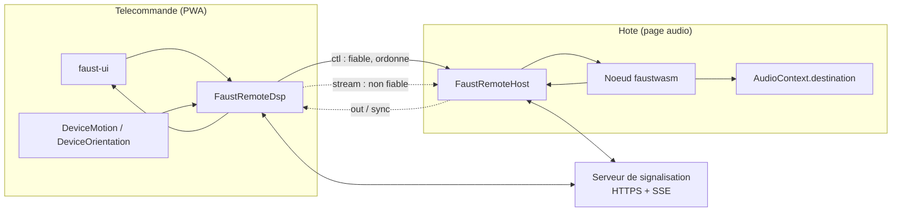
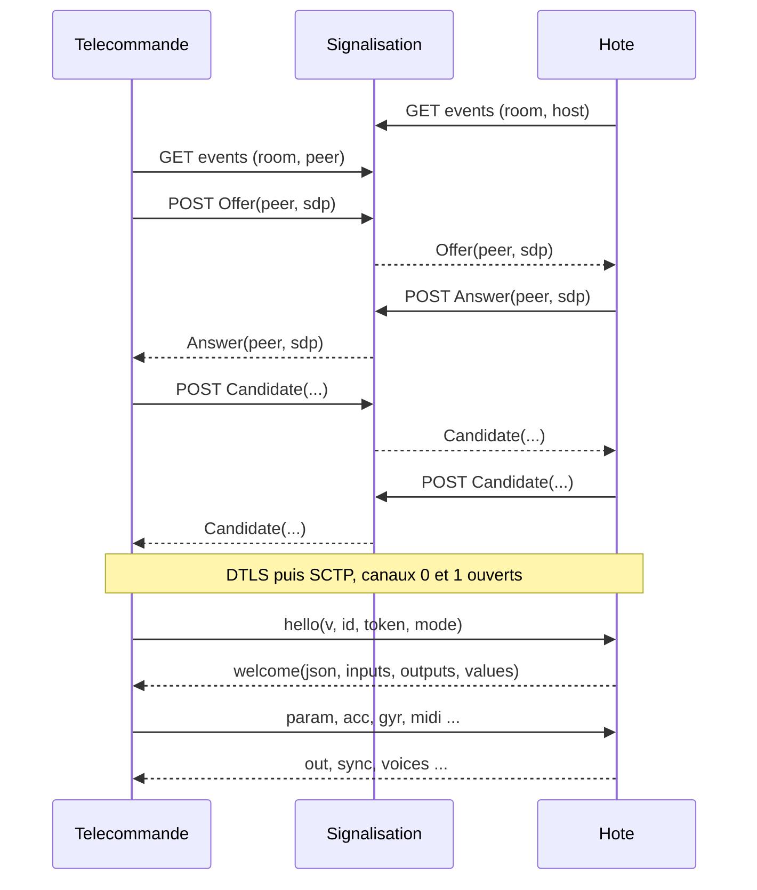
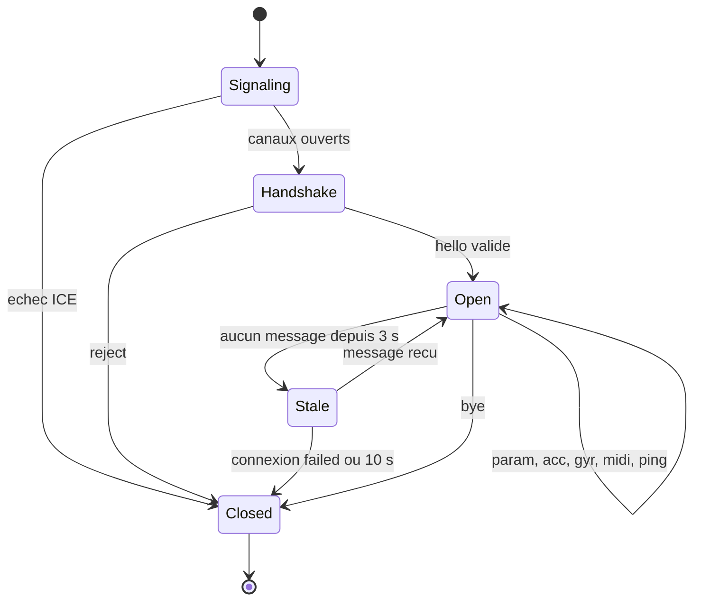
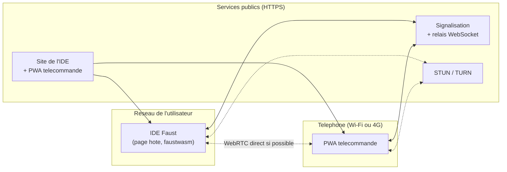

```header
faustwasm — contrôle à distance | | {page} / {pages}
```

# Contrôle à distance des applications Faust Web Audio par WebRTC

::: toc+
- **Résumé** — le verdict de faisabilité et les choix structurants, en une page.
- **Contexte et objectifs** — les cas d'usage, ce que l'extension doit faire et ce qu'elle ne fera pas.
- **Ce que faustwasm fournit déjà** — les API publiques sur lesquelles tout repose, et les contraintes qu'elles imposent.
- **Architecture** — les trois rôles, le schéma d'ensemble, les topologies de déploiement.
- **Transport** — pourquoi WebRTC, la configuration des canaux de données, ICE, le contrôle de flux.
- **Signalisation** — le besoin, les options, la recommandation, la séquence d'établissement.
- **Protocole applicatif** — les messages, la poignée de main, les modes uni- et bidirectionnel, la validation.
- **Capteurs** — où appliquer le mapping `[acc:]`/`[gyr:]`, et les contraintes des navigateurs mobiles.
- **Retour de l'hôte vers la télécommande** — bargraphs, synchronisation d'état, suppression d'écho.
- **Temps, latence et gigue** — le budget de latence, le mode immédiat, le mode horodaté.
- **Plusieurs télécommandes** — les politiques de partage et leurs limites.
- **Sécurité et robustesse** — appairage, validation, panique à la déconnexion.
- **API proposée** — les interfaces TypeScript côté hôte et côté télécommande.
- **Intégration dans le package** — fichiers, construction, générateur, dépendances, version.
- **Tests et mesures** — comment vérifier sans navigateur, puis mesurer en vrai.
- **Risques et questions ouvertes** — ce qui reste à trancher avec le mainteneur.
- **État de la mise en œuvre** — ce qui est fait, phase par phase, et les écarts avec ce qui précède.
- **Usage sur Internet** — ce qu'il faudrait pour l'IDE en ligne : serveur public, pages, NAT, sécurité, hébergement.
- **Plan de mise en œuvre** — les phases et leur ordre.
:::

## 1. Résumé

**L'extension est faisable sans modifier le runtime DSP.** Tout ce dont une
télécommande a besoin existe déjà dans l'API publique des nœuds faustwasm :
l'espace d'adresses des paramètres (`getParams`, `getUI`, `getJSON`), l'écriture
horodatée (`setParamValue(path, value, time?)`), le flux des bargraphs
(`setOutputParamHandler`), l'écho de tout changement de paramètre
(`setInputParamHandler`), les capteurs bruts (`propagateAcc`, `propagateGyr`) et
le MIDI. La couche distante est donc une couche *additive*, sur le thread
principal, au-dessus d'un nœud existant : aucune ligne de
`FaustWebAudioDsp.ts`, de `FaustAudioWorkletProcessor.ts` ou de `src/worklet/`
n'a besoin de changer, et les invariants du thread audio (pas d'allocation, pas
d'exception dans `process`) ne sont pas concernés.

Les choix structurants proposés :

1. **Deux rôles** : un *hôte* (la page qui joue le son, sur la machine reliée
   aux haut-parleurs) et des *télécommandes* (une PWA sur téléphone). La
   télécommande n'embarque **ni compilateur, ni wasm** : elle reçoit le JSON du
   DSP de l'hôte et construit son interface avec faust-ui.
2. **WebRTC DataChannel**, avec deux canaux négociés : un canal *fiable et
   ordonné* pour la session, les boutons et le MIDI, et un canal *non fiable,
   non ordonné* pour les flux continus (sliders, capteurs, bargraphs), où la
   dernière valeur gagne.
3. **Bidirectionnel par défaut.** Le retour a du sens : le JSON de l'interface,
   les bargraphs, la synchronisation des sliders entre plusieurs télécommandes,
   le nombre de voix actives. Le mode unidirectionnel n'est pas un second
   protocole mais un sous-ensemble du même (l'hôte se tait après la poignée de
   main).
4. **Capteurs : valeurs brutes, mapping sur l'hôte.** La télécommande envoie
   les valeurs brutes de l'accéléromètre et du gyroscope ; l'hôte les passe à
   `propagateAcc`/`propagateGyr`, si bien que les courbes `[acc:]`/`[gyr:]`
   s'appliquent exactement comme en local et que `FaustSensors` reste interne.
5. **Signalisation sans dépendance** : un petit serveur Node (HTTPS statique +
   signalisation HTTP/SSE) qui sert aussi la PWA, derrière une interface
   abstraite remplaçable par n'importe quel autre canal.
6. **Aucune nouvelle dépendance d'exécution.** Le code distant est un bundle
   séparé, hors de `src/exports.ts` tant qu'il est expérimental.

Le principal obstacle n'est pas technique mais pratique : capteurs et service
worker exigent un **contexte sécurisé (HTTPS)**, ce qui impose un certificat
sur le réseau local (\ref{sec:signal}).

## 2. Contexte et objectifs

### 2.1. Cas d'usage

- **Concert, installation** : un ordinateur relié à la sonorisation exécute une
  application Faust ; des musiciens ou le public la pilotent depuis leur
  téléphone, par l'écran ou par le geste.
- **Régie et répétition** : un technicien règle depuis la salle les paramètres
  d'un traitement qui tourne en coulisse.
- **Interface gestuelle déportée** : le téléphone fournit les capteurs, une
  machine plus puissante calcule un DSP trop lourd pour le téléphone (forte
  polyphonie, réverbérations, spatialisation multicanale) et sort le son sur
  ses propres interfaces audio.
- **Partage depuis un éditeur** : un environnement fondé sur faustwasm (l'IDE
  Faust en ligne, par exemple) propose « télécommande » et affiche un code QR ;
  les téléphones présents pilotent le DSP en cours d'écriture.

### 2.2. Objectifs

O1
:   Piloter depuis une PWA tous les widgets d'entrée d'un DSP Faust
    (`button`, `checkbox`, `hslider`, `vslider`, `nentry`) qui tourne dans un
    nœud faustwasm (AudioWorklet ou ScriptProcessor, mono ou polyphonique).

O2
:   Piloter ces mêmes widgets par les capteurs du téléphone, avec la sémantique
    des métadonnées `[acc:]` et `[gyr:]` déjà implémentée.

O3
:   Afficher sur la télécommande les bargraphs de l'hôte et l'état courant des
    paramètres, quand cela a du sens (mode bidirectionnel).

O4
:   Réutiliser l'interface générée existante : le code qui construit une UI
    faust-ui à partir d'un nœud local (`createFaustUI(div, node)`) doit
    fonctionner sans modification avec un mandataire distant.

O5
:   Ne rien imposer aux applications qui n'utilisent pas l'extension : pas de
    dépendance, pas de surcoût dans le bundle principal, comportement mono/poly
    bit à bit identique.

### 2.3. Non-objectifs

- Transporter de l'audio du téléphone vers l'hôte ou l'inverse (une extension
  possible est décrite en \ref{sec:risques}, hors v1).
- Compiler ou modifier un DSP à distance : la télécommande ne soumet jamais de
  code, seulement des valeurs.
- Fournir un serveur TURN, un service de signalisation public ou une
  authentification par compte.
- Les nœuds FFT (`createFFTNode`) : leur interface de paramètres est la même et
  devrait fonctionner, mais ils ne sont pas visés par la v1.

## 3. Ce que faustwasm fournit déjà

Tout ce qui suit est de l'API publique, commune à `FaustMonoAudioWorkletNode`,
`FaustPolyAudioWorkletNode` et à leurs équivalents ScriptProcessor.

| Existant | Rôle dans l'extension |
| :-- | :-- |
| `getParams()`, `getUI()`, `getJSON()`, `getDescriptors()` | Espace d'adresses des paramètres (`/dsp/group/param`), identique à celui des interfaces OSC et HTTP du Faust C++. Transmis à la télécommande à la connexion. |
| `setParamValue(path, value, time?)` | Écriture d'un paramètre ; `time` en secondes de l'`AudioContext`, appliqué à l'échantillon près en AudioWorklet, ignoré en ScriptProcessor. |
| `setOutputParamHandler(h)` | Flux des bargraphs, vers la télécommande. |
| `setInputParamHandler(h)` | Écho de *tout* changement de paramètre vu par le DSP, quelle qu'en soit l'origine (UI locale, MIDI, capteurs, autre télécommande). Base de la synchronisation d'état. |
| `hasAccInput`, `hasGyrInput`, `propagateAcc`, `propagateGyr` | Capteurs bruts ; le mapping `[acc:]`/`[gyr:]` est fait par le DSP (sur le thread audio en AudioWorklet). |
| `midiMessage`, `keyOn`, `keyOff`, `ctrlChange`, `pitchWheel` (avec `time?`) | MIDI et notes, pour un clavier sur la télécommande et pour la polyphonie. |
| `getNumActiveVoices()` (poly) | Retour d'état facultatif. |
| `faust2wasm-ts … -pwa`, `FaustPWA`, `createFaustUI` | Générateur et squelette de PWA ; `createFaustUI` n'utilise que `getUI`, `setParamValue`, `setOutputParamHandler` et `setInputParamHandler`. |

L'étude du code fait apparaître cinq contraintes dont la conception tient
compte :

C1 — Un seul handler par nœud
:   `setOutputParamHandler` et `setInputParamHandler` remplacent le handler
    précédent. Si la page hôte affiche aussi sa propre interface, l'hôte distant
    doit *chaîner* le handler existant (l'appeler puis émettre) et le rendre
    à la fermeture. Une API d'écouteurs multiples dans le cœur serait plus
    propre mais constitue un ajout d'API publique (question ouverte Q1).

C2 — Le drapeau `invert` dépend de la plateforme du capteur
:   `handleDeviceMotion` calcule `invert` à partir de l'agent utilisateur
    (`/Android/i`) de la machine *qui porte le capteur*. À distance, c'est la
    plateforme de la télécommande qui compte, pas celle de l'hôte : le drapeau
    doit voyager avec la mesure.

C3 — Cadence fixe et non agrégée des bargraphs
:   `updateOutputs` émet *tous* les bargraphs tous les 6 appels de `compute`,
    même inchangés, chacun dans un `postMessage` distinct : 6 × 128 = 768
    trames, soit 62,5 Hz à 48 kHz en AudioWorklet (environ 15,6 Hz en
    ScriptProcessor de 512 trames). L'hôte distant doit agréger, filtrer les
    valeurs inchangées et limiter le débit avant le réseau.

C4 — `FaustSensors` reste interne
:   Conformément à `AGENTS.md`, le mapping des capteurs n'est pas exporté. Le
    choix fait en \ref{sec:capteurs} (valeurs brutes, mapping sur l'hôte)
    le respecte.

C5 — Rien sur le thread audio
:   Les messages réseau arrivent sur le thread principal de l'hôte ; ils sont
    convertis en appels de l'API du nœud, qui passe déjà par le port de
    l'AudioWorklet. Le processeur ne voit aucune différence entre une écriture
    locale et une écriture distante.

## 4. Architecture

### 4.1. Rôles

Hôte
:   La page (ou le processus) qui possède le nœud faustwasm et l'`AudioContext`
    relié aux haut-parleurs. Elle crée un `FaustRemoteHost` au-dessus du nœud.
    C'est l'*autorité* : elle valide et borne toute valeur reçue.

Télécommande
:   Une PWA légère qui crée un `FaustRemoteDsp`, mandataire qui expose la partie
    « contrôle » de l'API d'un nœud (paramètres, handlers, capteurs, MIDI) sans
    produire de son. Elle charge faust-ui et le bundle distant, pas faustwasm.

Signalisation
:   Le canal hors bande qui permet aux deux pairs d'échanger offre, réponse SDP
    et candidats ICE avant que le canal WebRTC existe. Il ne voit passer aucun
    message de contrôle.

### 4.2. Schéma d'ensemble



### 4.3. Topologies de déploiement

Réseau local (cas principal)
:   Hôte et téléphones sur le même Wi-Fi. Le serveur Node tourne sur la machine
    hôte : il sert la PWA, la page hôte et la signalisation en HTTPS. Les
    candidats ICE locaux suffisent, aucun STUN n'est nécessaire.

Internet
:   Hôte et télécommandes sur des réseaux différents. La signalisation doit être
    joignable publiquement (serveur hébergé ou service tiers) et un serveur
    TURN devient nécessaire derrière les NAT symétriques. L'extension accepte
    une `RTCConfiguration` mais ne fournit ni l'un ni l'autre.

Même page
:   Hôte et télécommande dans la même page, reliés par un transport en mémoire.
    Sans intérêt en production, c'est le support des tests unitaires (\ref{sec:tests}).

## 5. Transport

### 5.1. Pourquoi WebRTC

| Critère | WebRTC DataChannel | WebSocket (via relais) | WebTransport |
| :-- | :-- | :-- | :-- |
| Navigateur hôte joignable directement | oui, pair à pair | non, relais obligatoire | non, serveur HTTP/3 obligatoire |
| Messages non fiables et non ordonnés | oui | non (TCP) | oui (datagrammes) |
| Blocage en tête de file sur perte Wi-Fi | évitable | inévitable | évitable |
| Signalisation préalable | nécessaire | inutile | inutile |
| Chiffrement | DTLS, obligatoire | TLS (`wss:`) | TLS 1.3 |
| iOS Safari | oui | oui | récent ou partiel selon les versions |
| Hôte sous Node | bibliothèque native à ajouter | serveur à écrire ou `ws` | serveur HTTP/3 à ajouter |

L'argument décisif est le premier : **une page web ne peut pas accepter de
connexion entrante**, ni WebSocket ni WebTransport. Seul WebRTC relie deux
navigateurs sans faire transiter les messages par un serveur, et seul WebRTC
(avec WebTransport) offre des messages non fiables, indispensables pour qu'une
perte sur le Wi-Fi ne retarde pas les valeurs suivantes. Le prix est la
signalisation et ICE.

Le transport est néanmoins abstrait (interface `FaustRemoteTransport`, \ref{sec:api}) : un transport WebSocket par relais reste un repli simple pour
les réseaux où ICE échoue, sans toucher au protocole.

### 5.2. Canaux de données

Deux canaux, créés en mode *négocié* (`negotiated: true`, identifiants fixes)
par les deux pairs : ils sont utilisables dès l'ouverture de la connexion SCTP,
sans aller-retour DCEP.

| Canal | Options | Contenu |
| :-- | :-- | :-- |
| `faust-ctl` (id 0) | `ordered: true`, fiable | poignée de main, `button` et `checkbox`, dernière valeur d'un geste, MIDI, synchronisation d'état, ping, voix actives, fin de session |
| `faust-stream` (id 1) | `ordered: false`, `maxRetransmits: 0` | valeurs continues des sliders pendant un geste, capteurs, bargraphs |

Deux règles découlent de cette séparation :

- **Un événement discret n'emprunte jamais le canal non fiable.** Un relâchement
  de bouton perdu laisserait une note bloquée.
- **La dernière valeur d'un geste est garantie.** Quand un slider cesse de
  bouger (fin de geste faust-ui, ou 100 ms sans nouvelle valeur), la
  télécommande renvoie sa dernière valeur sur `faust-ctl`. Le flux non fiable
  donne la réactivité, ce renvoi donne la valeur finale exacte.

Comme `faust-stream` n'est pas ordonné, chaque message y porte un numéro de
séquence par émetteur ; le récepteur ignore, pour une même clé (paramètre,
capteur), tout message plus ancien que le dernier appliqué.

### 5.3. ICE, STUN, TURN

Sur un réseau local, les candidats *host* suffisent. Les navigateurs masquent
désormais les adresses locales derrière des noms mDNS (`….local`) ; la
résolution fonctionne sur la plupart des réseaux domestiques et de salle, mais
certains réseaux d'entreprise ou d'établissement filtrent le multicast. Dans ce
cas il faut un STUN (accessible) ou un TURN, ou le repli WebSocket. Le
diagnostic doit être visible : la télécommande affiche l'état ICE
(`checking`, `connected`, `failed`) plutôt qu'un échec silencieux.

### 5.4. Contrôle de flux

Les flux continus ne doivent jamais s'accumuler : une file d'attente est une
latence. Avant chaque envoi sur `faust-stream`, l'émetteur consulte
`bufferedAmount` ; au-delà d'un seuil (4 Kio par défaut), il **remplace** la
valeur en attente pour cette clé au lieu d'en empiler une nouvelle, et l'envoie
au prochain évènement `bufferedamountlow`. Le débit utile est d'ailleurs
minime : un capteur à 60 Hz en messages JSON d'environ 80 octets représente
environ 5 Ko/s.

## 6. Signalisation \label{sec:signal}

### 6.1. Besoin

Avant toute connexion WebRTC, les deux pairs doivent échanger une offre SDP,
une réponse SDP et leurs candidats ICE. La télécommande est l'*appelant* (elle
crée l'offre), l'hôte est l'*appelé* (il répond) : c'est l'hôte qui « écoute »,
comme un serveur.

```adt
Signal ::= Offer(peer, sdp)              (* télécommande vers hôte *)
         | Answer(peer, sdp)             (* hôte vers télécommande *)
         | Candidate(peer, candidate)    (* dans les deux sens, ICE incrémental *)
         | Bye(peer)
```

### 6.2. Options

| Option | Avantages | Inconvénients |
| :-- | :-- | :-- |
| Serveur Node HTTP + SSE (recommandé) | aucune dépendance (`node:https`), sert aussi la PWA et la page hôte, une seule origine | un processus à lancer, un certificat à fournir |
| Serveur WebSocket | bidirectionnel natif | Node n'a pas de serveur WebSocket intégré : dépendance `ws` ou code de trame à écrire |
| Service tiers ou serveur public | fonctionne sur Internet, convient à l'IDE en ligne | dépendance externe, confidentialité, disponibilité |
| Manuelle (SDP dans un code QR) | aucun serveur | il faut aussi rapporter la réponse vers l'hôte (caméra), fragile ; écartée |

### 6.3. Recommandation

Un script `faust-remote-server-ts`, sans dépendance, qui :

- sert en HTTPS la page hôte et la PWA télécommande générées ;
- expose `POST /signal/{room}/{peer}` (un message de signalisation) et
  `GET /signal/{room}/{peer}/events` (flux SSE des messages destinés à ce
  pair), où `room` identifie une session hôte ;
- n'interprète ni ne conserve les messages : il les relaie entre l'hôte de la
  salle et ses pairs, puis les oublie.

L'**appairage** passe par une URL, affichée par la page hôte en clair et, si
possible, en code QR : `https://hote.local:8443/remote/#room=…&token=…`. Le
jeton est dans le *fragment* de l'URL : il n'est envoyé ni dans les journaux du
serveur HTTP ni dans l'en-tête `Referer`. La télécommande le transmet à l'hôte
dans son `hello`, sur le canal chiffré.

::: warning [HTTPS sur le réseau local]
`DeviceMotionEvent`, `DeviceOrientationEvent` et l'enregistrement d'un service
worker exigent un contexte sécurisé. `http://localhost` en est un, mais pas
`http://192.168.1.10` vu depuis un téléphone. Le serveur doit donc recevoir un
certificat (`--cert`, `--key`) que les téléphones acceptent : typiquement une
autorité locale de type mkcert installée sur les appareils, ou un nom de
domaine réel avec un certificat public pointant vers l'adresse locale. Une page
servie en HTTPS depuis un hébergement public ne peut pas, à l'inverse,
interroger un serveur de signalisation local en HTTP (contenu mixte bloqué).
C'est le principal coût d'usage de l'extension, et la documentation doit le
traiter en premier.
:::

### 6.4. Séquence d'établissement



L'interface `FaustSignaling` (\ref{sec:api}) rend ce mécanisme
remplaçable : un environnement qui possède déjà un canal (l'IDE en ligne, un
serveur d'application) l'adapte en quelques lignes.

## 7. Protocole applicatif

### 7.1. Principes

- **Messages texte JSON**, un objet par message, discriminé par `type` (comme
  les messages actuels entre nœud et processeur). Les messages binaires sont
  réservés à une version ultérieure, si les mesures le justifient ; un
  récepteur v1 les ignore.
- **Adressage par indices** après la poignée de main : `welcome` donne la liste
  ordonnée des entrées (`inputs`, l'ordre de `getParams()`) et des sorties
  (`outputs`, les adresses des bargraphs) ; les messages courants désignent un
  paramètre par son indice `i` dans ces listes.
- **Valeurs dans les unités du widget** (celles de `setParamValue`), jamais
  normalisées. L'hôte borne à `[min, max]` ; il ne quantifie pas au pas, ce que
  fait déjà faust-ui.
- **L'hôte fait autorité** : il ne reçoit jamais de JSON, de code ou d'adresse
  qui ne soit pas dans ses propres listes.
- **Version** : `hello` et `welcome` portent `v` (1). Un hôte refuse une
  version majeure qu'il ne connaît pas avec `reject`.

### 7.2. Messages

```adt
ClientMsg ::= Hello(v, id, token, mode, hash?)     (* ctl *)
            | Param(i, value, seq, time?)          (* stream pendant un geste, ctl sinon *)
            | Acc(x, y, z, invert, seq, time?)     (* stream ; invert = plateforme du téléphone *)
            | Gyr(α, β, γ, seq, time?)             (* stream *)
            | Midi(bytes, time?)                   (* ctl ; messages de canal uniquement *)
            | Ping(s, t₀)                          (* ctl, toutes les secondes *)
            | Bye                                  (* ctl *)

HostMsg   ::= Welcome(v, session, mode, json?, inputs, outputs, values, outputValues, voices, rates)  (* ctl *)
            | Reject(code, reason)                 (* ctl, puis fermeture *)
            | Out(values, i?)                      (* stream ; bargraphs, i = indices si partiel *)
            | Sync(i, value)                       (* ctl ; paramètre changé par une autre source *)
            | Voices(count)                        (* ctl ; poly *)
            | Pong(s, t₀, t₁, t₂)                  (* ctl ; t₁, t₂ = horloge de l'hôte *)
            | Bye(reason)                          (* ctl *)
```

`time` n'est présent qu'en mode horodaté (\ref{sec:temps}) ; il est
exprimé dans l'horloge `performance.now()` de la télécommande, en
millisecondes. `hash` n'est utile qu'en mode unidirectionnel (section 7.4).

Le JSON d'un DSP peut dépasser la taille de message SCTP interopérable (la
limite sûre est de 16 Kio ; `RTCSctpTransport.maxMessageSize` donne la valeur
négociée). L'hôte découpe alors `welcome` en fragments
`{"type":"chunk","id":…,"part":k,"of":n,"data":…}` sur `faust-ctl` ; l'ordre et
la fiabilité du canal rendent le réassemblage trivial.

### 7.3. Exemples

```json
{"type":"hello","v":1,"id":"c-7f3a","token":"Zq3…","mode":"bi"}
{"type":"welcome","v":1,"session":"s-21","json":"{…}","inputs":["/synth/freq","/synth/gate"],"outputs":["/synth/level"],"values":[440,0],"voices":0,"rates":{"out":30}}
{"type":"param","i":0,"value":523.25,"seq":118}
{"type":"param","i":1,"value":1}
{"type":"acc","x":0.12,"y":-9.71,"z":0.4,"invert":false,"seq":119}
{"type":"out","values":[0.031]}
{"type":"sync","i":0,"value":523.25}
```

### 7.4. Modes unidirectionnel et bidirectionnel

La poignée de main est toujours bidirectionnelle ; le mode décide de ce que
l'hôte émet *ensuite*.

| Message de l'hôte | `bi` (défaut) | `uni` |
| :-- | :-- | :-- |
| `welcome` avec le JSON | oui | sans le JSON, que la PWA embarque déjà |
| `out` (bargraphs) | oui | non |
| `sync` (état des paramètres) | oui | non |
| `voices` | oui | non |
| `pong` | oui | oui (mesure de latence, vivacité) |

Le mode unidirectionnel sert deux situations : une PWA générée avec le DSP, qui
connaît déjà son interface (elle envoie alors `hash`, le SHA-256 de son JSON, et
l'hôte refuse une interface différente) ; et un grand nombre de télécommandes,
où le retour coûterait à l'hôte autant de flux que de clients. Dans tous les
autres cas, le bidirectionnel est préférable : il évite de distribuer le JSON
avec la PWA, il garde les télécommandes cohérentes entre elles et avec l'hôte,
et il rend l'affichage des bargraphs possible, ce que rien d'autre ne permet.

### 7.5. Cycle de vie d'une session



Le passage par `Closed` déclenche toujours la panique décrite en
\ref{sec:securite}. Une télécommande qui revient (téléphone sorti de veille)
ouvre une nouvelle connexion avec le même `id` ; l'hôte la traite comme une
nouvelle session et lui renvoie l'état complet dans `welcome`.

### 7.6. Validation côté hôte

Pour chaque message reçu, l'hôte applique dans l'ordre :

1. message JSON bien formé, `type` connu, sinon ignoré (pas de fermeture : une
   télécommande plus récente peut émettre des types que l'hôte ignore) ;
2. session ouverte (seul `hello` est accepté avant) ;
3. indice dans les bornes de `inputs`, paramètre exposé (option `expose`) ;
4. valeur numérique finie, bornée à `[min, max]` du descripteur ;
5. numéro de séquence plus récent que le dernier appliqué pour cette clé ;
6. débit par client sous la limite (200 messages/s par défaut), sinon
   message abandonné ;
7. pour `midi` : messages de canal uniquement (notes, contrôleurs, pitch bend,
   pression, programme), pas de SysEx.

## 8. Capteurs \label{sec:capteurs}

### 8.1. Option retenue : valeurs brutes, mapping sur l'hôte

La télécommande lit `devicemotion` (`accelerationIncludingGravity`) et
`deviceorientation` (`alpha`, `beta`, `gamma`), et les envoie telles quelles
dans `acc` et `gyr`, avec le drapeau `invert` de *sa* plateforme (contrainte
C2). L'hôte appelle `node.propagateAcc({x, y, z}, invert)` et
`node.propagateGyr({alpha, beta, gamma})`. Le DSP de l'hôte applique les
courbes `[acc: a c amin amid amax]` exactement comme pour un capteur local, et
chaque paramètre ainsi piloté revient en `in-param`, donc en `sync` vers les
télécommandes : leurs sliders suivent le geste.

Ce choix a quatre avantages : le mapping n'existe qu'en un seul endroit, celui
qui est déjà testé ; `FaustSensors` reste interne (C4) ; la télécommande n'a pas
à connaître les métadonnées ; et `hasAccInput`/`hasGyrInput`, que le mandataire
calcule à partir du JSON comme le fait le nœud, suffisent à décider s'il faut
demander la permission et écouter les capteurs.

### 8.2. Option écartée : mapping sur le téléphone

Appliquer les courbes sur la télécommande et n'envoyer que des valeurs de
paramètres dupliquerait le mapping hors du thread audio et obligerait à exporter
`FaustSensors`, ce que `AGENTS.md` exclut. Le seul gain, ne transmettre que les
axes utilisés, s'obtient aussi en n'envoyant pas `gyr` quand `hasGyrInput` est
faux.

### 8.3. Contraintes des navigateurs mobiles

- **Permission iOS** : `DeviceMotionEvent.requestPermission()` doit être appelé
  depuis un geste de l'utilisateur ; la PWA reprend `requestPermissions()` de
  `create-node.js`.
- **Cadence** : environ 60 Hz sur iOS, du même ordre sur Android ; la
  télécommande n'envoie un échantillon que s'il diffère du précédent au-delà
  d'un seuil, ce qui supprime l'essentiel du trafic d'un téléphone posé.
- **Arrière-plan** : un téléphone verrouillé ou une PWA masquée cessent de
  fournir des capteurs et, sur iOS, perdent rapidement leur connexion WebRTC.
  Sur `visibilitychange`/`pagehide`, la télécommande envoie `bye` ; au retour,
  elle se reconnecte. L'API Screen Wake Lock peut garder l'écran allumé, avec un
  support variable selon les versions d'iOS en mode PWA installée.
- **Plusieurs capteurs, un paramètre** : si deux télécommandes envoient `acc`,
  la dernière écriture gagne (\ref{sec:multi}).

## 9. Retour de l'hôte vers la télécommande

### 9.1. Bargraphs

L'hôte chaîne `setOutputParamHandler` (C1) et range chaque valeur reçue à
l'indice de son adresse dans `outputs`. Il émet un message `out` quand deux
conditions sont réunies :

- au moins une valeur a changé de plus que `outputDeadband` (par défaut 0,1 %
  de la plage du bargraph) depuis le dernier envoi ;
- au moins $1/\text{outputRate}$ s se sont écoulées depuis le dernier envoi
  (30 Hz par défaut, l'œil n'en demande pas plus).

Le déclenchement se fait à l'arrivée des valeurs, sans minuterie : comme le
processeur émet tous les bargraphs à chaque tic (C3), aucune valeur ne reste en
attente plus d'un tic. Cela évite aussi le ralentissement des minuteries dans
un onglet hôte en arrière-plan. Pour un DSP à nombreux bargraphs, `out` porte
`i`, la liste des indices modifiés, au lieu du tableau complet.

### 9.2. Synchronisation d'état et suppression d'écho

L'hôte chaîne `setInputParamHandler`. Le DSP appelant ce handler après toute
écriture, l'hôte apprend chaque changement, d'où qu'il vienne : son interface
locale, le MIDI, les capteurs, une autre télécommande. Il le diffuse en `sync`,
limité en débit comme les bargraphs.

Le retour d'une valeur à la télécommande qui vient de l'écrire ferait sauter son
slider en arrière pendant le geste. L'hôte mémorise donc, par télécommande et par
paramètre, la dernière valeur reçue et son instant ; un `in-param` égal à
`Math.fround` de cette valeur (le DSP calcule en float32) et arrivé moins de
500 ms après n'est pas renvoyé à cette télécommande, mais l'est aux autres. Une
valeur que l'hôte a bornée diffère de celle envoyée : elle revient, et corrige
le slider, ce qui est le comportement voulu. Les doublons éventuels (message de
port et `AudioParam` vus tous deux par le processeur) sont filtrés par la même
règle.

### 9.3. Autres retours

`voices` relaie `getNumActiveVoices()` quand il change (nœuds poly). `pong`
sert à la fois à la vivacité et à la mesure de latence, affichée par la
télécommande (aller-retour médian et 95ᵉ centile).

## 10. Temps, latence et gigue \label{sec:temps}

### 10.1. Budget de latence

Ordres de grandeur attendus, à confirmer par les mesures décrites en
\ref{sec:tests} :

```csv "Budget de latence geste vers son, réseau local" \label{tab:latence}
Étape, Typique (ms), Défavorable (ms)
Période d'échantillonnage du capteur à 60 Hz, 0 à 17, 17
Traitement JS et envoi sur la télécommande, < 1, 5 à 20 (GC ou thread chargé)
Wi-Fi local aller simple, 2 à 5, 50 à 200 (économie d'énergie ou interférences)
Réception sur le thread principal de l'hôte, < 1, 10 à 50 (page chargée)
Port de l'AudioWorklet et bloc suivant, 0 à 3, 3
Latence de sortie audio de l'hôte, 10 à 30, 50 et plus
Total geste vers son, 15 à 55, au-delà de 200
```

Le terme dominant et le plus variable est le Wi-Fi des téléphones, dont la mise
en veille de l'interface radio produit des pointes de plusieurs dizaines de
millisecondes. Rien dans la couche logicielle ne les supprime ; on peut
seulement choisir entre les subir (mode immédiat) et les lisser au prix d'un
retard constant (mode horodaté).

### 10.2. Mode immédiat (défaut)

Chaque valeur est appliquée dès réception, par `setParamValue(path, value)`
sans `time`. C'est la latence la plus faible et le bon choix pour un geste
d'interprète, où un retard constant gêne plus qu'une gigue modérée ; le lissage
reste du ressort du DSP (`si.smoo` sur les paramètres continus, comme pour une
interface locale).

### 10.3. Mode horodaté (option `playoutDelay`)

Pour une gigue gênante (séquences, rythmes produits sur le téléphone), la
télécommande horodate chaque message dans son horloge et l'hôte applique les
valeurs à un instant régulier, retardé d'une durée $D$ fixe, par les écritures
horodatées existantes (`setParamValue(path, value, time)`, `midiMessage(data,
time)`), donc à l'échantillon près en AudioWorklet.

L'écart d'horloge $θ$ entre les deux `performance.now()` s'estime par les
échanges `ping`/`pong`, à la manière de NTP[@ntp] et de l'algorithme de
Cristian[@cristian] : $t_0$ et $t_3$ sont lus par la télécommande à l'envoi du
`ping` et à la réception du `pong`, $t_1$ et $t_2$ par l'hôte.

```math
\begin{aligned}
  δ &= (t_3 - t_0) - (t_2 - t_1) && \text{(aller-retour)} \\
  θ &= \frac{(t_1 - t_0) + (t_2 - t_3)}{2} && \text{(écart d'horloge)} \\
  τ &= \mathrm{currentTime} + D - \frac{h - (t + θ)}{1000} && \text{(instant d'application, en secondes de l'AudioContext)}
\end{aligned}
```

où $t$ est l'horodatage du message et $h$ le `performance.now()` de l'hôte à sa
réception. Le terme soustrait est l'âge du message ; le résultat ne dépend pas
d'une correspondance absolue entre les horloges `performance.now()` et
`AudioContext.currentTime`.

```algorithm "Application d'un message horodaté sur l'hôte"
Input: message m (indice, valeur, horodatage t), estimation θ, délai D
age ← (performance.now() - (t + θ)) / 1000
τ ← ctx.currentTime + D - age
if τ ≤ ctx.currentTime then
  node.setParamValue(path(m.i), m.value)        // en retard : tout de suite
else
  node.setParamValue(path(m.i), m.value, τ)
end
```

L'hôte conserve, parmi les 16 derniers échanges, celui dont l'aller-retour
$δ$ est minimal (le moins perturbé par la file d'attente) et en tire $θ$ ; un
`ping` par seconde suffit à suivre la dérive des horloges. $D$ se choisit
au-dessus du 95ᵉ centile de la gigue mesurée, typiquement 20 à 40 ms, et la
télécommande peut le proposer à partir de ses propres mesures.

## 11. Plusieurs télécommandes \label{sec:multi}

L'hôte accepte jusqu'à `maxClients` télécommandes (16 par défaut). Les
politiques possibles :

Partagée (défaut)
:   Toutes les télécommandes écrivent tous les paramètres exposés ; la dernière
    écriture gagne ; `sync` maintient tout le monde cohérent.

Exclusive
:   Une seule télécommande « pilote » à la fois, les autres reçoivent `out` et
    `sync` mais leurs écritures sont ignorées. Utile en régie.

Répartie
:   Une fonction `assign(client)` rend, pour chaque télécommande, le prédicat des
    adresses qu'elle peut écrire (par exemple le groupe `/voice_3/` pour le
    troisième téléphone). La télécommande peut n'afficher que ce sous-ensemble.

Polyphonie
:   L'hôte attribue à chaque télécommande les notes qu'elle déclenche, pour les
    relâcher à sa déconnexion. Deux télécommandes jouant la même hauteur sur le
    même canal entrent en collision dans l'allocation de voix (le `keyOff` d'une
    hauteur relâche la voix qui la joue, quelle que soit la télécommande) ;
    attribuer un canal MIDI par télécommande l'évite.

Le nombre de connexions WebRTC qu'une page hôte supporte confortablement est de
l'ordre de quelques dizaines (coût DTLS et SCTP par pair, et le retour `out`
multiplié par le nombre de clients) ; il est à mesurer. Au-delà (une salle
entière), il faut un relais côté serveur qui agrège, et le mode unidirectionnel.
L'agrégation de capteurs de plusieurs téléphones sur un même paramètre (somme,
moyenne) est faisable par une fonction de réduction sur l'hôte mais reste hors
v1.

## 12. Sécurité et robustesse \label{sec:securite}

- **Appairage** : un jeton aléatoire de 128 bits par session hôte, dans le
  fragment de l'URL d'appairage, vérifié dans `hello`. Sans jeton valide,
  `reject` et fermeture. Le serveur de signalisation n'accepte de message pour
  une salle qu'accompagné de ce jeton, dans le corps de la requête et jamais
  dans l'URL ; le flux SSE d'un pair est désigné par un identifiant aléatoire
  de 128 bits que lui seul connaît (`EventSource` ne permettant pas d'en-tête
  d'authentification).
- **Chiffrement** : DTLS est obligatoire en WebRTC, la signalisation passe en
  HTTPS.
- **Autorité de l'hôte** : validation de la section 7.6 ; aucune adresse, aucun
  JSON, aucun code venant d'une télécommande ; filtre `expose` pour ne rendre
  pilotables que certains paramètres (un volume général, par exemple, peut
  rester local).
- **Panique à la déconnexion** : quand une télécommande passe à `Closed`
  (`bye`, échec de la connexion, absence de message depuis le délai de
  vivacité), l'hôte remet à 0 les `button` qu'elle tenait enfoncés (et que
  personne d'autre ne tient), relâche ses notes, puis la retire de la
  diffusion. C'est le pendant distant de l'invariant « une panique vide les
  évènements en attente ».
- **Fermeture de l'hôte** : `close()` envoie `bye` à toutes les télécommandes,
  rend au nœud les handlers d'origine (C1) et ferme les connexions ; le nœud
  continue de fonctionner comme avant.
- **Erreurs** : aucune erreur de réseau ou de protocole ne remonte en exception
  dans le code de l'application hôte ; elles sont signalées par évènement.

## 13. API proposée \label{sec:api}

Esquisse, à affiner pendant la phase de prototype.

```ts
/** Deux canaux logiques, messages texte. */
export type FaustRemoteChannel = 'ctl' | 'stream';

export interface FaustRemoteTransport {
    send(channel: FaustRemoteChannel, message: string): void;
    /** Octets en attente (RTCDataChannel.bufferedAmount). */
    bufferedAmount(channel: FaustRemoteChannel): number;
    onmessage: ((channel: FaustRemoteChannel, message: string) => void) | null;
    onclose: ((reason: string) => void) | null;
    close(): void;
}

/** Transport WebRTC : crée les canaux négociés 0 et 1 sur la connexion. */
export function createRTCTransport(pc: RTCPeerConnection): Promise<FaustRemoteTransport>;

/** Paire reliée en mémoire, pour les tests et la démonstration dans une page. */
export function createLoopbackTransports(): [FaustRemoteTransport, FaustRemoteTransport];

export type FaustSignalMessage =
    | { type: 'offer'; peer: string; sdp: string }
    | { type: 'answer'; peer: string; sdp: string }
    | { type: 'candidate'; peer: string; candidate: RTCIceCandidateInit | null }
    | { type: 'bye'; peer: string };

export interface FaustSignaling {
    send(message: FaustSignalMessage): void;
    onmessage: ((message: FaustSignalMessage) => void) | null;
    close(): void;
}

/** Client du serveur de signalisation HTTP + SSE fourni. */
export function createHttpSignaling(
    url: string,
    room: string,
    token: string,
    options: { role: 'host' | 'remote'; id?: string; onerror?: (error: Error) => void }
): FaustSignaling & { readonly ready: Promise<void> };

export interface FaustRemoteHostOptions {
    token?: string;
    mode?: 'bi' | 'uni';               // défaut 'bi'
    policy?: 'shared' | 'exclusive';   // défaut 'shared'
    assign?: (client: FaustRemoteClientInfo) => (path: string) => boolean;
    expose?: (path: string) => boolean;
    maxClients?: number;               // défaut 16
    outputRate?: number;               // Hz, défaut 30
    outputDeadband?: number;           // fraction de la plage, défaut 0.001
    playoutDelay?: number | null;      // secondes ; null = mode immédiat (défaut)
    livenessTimeout?: number;          // ms, défaut 3000
}

export interface FaustRemoteClientInfo {
    readonly id: string;
    readonly mode: 'bi' | 'uni';
}

export class FaustRemoteHost extends EventTarget {
    constructor(
        node: IFaustMonoWebAudioNode | IFaustPolyWebAudioNode,
        options?: FaustRemoteHostOptions
    );
    /** Accepte une télécommande sur un transport déjà ouvert. */
    accept(transport: FaustRemoteTransport): void;
    /** Écoute la signalisation et ouvre une RTCPeerConnection par télécommande. */
    listen(signaling: FaustSignaling, rtc?: RTCConfiguration): void;
    readonly clients: ReadonlyArray<FaustRemoteClientInfo>;
    /** Évènements : 'join', 'leave', 'error'. */
    /** Envoie bye, rend les handlers d'origine au nœud, ferme tout. */
    close(): void;
}

/** La partie « contrôle » de l'API d'un nœud, sans audio. */
export type IFaustRemoteControl = Pick<
    IFaustBaseWebAudioDsp,
    | 'setParamValue' | 'getParamValue' | 'getParams'
    | 'getMeta' | 'getUI' | 'getJSON' | 'getDescriptors'
    | 'setOutputParamHandler' | 'getOutputParamHandler'
    | 'setInputParamHandler' | 'getInputParamHandler'
    | 'midiMessage' | 'keyOn' | 'keyOff' | 'ctrlChange' | 'pitchWheel'
    | 'hasAccInput' | 'hasGyrInput' | 'propagateAcc' | 'propagateGyr'
    | 'startSensors' | 'stopSensors'
>;

export interface FaustRemoteDspOptions {
    token: string;
    id?: string;                       // stable entre reconnexions
    mode?: 'bi' | 'uni';
    json?: string;                     // obligatoire en mode 'uni'
    timestamps?: boolean;              // mode horodaté, défaut false
}

export class FaustRemoteDsp extends EventTarget implements IFaustRemoteControl {
    static connect(transport: FaustRemoteTransport, options: FaustRemoteDspOptions): Promise<FaustRemoteDsp>;
    static connectRTC(
        signaling: FaustSignaling,
        options: FaustRemoteDspOptions,
        rtc?: RTCConfiguration
    ): Promise<FaustRemoteDsp>;
    readonly state: 'connecting' | 'open' | 'reconnecting' | 'closed';
    readonly rtt: number;
    getNumActiveVoices(): number;
    /** Évènements : 'statechange', 'error'. */
    close(): void;
    // … plus les méthodes de IFaustRemoteControl
}
```

Avec ce mandataire, la télécommande réutilise le code existant tel quel :

```js
const signaling = createHttpSignaling(location.origin, room, token, { role: "remote" });
const dsp = await FaustRemoteDsp.connectRTC(signaling, { token });
const faustUI = await createFaustUI(divFaustUI, dsp);  // inchangé
await requestPermissions();                              // geste utilisateur
dsp.startSensors();                                      // si hasAccInput / hasGyrInput
```

et l'hôte n'ajoute que deux lignes à une application existante :

```js
const host = new FaustRemoteHost(faustNode, { token });
host.listen(createHttpSignaling(location.origin, room, token, { role: "host" }));
```

## 14. Intégration dans le package

### 14.1. Fichiers proposés

```tree
src
  remote
    protocol.ts — types des messages, version, validation
    FaustRemoteHost.ts — côté hôte, au-dessus d'un nœud existant
    FaustRemoteDsp.ts — côté télécommande, mandataire du DSP
    transport.ts — RTCDataChannel et boucle locale en mémoire
    signaling.ts — client HTTP + SSE
    clock.ts — estimation de l'écart d'horloge
    index.ts — point d'entrée du bundle distant
scripts
  faust-remote-server.js — HTTPS statique et signalisation, sans dépendance
assets
  remote
    host — page hôte : nœud, FaustRemoteHost, URL et QR d'appairage
    client — PWA télécommande : faust-ui, FaustRemoteDsp, capteurs
test
  unit
    remote-protocol.test.mjs
    remote-host.test.mjs
    remote-render.test.mjs
  web
    remote — pages manuelles hôte et télécommande
```

### 14.2. Construction et distribution

- **Bundle séparé.** `src/remote/index.ts` devient une entrée esbuild de plus,
  produisant `dist/remote/index.js` (ESM) et `dist/remote/index.d.ts`. Un
  répertoire à part plutôt que `dist/esm/` : `postbuild.js` copie `dist/esm/`
  dans chaque application autonome générée, qui n'a pas à embarquer le bundle
  distant. La télécommande n'importe que ce bundle (48 Ko non minifié, sans
  wasm) ; il ne dépend de faustwasm que par les types. Le package n'ayant pas
  de champ `exports`, le chemin `@grame/faustwasm/dist/remote/index.js` suffit ;
  ajouter un champ `exports` changerait la résolution de tous les imports
  profonds existants et doit rester une décision à part. Pas de variante IIFE
  tant qu'aucune page ne la demande.
- **Hors de `src/exports.ts`** tant que l'API est expérimentale : tout ce qui y
  entre devient un engagement de compatibilité.
- **Rien pour le thread audio** : le bundle distant ne passe pas par
  `build-worklets.js`.
- **Aucune dépendance d'exécution** : WebRTC, `EventSource`, `crypto.subtle`
  sont natifs dans les navigateurs ; le serveur n'utilise que `node:https`,
  `node:fs` et `node:path`. Un générateur de code QR serait à embarquer dans
  `assets/` comme l'est faust-ui (question ouverte Q3).
- **`files`** : `assets` et `scripts` y sont déjà ; la nouvelle entrée `bin`
  (`faust-remote-server-ts`) et les fichiers de `dist` sont couverts. À vérifier
  avec `npm pack --dry-run`.

### 14.3. Générateur

`faust2wasm-ts foo.dsp out -pwa -remote` produirait, à côté des fichiers
actuels :

- `out/host/` : la page hôte, construite comme l'application autonome actuelle
  (nœud, interface locale) plus `FaustRemoteHost` et l'affichage de l'URL
  d'appairage ;
- `out/remote/` : la PWA télécommande (manifeste, service worker, faust-ui,
  bundle distant) sans `dsp-module.wasm` ;
- l'instruction de lancement : `npx faust-remote-server-ts out --cert … --key …`.

Les ensembles de fichiers attendus vont dans `test/cli/expected.mjs`, comme
pour les autres modes.

### 14.4. Hôte sous Node

Un hôte sans navigateur supposerait une implémentation de Web Audio pour Node
(par exemple node-web-audio-api) et une bibliothèque WebRTC native. Les deux
sont des dépendances lourdes et ne doivent pas entrer dans le package ;
l'abstraction `FaustRemoteTransport` permet à un tel hôte de fournir son propre
transport. L'hôte de référence reste une page de navigateur, éventuellement en
mode kiosque sur la machine audio. Faisabilité à étudier séparément (Q4).

### 14.5. Version et C++

Ajout de fonctionnalité et d'API : **version mineure** (0.22.0 → 0.23.0) selon
`AGENTS.md`, à convenir avec le mainteneur. Le Faust C++ n'a pas d'équivalent
WebRTC ; en revanche le protocole reprend l'espace d'adresses de ses interfaces
OSC[@osc] et HTTP, ce qui rendrait possible une passerelle WebRTC vers OSC pour
piloter une application native (`faust2xxx -osc`) depuis la même PWA.

## 15. Tests et mesures \label{sec:tests}

Unitaires, sans navigateur
:   Le transport en mémoire relie un `FaustRemoteHost` et un `FaustRemoteDsp`
    dans le même processus Node. `remote-protocol.test.mjs` couvre la
    validation (indices hors bornes, valeurs non finies, bornage, séquences
    anciennes, débit, MIDI filtré), le découpage de `welcome`, la suppression
    d'écho et la panique à la déconnexion. `remote-render.test.mjs` place
    l'hôte sur un vrai nœud créé par `createNode`, avec le faux environnement
    Web Audio de `test/unit/web-audio.mjs`, comme `node-render.test.mjs` : une
    valeur envoyée par la télécommande doit changer le rendu, un `acc` doit
    produire le même rendu qu'un `propagateAcc` local, et un bargraph doit
    revenir en `out`.

Mutants
:   Ajouter à `test/mutants.mjs` les ruptures qui comptent : envoyer un
    `button` sur le canal non fiable, ne pas relâcher à la déconnexion,
    oublier le bornage, renvoyer l'écho à l'émetteur.

Vérification de types
:   `npm run lint-tests` couvre les nouveaux tests comme les autres.

Manuel, dans le navigateur
:   `test/web/remote/` : une page hôte et une page télécommande sur la même
    machine, puis un téléphone réel sur le Wi-Fi.

Mesures
:   Aller-retour et gigue (histogrammes de `δ` et des intervalles d'arrivée),
    sur un réseau local réel, avec et sans économie d'énergie du Wi-Fi ; latence
    geste vers son par enregistrement simultané d'un clic sur le téléphone et
    de la sortie de l'hôte. Une variante de `npm run measure` peut relier deux
    pages Chromium par WebRTC en boucle locale pour suivre les régressions de la
    couche logicielle, mais pas le Wi-Fi.

## 16. Risques et questions ouvertes \label{sec:risques}

| Risque | Effet | Parade |
| :-- | :-- | :-- |
| Certificat HTTPS sur le réseau local | capteurs et PWA indisponibles | documentation, option `--cert/--key`, procédure mkcert |
| mDNS filtré, NAT symétrique | ICE échoue | STUN/TURN configurables, repli WebSocket par relais |
| Wi-Fi des téléphones en économie d'énergie | pointes de latence | mode horodaté, mesures affichées |
| iOS en arrière-plan | coupure de la connexion | `bye`, reconnexion automatique, Wake Lock |
| Handler unique (C1) remplacé après coup par l'application | l'hôte perd le flux | documenter l'ordre, ou API d'écouteurs (Q1) |
| Beaucoup de télécommandes | CPU de l'hôte | `maxClients`, mode `uni`, relais |

Questions à trancher avec le mainteneur :

Q1
:   Chaîner les handlers dans l'hôte (v1, aucun changement du cœur) ou ajouter
    au cœur une API d'écouteurs multiples (`addOutputParamListener`…), ajout
    d'API publique et donc version mineure ?

Q2
:   Bundle distant dans `@grame/faustwasm` (proposé) ou package séparé
    (`@grame/faustwasm-remote`) ?

Q3
:   Embarquer un générateur de code QR dans `assets/`, ou n'afficher que l'URL ?
    **Tranché :** le générateur de Project Nayuki (MIT) est intégré tel quel
    dans `src/remote/vendor/qrcodegen.ts` (seulement exporté en module, sa
    notice de licence conservée dans le bundle) ; `qrCodeSvg` le rend en SVG et
    la page hôte affiche le code sous le lien d'appairage.

Q4
:   Faut-il étudier un hôte sous Node (Web Audio et WebRTC natifs), ou s'en tenir
    à l'hôte navigateur ?

Q5
:   Signalisation pour l'usage Internet (IDE en ligne) : service hébergé par
    GRAME, ou laissé à l'intégrateur via `FaustSignaling` ? Analyse détaillée
    en \ref{sec:internet} : ce qui manque au serveur (CORS, origine du relais,
    protection contre les abus, mandataires), aux pages (adresse de
    signalisation, serveurs ICE), la traversée des NAT et le travail à faire.

Q6
:   Une convention de métadonnées (`[remote:off]` sur un widget, ou
    `declare remote "…"`) pour que le DSP déclare lui-même ce qui est pilotable,
    en plus de l'option `expose` ?

Q7
:   Retour audio : une piste WebRTC (Opus) de l'hôte vers la télécommande, pour
    l'écoute au casque en répétition (latence de l'ordre de 100 à 200 ms, donc
    inutilisable pour jouer). Utile en v2 ?

## 16 bis. État de la mise en œuvre

P0, P1, P2 et P3 sont réalisées sur la branche `remote-control`.

P0
:   `src/remote/` : protocole, `FaustRemoteHost`, `FaustRemoteDsp`, transport
    en mémoire. Tests `remote-protocol`, `remote-host`, `remote-render`.

P1
:   `createRTCTransport`, `callHost`/`answerPeers` (exposés comme
    `FaustRemoteDsp.connectRTC` et `FaustRemoteHost.listen`),
    `createHttpSignaling`, `createLoopbackSignaling`, le serveur
    `faust-remote-server-ts` (`src/faustRemoteServer.js`) et les pages
    `test/web/remote/host.html` et `remote.html`. Tests `remote-rtc` (faux
    `RTCPeerConnection`, strict sur l'ordre des candidats) et `remote-server`,
    plus `test/cli/remote-server.test.mjs`.

Écarts avec les sections précédentes, décidés en implémentant :

- **Signalisation** : le jeton voyage dans l'en-tête `x-faust-token` de
  *toutes* les requêtes, y compris le flux d'évènements, lu avec `fetch` plutôt
  qu'`EventSource` ; les points d'entrée sont `POST host`, `GET events/<id>` et
  `POST send` sous `/signal/<room>/`.
- **Candidats ICE** : chaque côté retient les siens jusqu'à l'envoi de sa
  description, et l'hôte garde (en nombre borné) ceux qui arrivent avant
  l'offre, la signalisation ne garantissant pas l'ordre de deux messages.
- **État initial** : `setInputParamHandler` et `setOutputParamHandler` d'un
  `FaustRemoteDsp` rejouent aussitôt les valeurs courantes, pour que
  `createFaustUI` montre l'état de l'hôte et non les valeurs `init`.
- **Mesure** : `FaustRemoteDsp` émet un évènement `rtt` à chaque aller-retour.

P2
:   `faust2wasm-ts foo.dsp out -remote` (`copyWebRemoteAssets`, modèles dans
    `assets/remote/`). Test `test/cli/remote-app.test.mjs`, et le mode
    `remote` dans la matrice de `faust2wasm-modes.test.mjs`.

Disposition produite, différente de la section 14.3 : la page hôte est à la
racine de `out/` (à côté de `dsp-module.wasm`, comme l'application autonome)
et la PWA télécommande dans `out/remote/`, qui réutilise `../create-node.js`,
`../faust-ui/` et `../faustwasm-remote/` (le bundle `dist/remote`). On sert
`out/` avec `faust-remote-server-ts`. Points notables :

- La PWA télécommande a son propre service worker : celui des PWA
  existantes met en cache toute réponse GET avant de la rendre, ce qui
  bloquerait indéfiniment le flux de signalisation. Le sien ne répond que
  pour ses fichiers et laisse passer `/signal/`.
- La session (salle, jeton) est gardée dans `localStorage` des deux côtés :
  l'hôte la retrouve au rechargement (bouton « New session » pour en changer,
  `FaustRemoteHost.setToken`), et la PWA installée, qui démarre sans le
  fragment du lien, retrouve son hôte. Le fragment est retiré de la barre
  d'adresse dès qu'il est lu.
- Masquée, la télécommande dit au revoir (l'hôte relâche ce qu'elle tenait) ;
  visible de nouveau, elle se reconnecte ; une connexion perdue est retentée.
- Code QR du lien d'appairage sur la page hôte (Q3), redessiné à chaque
  nouvelle session. Testé en le décodant : un décodeur écrit dans le test
  d'après la norme (`remote-qr.test.mjs`), et le détecteur de codes-barres
  de Chromium.
- Une télécommande peut se connecter avant que l'audio de l'hôte soit
  activé ; ses écritures sont appliquées dès que l'`AudioContext` tourne.
- Bundles par rôle : `dist/remote/client.js` (télécommande),
  `dist/remote/host.js` (hôte, avec le générateur QR) et `dist/remote/index.js`
  (tout, pour l'API), produits par une seule commande esbuild, chacun autonome.
  La télécommande générée ne charge que `client.js` : 40 Ko au lieu de 109
  (non minifiés), 6,6 Ko au lieu de 16,4 une fois minifiés et compressés.
  L'application générée ne reçoit que `client.js` et `host.js`.

P3
:   Mode horodaté (`playoutDelay`, `src/remote/clock.ts`) et repli par relais
    WebSocket (`src/remote/relay.ts`, relais dans le serveur). Les politiques
    exclusive et répartie et les notes par télécommande existaient depuis P0.
    Tests `remote-timed` et relais dans `remote-server`.

Mode horodaté, tel qu'implémenté (la section 10.3 décrivait la conversion
côté hôte ; elle est faite côté télécommande, plus simple) :

- La télécommande estime l'écart d'horloge (`FaustRemoteClock` : l'échange au
  plus court aller-retour parmi les 16 derniers) et envoie `time` déjà dans
  l'horloge `performance.now()` de l'hôte. Elle n'horodate que si `welcome`
  annonce un `delay` ; elle envoie alors une salve de quatre pings pour
  connaître l'horloge au plus tôt.
- L'hôte applique à `currentTime + délai − âge` : à l'échantillon près pour
  les paramètres et le MIDI (écritures horodatées du nœud), par un minuteur
  pour les capteurs, que le nœud ne sait pas programmer. Un horodatage un peu
  en avance (erreur d'estimation de l'horloge, la même pour tous les messages)
  est conservé, borné à deux fois le délai ; le ramener à « maintenant »
  recréait de la gigue. Un message plus en retard que le délai est appliqué à
  l'arrivée.
- À la déconnexion, les relâchements sont programmés après la dernière valeur
  programmée de cette télécommande : sinon un « gate = 1 » encore en attente
  passerait après le relâchement et la note resterait tenue.
- Page hôte générée : `index.html?delay=40` pour 40 ms.

Gigue mesurée sur le transport en mémoire, latence tirée entre 0 et 40 ms,
100 notes envoyées toutes les 10 ms ; écart entre l'espacement d'application
et l'espacement d'envoi :

```csv "Gigue avant et après le délai de lecture"
Mode, Médiane (ms), p95 (ms), Max (ms)
Immédiat, 9.15, 23.27, 29.28
Délai de 80 ms, 0.00, 0.02, 0.06
```

C'est la couche logicielle seule, sur une horloge commune : sur un vrai
réseau s'y ajoutent l'erreur et la dérive de l'estimation d'horloge, à
mesurer avec un téléphone.

Relais WebSocket : `GET /relay/<room>` passé en WebSocket (RFC 6455 écrit à
la main, messages texte seulement), premier message `{ token, role, id }`,
puis préfixe `id\n` ajouté par le serveur. `FaustRemoteHost.listenRelay` et
`FaustRemoteDsp.connectRelay` ; la télécommande générée essaie WebRTC (8 s)
puis le relais, et affiche lequel elle utilise. Le relais passe par TCP : une
perte retarde tout ce qui suit, sur les deux canaux. `listen` et `listenRelay`
rendent leur fonction d'arrêt (pour « New session ») ; arrêter le relais
déconnecte les télécommandes qui passaient par lui.

Vérifié dans un navigateur (Chromium intégré, deux onglets en localhost) :
connexion par le serveur, paramètres et bouton appliqués sur l'hôte, bargraph
de retour, accéléromètre simulé appliqué puis synchronisé, 8 connexions de suite
ouvertes en 13 à 15 ms, aller-retour médian de 1,2 ms en boucle locale. La
toute première tentative a expiré sans cause identifiée ; non reproduite
ensuite. Une application générée par `-remote` a été vérifiée de la même façon
(curseur déplacé sur la télécommande et appliqué sur l'hôte, aucun `.wasm`
chargé côté télécommande, déconnexion quand la page est masquée et
reconnexion quand elle redevient visible). Le service worker n'a pas pu y être
vérifié : ce navigateur intégré refuse tout enregistrement de service worker ;
il est testé sous Node. P3 vérifié de même : télécommande générée privée de
WebRTC, repliée sur le relais, curseur appliqué sur l'hôte en mode horodaté
(`?delay=40`). **Non vérifié : un vrai téléphone sur le Wi-Fi**, donc ni HTTPS avec
certificat, ni capteurs réels, ni latence radio.

Défaut constaté en vérifiant, hors de cette couche, corrigé sur `master`
(« AudioWorklet node: getParamValue reports values written on the audio
thread ») : `getParamValue` d'un nœud AudioWorklet lisait son `AudioParam`, que
les écritures faites sur le thread audio (correspondance des capteurs, MIDI)
ne mettent pas à jour ; les valeurs initiales envoyées dans `welcome` pour un
paramètre piloté par capteur pouvaient donc être en retard. Le nœud retient
désormais ces écritures et les rend dans `getParamValue`.

## 16 ter. Usage sur Internet \label{sec:internet}

Tout ce qui précède suppose que l'hôte, le serveur et les téléphones sont sur
le **même réseau local** : `faust-remote-server` tourne sur la machine hôte, et
les téléphones du même Wi-Fi le joignent par son adresse locale
(`https://192.168.1.43:8443`). Cette section analyse ce qu'il faudrait pour
s'en passer (question Q5), avec l'IDE Faust en ligne comme cas type : la page
hôte y est l'IDE lui-même, servi par un site public, qui fait tourner le DSP
avec faustwasm dans le navigateur de l'utilisateur. `FaustRemoteHost` s'y pose
tel quel sur le nœud ; c'est tout ce qui entoure la connexion qui change.

### 16 ter.1. Ce qui empêche le montage actuel

Pas de serveur local
:   L'utilisateur de l'IDE n'a ni Node, ni certificat, ni serveur à lancer. La
    signalisation doit être un service déjà là.

Contenu mixte et réseau privé
:   Une page servie en HTTPS par un site public ne peut pas appeler
    `http://192.168.x.x` (contenu mixte, bloqué), et Chrome restreint de plus
    les requêtes d'un site public vers une adresse privée (*Private Network
    Access*). Même lancé, un serveur local serait hors d'atteinte de la page.

Une télécommande à charger
:   Le téléphone doit obtenir la PWA télécommande quelque part : elle doit être
    hébergée publiquement, et le lien d'appairage la désigner.

Réseaux différents
:   Le téléphone peut être en 4G ou sur un autre Wi-Fi : la connexion doit
    traverser des NAT, ce que le réseau local n'a jamais demandé.

### 16 ter.2. Topologie



```csv "Selon où sont l'ordinateur et le téléphone" \label{tab:internet}
Situation, Signalisation, Connexion de contrôle, Latence ajoutée
Même Wi-Fi, par Internet (quelques messages au début), WebRTC direct sur le réseau local, aucune
Réseaux différents et NAT ordinaires, par Internet, WebRTC direct après STUN, le trajet Internet
Réseaux différents et NAT symétrique (4G), par Internet, TURN ou relais WebSocket, le trajet jusqu'au serveur et retour
```

Le cas de loin le plus courant, l'ordinateur et le téléphone dans la même
pièce, est aussi le meilleur : seule la signalisation passe par Internet, et la
connexion de contrôle s'établit directement sur le réseau local, avec la
latence d'aujourd'hui.

### 16 ter.3. Ce qu'il faut côté serveur

`faust-remote-server` fait déjà presque tout ce qu'un service public doit
faire (salles, jetons, signalisation, relais). Il lui manque :

CORS
:   La page de l'IDE et le serveur n'ont pas la même origine. Le client envoie
    l'en-tête `x-faust-token` et du `application/json`, ce qui déclenche une
    requête préalable `OPTIONS` : le serveur n'y répond pas aujourd'hui (elle
    est refusée faute de jeton). Il faut répondre à `OPTIONS` sans jeton, et à
    toutes les requêtes avec `Access-Control-Allow-Origin` (l'origine de la
    page si elle est dans une liste autorisée, jamais `*` avec un jeton),
    `Access-Control-Allow-Headers: content-type, x-faust-token` et
    `Access-Control-Allow-Methods: GET, POST`. Le flux d'évènements, lu avec
    `fetch`, est concerné de la même façon.

Origine du relais
:   Un WebSocket n'est pas soumis à CORS : le serveur doit vérifier lui-même
    l'en-tête `Origin` de la demande de connexion contre la même liste, pour
    qu'une page tierce ne puisse pas s'en servir.

Protection contre les abus
:   Ouvert à tous, le serveur doit borner ce que chacun peut lui faire coûter :
    nombre de salles et de flux par adresse, expiration des salles inactives,
    débit de messages de signalisation et de relais, taille des files
    d'attente (déjà bornée : 64 messages, une minute). Les noms de salle sont
    aléatoires (48 bits) et le premier jeton possède la salle : prendre la
    salle d'un autre demande de deviner son nom.

Derrière un mandataire
:   Un serveur public est souvent placé derrière nginx ou un équivalent, qui
    par défaut **retient** les réponses en flux : le flux d'évènements de la
    signalisation n'arriverait qu'à sa fermeture. Le serveur doit envoyer
    `X-Accel-Buffering: no` sur ce flux, et la documentation de déploiement
    décrire la configuration du mandataire (`proxy_buffering off` pour
    `/signal/`, en-têtes `Upgrade` et `Connection` pour `/relay/`, délais
    d'inactivité supérieurs au battement de 15 s).

Certificat
:   Un vrai certificat (Let's Encrypt) remplace mkcert : plus rien à installer
    sur les téléphones, ce qui est en soi un gros gain d'usage.

### 16 ter.4. Ce qu'il faut côté pages

Adresse de signalisation configurable
:   Les pages supposent aujourd'hui que la signalisation est servie par la même
    origine qu'elles (`location.origin`). Il faut pouvoir la donner : option de
    la page hôte (et du générateur, par exemple `-signal <url>`), et, côté
    télécommande, un champ de plus dans le fragment du lien (`&signal=…`).
    Une PWA hébergée publiquement ne doit accepter qu'une liste de serveurs
    connus : sinon un lien piégé dirigerait le téléphone vers un serveur
    tiers, qui verrait passer ses messages de contrôle.

Serveurs ICE
:   Passer une `RTCConfiguration` avec un serveur STUN (il en existe de
    gratuits) et, si on en a un, TURN : l'API l'accepte déjà
    (`FaustRemoteDsp.connectRTC`, `FaustRemoteHost.listen`), il suffit que les
    pages la transmettent.

PWA télécommande hébergée
:   La télécommande générée par `-remote` convient telle quelle, servie par le
    site de l'IDE ou par le serveur de signalisation, à condition de lui donner
    l'adresse de signalisation comme ci-dessus.

Intégration dans l'IDE
:   Un bouton « Télécommande » qui crée un `FaustRemoteHost` sur le nœud en
    cours, ouvre la session et affiche le code QR (`qrCodeSvg`) ; à refaire à
    chaque recompilation du DSP, puisque le nœud change.

### 16 ter.5. Traverser les NAT

Entre deux réseaux, WebRTC doit découvrir des adresses joignables. **STUN**
suffit derrière la plupart des box. Derrière un NAT symétrique, fréquent sur
les réseaux mobiles, il faut un **TURN**, qui relaie tout le trafic de la
session et coûte donc de la bande passante à celui qui l'héberge (*coturn* est
la référence libre).

Le **relais WebSocket** existant joue le même rôle sans serveur
supplémentaire : l'hôte et le téléphone s'y connectent tous deux vers
l'extérieur, ce qui passe tous les NAT. Ses limites, déjà notées en P3,
pèsent plus sur Internet : tout transite par TCP, donc une perte retarde ce
qui suit, sur les deux canaux. Le débit d'une session est minime (quelques
Ko/s) : un relais sur le serveur de signalisation tient de nombreuses
sessions. Le mode horodaté (`playoutDelay`) absorbe la gigue d'un trajet
Internet, au prix d'un retard fixe de quelques dizaines de millisecondes,
acceptable pour du contrôle de paramètres, moins pour du jeu de notes.

### 16 ter.6. Sécurité et confidentialité

- Le serveur de signalisation voit les noms de salle, les jetons (dans les
  en-têtes) et les descriptions SDP, qui contiennent les adresses IP des pairs.
  Il ne voit pas les messages de contrôle d'une connexion WebRTC, chiffrée de
  bout en bout par DTLS.
- Par le relais, en revanche, les messages de contrôle traversent le serveur
  en clair pour lui (chiffrés seulement jusqu'à lui, par TLS). Pour des
  valeurs de curseurs, c'est acceptable de la part d'un service de confiance ;
  c'est à dire dans sa politique de confidentialité.
- Le serveur ne doit rien journaliser de ce qui passe : ni jetons, ni SDP, ni
  messages.
- Le jeton dans le fragment du lien et l'appairage par code QR restent valables
  sur Internet : le lien n'est jamais envoyé à un serveur, il passe de l'écran
  de l'hôte à la caméra du téléphone.

### 16 ter.7. Qui héberge

| | A. Service hébergé par GRAME | B. Briques pour l'intégrateur |
| :-- | :-- | :-- |
| Pour l'utilisateur de l'IDE | rien à installer, cela marche | dépend de l'intégrateur |
| Services | signalisation, relais, PWA télécommande, éventuellement TURN | à déployer par chacun |
| Coût | un service à maintenir, superviser et protéger ; TURN coûte de la bande passante | la documentation de déploiement |
| faustwasm fournit | le serveur, configuré pour l'IDE | le serveur avec CORS, `FaustSignaling` pour tout autre canal |

Les deux ne s'excluent pas : B est de toute façon nécessaire pour A, et
l'interface `FaustSignaling` permet à une application qui a déjà son propre
serveur (WebSocket, Firebase, Matrix…) de s'en servir pour la signalisation.

### 16 ter.8. Travail à faire, dans l'ordre

1. **CORS et origine du relais** dans `faust-remote-server`, avec une liste
   d'origines autorisées en option (`-allow-origin`), et `X-Accel-Buffering`
   sur le flux d'évènements. Petit, et testable comme le reste du serveur.
2. **Adresse de signalisation et serveurs ICE configurables** dans les pages
   générées et le générateur (`-signal`, `-stun`), la télécommande ne suivant
   que des serveurs connus.
3. **Protection contre les abus** : quotas par adresse, expiration des
   salles, débits.
4. **Documentation de déploiement** : TLS, mandataire, supervision.
5. **Déploiement** d'un service (option A) ou non : décision du mainteneur.
6. **Intégration dans l'IDE**, une fois le service disponible.
7. **TURN**, seulement si les mesures sur réseaux mobiles montrent que le
   relais ne suffit pas.

Les points 1 et 2 sont utiles même sans usage sur Internet : un serveur de
signalisation séparé de la page hôte sert aussi sur un réseau local.

## 17. Plan de mise en œuvre

| Phase | Contenu | Critère de fin |
| :-- | :-- | :-- |
| P0 — protocole | `protocol.ts`, `FaustRemoteHost`, `FaustRemoteDsp`, transport en mémoire, tests unitaires | `npm test` vert, rendu piloté à distance dans `remote-render.test.mjs` |
| P1 — WebRTC | `createRTCTransport`, serveur de signalisation, pages `test/web/remote/` | téléphone réel pilotant un hôte sur le réseau local ; premières mesures de latence |
| P2 — générateur | `-remote` dans `faust2wasm-ts`, PWA télécommande, page hôte, appairage | `npm run test-cli` vert avec les nouveaux fichiers attendus |
| P3 — extensions | mode horodaté, politiques exclusive et répartie, notes par télécommande, repli WebSocket | mesures de gigue avant et après, documentation |

P0 ne dépend d'aucun choix de réseau ni de signalisation et fixe l'essentiel :
le protocole et sa validation. C'est par là qu'il faut commencer ; les questions
Q1 et Q2 doivent être tranchées avant sa fin, les autres peuvent attendre P2.

[@ntp]: Mills, D., Martin, J., Burbank, J., Kasch, W. (2010). *Network Time Protocol Version 4: Protocol and Algorithms Specification*. RFC 5905, IETF.
[@cristian]: Cristian, F. (1989). *Probabilistic clock synchronization*. Distributed Computing 3(3), 146-158.
[@osc]: Wright, M., Freed, A. (1997). *Open Sound Control: A New Protocol for Communicating with Sound Synthesizers*. Proceedings of the International Computer Music Conference.
